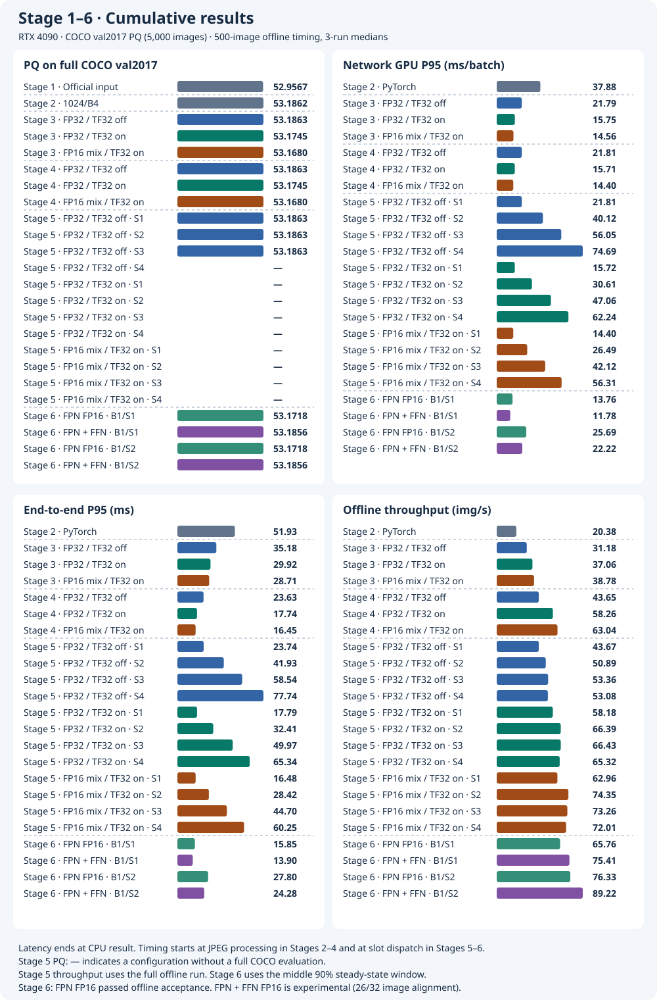

# MaskDINO-TensorRT

**English** · [简体中文](README.zh-CN.md)

**End-to-end GPU inference engineering for model deployment, profiling, optimization, and accuracy validation**

<table>
  <tr>
    <td align="center">
      <h2>2.62×</h2>
      TensorRT FP32 offline throughput
    </td>
    <td align="center">
      <h2>4.37×</h2>
      Experimental peak offline throughput
    </td>
    <td align="center">
      <h2>73.2% lower</h2>
      Experimental single-slot P95 latency
    </td>
  </tr>
</table>

Compared with the PyTorch FP32 baseline on an RTX 4090.

[Official MaskDINO implementation](https://github.com/IDEA-Research/MaskDINO) · [Experiment environment and data](docs/experiment-environment.md)

## Engineering Highlights

1. **TensorRT integration.** Diagnose and fix a device compatibility issue with constants during ONNX export. Integrate MSDeformAttn PluginV3, build TensorRT engines, and validate plugin numerics and model outputs.
2. **Native inference pipeline.** Implement preprocessing after JPEG decoding, segmentation postprocessing, and output restoration in C++/CUDA. Manage GPU and pinned host buffers, run TensorRT asynchronously, and return a CPU panoptic map and segment metadata.
3. **Concurrency and profiling.** Schedule multiple slots with independent execution contexts, CUDA streams, and buffers. Use Nsight Systems, Nsight Compute, and TensorRT layer profiling to analyze GPU execution overlap, latency, throughput, and operator hotspots.
4. **Precision optimization and debugging.** Run targeted FP16 experiments on the FPN convolution and encoder FFNs. Investigate TensorRT tactic changes and use per-image alignment and full COCO PQ to evaluate performance gains and accuracy risks.

## Inference Performance Comparison

Fix the input at **1024×1024, batch 1** and use PyTorch FP32 with the same letterbox input as the baseline. Performance figures are medians of three runs on the same 500 JPEGs. Parentheses show improvements over PyTorch.

| Model / engine | Full COCO PQ | Single-slot end-to-end P95 ↓ | Full-run offline throughput ↑ | Accuracy loss |
| --- | ---: | ---: | ---: | --- |
| PyTorch FP32 baseline (TF32 off) | 53.1863 | 51.93 ms | 20.38 images/s (single pipeline) | Baseline |
| TensorRT FP32 (TF32 off) | 53.1863 | **23.63 ms** (28.30 ms / 54.5% lower) | **53.36 images/s** (2.62×, S3) | Same PQ to four decimal places, 32/32 images passed |
| TensorRT FP32 (TF32 on) | 53.1745 | **17.74 ms** (34.19 ms / 65.8% lower) | **66.43 images/s** (3.26×, S3) | PQ down 0.0117 points, 27/32 images passed |
| TensorRT FP16 mixed precision (TF32 on) | 53.1680 | **16.45 ms** (35.48 ms / 68.3% lower) | **74.35 images/s** (3.65×, S2) | PQ down 0.0182 points, 16/32 images passed, lowest category agreement 91.63% |
| Stage 6 · FPN + Encoder FFN FP16 (TF32 on) | **53.1856** | **13.90 ms** (38.03 ms / 73.2% lower) | **89.02 images/s** (4.37×, S2) | PQ down 0.0006 points, 26/32 images passed against the accepted FPN engine, lowest category agreement 85.68% |

**Measurement scope.** The table uses archived results from the RTX 4090 at 1024×1024 and B1. For PyTorch and Stage 4 single-slot runs, P95 spans the start of processing an in-memory JPEG to the availability of the CPU segmentation map and segment metadata. Stage 6 starts timing at dispatch to a slot. Throughput divides the number of images completed after warmup by full-run wall-clock time. The table uses Stage 2 single-pipeline throughput, the peak from the Stage 5 S1–S4 offline screen, and Stage 6 B1/S2 results.

**Accuracy reference.** Full PQ uses PyTorch FP32 B1 with identical letterbox inputs as the baseline and covers all 5,000 images in COCO val2017. The TensorRT precision policy pass counts come from the 32-image checks against PyTorch in Stage 3. Stage 6 FFN's **26/32** comes from a 32-image check against the accepted FPN engine. See [Stage 3](#stage-3--convert-the-network-to-tensorrt) and [Stage 6](#stage-6--profile-and-further-optimize-tensorrt-layers).

## Technical Roadmap

1. [Stage 1](#stage-1--reproduce-original-model-accuracy) · Reproduce the COCO PQ score with the official PyTorch configuration.
2. [Stage 2](#stage-2--adapt-preprocessing-and-establish-a-performance-baseline) · Switch preprocessing to letterbox, select 1024×1024 / B1 as the deployment baseline, and select 32 alignment images and 500 timing samples.
3. [Stage 3](#stage-3--convert-the-network-to-tensorrt) · Export ONNX, integrate the MSDeformAttn plugin, build TensorRT engines, replace the network backend, and screen precision policies.
4. [Stage 4](#stage-4--implement-pre--and-postprocessing-in-ccuda) · Implement C++/CUDA pre- and postprocessing and compare three engines with a single slot.
5. [Stage 5](#stage-5--run-requests-concurrently-with-multiple-cuda-streams) · Overlap GPU work with multiple CUDA streams and compare S1–S4 throughput for each engine.
6. [Stage 6](#stage-6--profile-and-further-optimize-tensorrt-layers) · Profile TensorRT layer by layer to locate hotspots and validate targeted mixed precision for FPN and encoder FFNs.

Stage 3 uses Python pre- and postprocessing. Stage 4 uses C++/CUDA pre- and postprocessing. Stage 5 shows peak offline throughput for the three engines (S3 / S3 / S2). Stage 6 shows **B1/S1 P95** and **B1/S2 full-run throughput** for FPN FP16 and for FPN with FFN FP16 added. The FFN candidate passed 26/32 per-image checks. Regenerate the chart with `python3 docs/plot-roadmap.py`.

## Stage 1 · Reproduce Original Model Accuracy

Evaluate all 5,000 COCO 2017 validation images on an RTX 4090 with the official MaskDINO R50 panoptic configuration and weights. The model and its pre- and postprocessing run through the official `train_net.py`. Detectron2's `COCOPanopticEvaluator` calls COCO panopticapi to compute PQ.

| Source | PQ | PQ Things | PQ Stuff |
| --- | ---: | ---: | ---: |
| [RTX 4090 measurement](stage1/results/official-r50-20261106-6eb01c1.log) | **52.9567** | 58.9645 | 43.8884 |
| [Official MaskDINO Model Zoo](https://github.com/IDEA-Research/MaskDINO/blob/3831d8514a3728535ace8d4ecc7d28044c42dd14/README.md#coco-panoptic-segmentation) | 53.0 | — | — |

Measured PQ rounds to **53.0** at the one-decimal precision used in the official table. Predictions cover all 5,000 ground-truth image IDs.

[Stage 1 reproduction instructions](stage1/README.md) · [Environment, data, and weights](docs/experiment-environment.md)

## Stage 2 · Adapt Preprocessing and Establish a Performance Baseline

To support fixed-shape batches across different source resolutions, letterbox preprocessing resizes images proportionally and pads them to a square. Segmentation outputs are restored to the original image coordinates. The 1024 input scored **1.1742 PQ points** above 800 and became the deployment size. [32 alignment images and 500 timing samples](stage2/sample.json)

### Full COCO PQ

| Input | Batch | PQ | PQ Things | PQ Stuff | ΔPQ vs. Stage 1 | Images evaluated |
| --- | ---: | ---: | ---: | ---: | ---: | ---: |
| Stage 1 official input | 1 | 52.9567 | 58.9645 | 43.8884 | — | 5,000 |
| 640×640 | 4 | 49.9662 | 54.8245 | 42.6330 | −2.9905 | 5,000 |
| 800×800 | 4 | 52.0120 | 57.3157 | 44.0065 | −0.9447 | 5,000 |
| 1024×1024 | 4 | **53.1862** | 59.0272 | 44.3697 | +0.2295 | 5,000 |

### RTX 4090 Performance Comparison

All configurations use the same 500-image list and FP32. Each configuration runs three times with 20 warmup batches per run. The table reports the median of the three runs. Throughput divides the full-run image count by wall-clock time. Both latency and throughput use an offline workload.

| Input | Batch | Network GPU P50 / P95 (ms/batch) | End-to-end P50 / P95 (ms/batch) | Offline end-to-end throughput (images/s) | Peak allocated / reserved (GiB) |
| --- | ---: | ---: | ---: | ---: | ---: |
| 800×800 | 1 | 26.49 / 26.77 | 35.02 / 37.85 | 28.35 | 2.07 / 3.92 |
| 800×800 | 4 | 87.61 / 88.14 | 122.15 / 127.34 | 32.72 | 2.37 / 4.83 |
| **1024×1024** | **1** | 37.77 / 37.88 | 48.79 / 51.93 | 20.38 | 2.58 / 4.71 |
| 1024×1024 | 2 | 71.22 / 71.44 | 93.47 / 97.81 | 21.33 | 2.74 / 5.59 |
| 1024×1024 | 4 | 138.83 / 139.37 | 183.56 / 189.70 | 21.82 | 3.06 / 4.91 |
| 1024×1024 | 8 | 264.16 / 274.32 | 355.51 / 365.04 | 22.56 | 5.06 / 7.25 |

The table and the right-hand chart measure batch end-to-end latency from the start of in-memory JPEG processing to the availability of the last image's CPU output.

[Stage 2 reproduction instructions and raw results](stage2/README.md)

## Stage 3 · Convert the Network to TensorRT

Keep Python pre- and postprocessing and replace the network backend with TensorRT using MSDeformAttn PluginV3. [Stage 3 build, precision screening, and profiling](stage3/README.md)

**32-image alignment.** All three engines are compared against PyTorch FP32 B1 with identical inputs. A pass requires ≥99.9% pixel-level category agreement, a match for every segment, and same-class IoU ≥0.98. FP32 (TF32 off) passes **32/32**. FP32 (TF32 on) passes **27/32**, with all five failures below the category agreement threshold. FP16 mixed precision (TF32 on) passes **16/32**, with **91.63%** category agreement on the worst image and one unmatched segment on each side. [Per-image results and full PQ](stage3/README.md#b1s1-precision-policy-screening)

**Select by acceptance criteria.** Only FP32 (TF32 off) meets the per-image agreement thresholds against PyTorch. If acceptance requires only that PQ, PQ Things, and PQ Stuff each fall by at most **0.05 points** against PyTorch FP32 on the same 5,000 COCO val2017 inputs, all three engines pass and both TF32-on configurations remain performance candidates.

PQ retains the official Stage 1 inputs and Stage 2 1024/B4 for historical reference. Performance starts with Stage 2 1024/B1 PyTorch. All three Stage 3 engines use B1/S1 and the same 500 JPEGs. [Performance of the three Stage 3 engines](stage3/README.md#offline-performance-of-the-three-engines)

### Peak GPU-Wide Memory

Fix 1024×1024 and B1/S1 with Python pre- and postprocessing. NVML samples GPU-wide memory every 20 ms, including the desktop and other processes. The table reports the median of the observed peaks across three runs. The two TF32-on configurations come from follow-up measurements. [FP32 baseline](stage3/README.md#performance) · [Follow-up precision measurements](stage3/README.md#offline-performance-of-the-three-engines)

| Backend | Peak GPU-wide memory (GiB) |
| --- | ---: |
| PyTorch FP32 | 5.79 |
| TensorRT FP32 (TF32 off) | 5.59 |
| TensorRT FP32 (TF32 on) | 5.59 |
| TensorRT FP16 mixed precision (TF32 on) | 5.49 |

## Stage 4 · Implement Pre- and Postprocessing in C++/CUDA

Reuse the Stage 3 engines, decode JPEGs in C++, and use CUDA for resizing, padding, normalization, mask restoration, and panoptic merging. Synchronize the stream to return the CPU results. [Reproduction, same-run comparison, and Nsight timeline](stage4/README.md)

Stage 3 and Stage 4 both use B1/S1 and show the results for Python and C++/CUDA pre- and postprocessing, respectively.

### Peak Process GPU Memory

Fix 1024×1024 and B1/S1. NVML samples the inference process's GPU memory by PID every 20 ms, covering the network, pre- and postprocessing, and CUDA context. The table reports the median of the observed peaks across three runs. The first three rows are from the same benchmark session. The last two come from the paired native-pipeline precision comparison. [Same-session performance and memory](stage4/README.md#rtx-4090-performance) · [Paired native-pipeline precision comparison](stage4/README.md#b1s1-precision-policy-comparison)

| Inference pipeline | Peak process GPU memory (GiB) |
| --- | ---: |
| PyTorch FP32 | 5.19 |
| Python pre- and postprocessing + TensorRT FP32 (TF32 off) | 4.98 |
| C++/CUDA pre- and postprocessing + TensorRT FP32 (TF32 off) | 1.24 |
| C++/CUDA pre- and postprocessing + TensorRT FP32 (TF32 on) | 1.24 |
| C++/CUDA pre- and postprocessing + TensorRT FP16 mixed precision (TF32 on) | 1.15 |

## Stage 5 · Run Requests Concurrently With Multiple CUDA Streams

Each slot owns an execution context, CUDA stream, and writable buffers. Nsight Systems shows cross-stream overlap during **37.32%** of TensorRT kernel-active time for FP32/TF32 off at B1/S3. [Timeline and raw reports](stage5/README.md#nsight-systems)

[Stage 5 concurrency settings, sustained offline benchmark, and precision comparison](stage5/README.md)

Stage 5 shows 12 configurations from the 500-image offline screen. Per-image P95 starts at dispatch to a slot. Stages 2–4 start at the beginning of in-memory JPEG processing. Both end when CPU results are ready. Stage 5 full COCO PQ covers S1–S3 for FP32/TF32 off. Other configurations are marked `—`. All 12 passed the 32-image check. [Correctness and full evaluation](stage5/README.md#correctness) · [Offline screening for three precision policies](stage5/README.md#b1--s1s4-screen-for-three-precision-policies)

### Peak Process GPU Memory

Fix B1 and sample the inference process with NVML every 20 ms. Report the median of three per-run peaks in GiB. [Throughput, per-image P95, and GPU memory chart](stage5/results/precision-comparison.svg)

| Engine | S1 | S2 | S3 | S4 |
| --- | ---: | ---: | ---: | ---: |
| FP32 / TF32 off | 1.24 | 1.79 | 2.34 | 2.89 |
| FP32 / TF32 on | 1.24 | 1.79 | 2.34 | 2.89 |
| FP16 mixed precision / TF32 on | 1.15 | 1.70 | 2.26 | 2.81 |

## Stage 6 · Profile and Further Optimize TensorRT Layers

**Goal.** After TensorRT conversion, C++/CUDA pre- and postprocessing, and multi-stream concurrency in Stages 3–5, locate compute bottlenecks **inside the TensorRT engine**. Use targeted FP16 changes to speed up the network and validate end-to-end performance and segmentation accuracy. Fix the RTX 4090, 1024×1024, B1, and the existing mixed-precision (TF32 on) base engine.

### Layer Profiling to Locate Hotspots and Choose Optimizations

Use `trtexec --separateProfileRun --dumpProfile` to measure per-layer time, Nsight Systems to correlate CUDA kernels, and Nsight Compute to analyze execution paths and hardware resource usage.

| Hotspot | Layer time (ms/image) | Share of total layer time |
| --- | ---: | ---: |
| Encoder FFN (6 layers × 2 GEMMs) | **3.675** | **24.30%** |
| Encoder MSDeformAttn (6 plugin layers) | 1.480 | 9.78% |
| FPN 3×3 Conv | **0.903** | **5.97%** |
| Input Projection 3×3 Conv | 0.306 | 2.02% |

These results identified two optimizations to test in sequence.

1. **FP16 for one FPN convolution.** The most expensive single layer uses FP32 Winograd, and the representative kernel does not use Tensor Cores. In ONNX the convolution feeds only the masks branch, so this is the first, more localized precision change.
2. **FP16 for encoder FFNs.** The 12 GEMMs account for **24.30%** of total layer time and offer more room for optimization. Their position in the encoder means they can affect downstream proposals and queries, making output agreement a priority.

The sum of layer profiler times differs from network latency in a normal run. These figures locate hotspots and cannot directly predict end-to-end speedup. [Profiling method, raw data, and kernel analysis](stage6/layer-profile.md)

### Optimization 1 · Single-Layer FPN FP16

**Method.** Convert only the inputs and weights of `/sem_seg_head/layer_1/Conv` to FP16 so TensorRT chooses an FP16 Tensor Core tactic, then cast back to FP32 before GroupNorm. The measurements include surrounding operations such as the added casts and reformats as well as the convolution kernel.

| Metric | Paired control | FPN FP16 | Improvement |
| --- | ---: | ---: | ---: |
| Target convolution time | 0.9035 ms | 0.2505 ms | **−72.3%** |
| B1/S1 end-to-end P95 | 16.27 ms | 15.85 ms | **−2.6%** |
| B1/S2 full-run throughput | 74.10 images/s | 76.24 images/s | **+2.9%** |

**Investigation.** Only **31/32** images passed the per-image check for the first candidate. Swapping logits and masks between engines on the failing image showed that the missing segment followed the **logits** regardless of which masks were used. Engine Inspector also showed that four **non-target backbone convolutions** changed tactics in the first rebuild. Rebuilding the pair with a shared timing cache kept tactics identical for matching non-target convolution and pooling layers. The failing image's logits and boxes matched elementwise again, and **32/32** images passed. This supports a link between the original failure and build differences outside the target layer, but does not establish any individual tactic as the sole cause.

**Accuracy and acceptance.** B1/S1 and B1/S2 each completed all 5,000 COCO val2017 images and scored **53.1718** PQ, meeting the predefined tolerances for PQ, PQ Things, and PQ Stuff. **The FPN optimization was accepted** in commit `5f7b57f`. [Full FPN A/B, output swapping, and full PQ](stage6/fpn-half-ab.md)

### Optimization 2 · Encoder FFN FP16

**Method.** Starting from the accepted FPN engine, switch `linear1 → ReLU → linear2` (including biases) to FP16 across all six encoder FFNs, covering **12 GEMMs**. Cast back to FP32 before the residual add and LayerNorm. Engine Inspector confirms FP16 Tensor Core tactics.

| Metric | FPN control | FPN + FFN FP16 | Improvement |
| --- | ---: | ---: | ---: |
| B1/S1 end-to-end P95 | 16.10 ms | 13.90 ms | **−13.7%** |
| B1/S2 full-run throughput | 76.22 images/s | 89.02 images/s | **+16.8%** |
| B1/S1 peak GPU memory | 1.15 GiB | 1.08 GiB | −0.07 GiB |

**Performance attribution.** B1/S1 network GPU P95 fell from **14.01 to 11.78 ms**. In a separate fixed-input Nsight Systems A/B, NVTX and Engine Inspector mapped GPU kernels to the six FFNs. `linear1` saved **1.02 ms**, and `linear2` through its output boundary saved **1.13 ms**. The `norm1` kernel with the new input cast took about **0.06 ms** more across the six blocks, leaving a **2.09 ms** net FFN kernel-time reduction. Other network kernels were effectively flat. [Method and trace results](stage6/README.md#where-the-network-time-was-saved)

**Accuracy results.** Full COCO PQ is **53.1856**, just **0.0006 points** below the PyTorch FP32 baseline of about **53.1863** on the same inputs. PQ Things and PQ Stuff also meet the current tolerances. Against the accepted FPN control, **only 26/32 images pass the per-image agreement check**, with pixel-level category agreement as low as **85.68%**.

**Nearly unchanged aggregate accuracy can coexist with substantial changes in individual predictions.** PQ measures overall segmentation quality against ground truth. Per-image alignment measures how closely the candidate reproduces the reference engine's predictions. **Intermediate tensors have yet to establish** whether encoder features, proposal TopK, and decoder queries amplify the numerical differences introduced by the FFN change.

**Conclusion.** The performance gains are substantial, but the candidate falls short of the strict per-image agreement threshold. [FFN performance, six failing images, and full PQ](stage6/ffn-full-half.md)

### Cumulative Stage 1–6 Comparison

End-to-end P95 starts at in-memory JPEG processing in Stages 2–4 and at dispatch to a slot in Stages 5–6. Both end when CPU results are ready. Offline throughput consistently uses full-run wall-clock time after warmup. Optimization gains come from same-session A/B comparisons.

Regenerate the cumulative charts with `python3 docs/plot-roadmap.py --cumulative-only`.

[Full Stage 6 experiments, evidence, reproduction, and limitations](stage6/README.md)

## Repository Structure

| Directory | Contents |
| --- | --- |
| [maskdino/](maskdino/) | Pinned upstream source, PyTorch environment, and CUDA extension compatibility patch |
| [stage1/](stage1/README.md) | Official evaluation entry point, reproduction commands, and results |
| [stage2/](stage2/README.md) | Square-input PyTorch inference, full PQ, and performance samples |
| [stage3/](stage3/README.md) | Single-slot TensorRT FP32 acceptance and Nsight baseline |
| [stage4/](stage4/README.md) | Native TensorRT/CUDA single-request pipeline and full evaluation |
| [stage5/](stage5/README.md) | B1 multi-slot execution, Nsight timelines, and the scheduler shared by two stages |
| [stage6/](stage6/README.md) | Layer profiling and FPN and encoder FFN precision experiments |
| [docs/](docs/) | Environment, data, and weights |

Building the image checks out the pinned revision of the official MaskDINO source.

## License

[Apache-2.0](LICENSE) · [Third-party components and licenses](maskdino/THIRD_PARTY_NOTICES.md)
