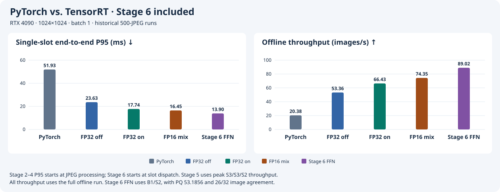
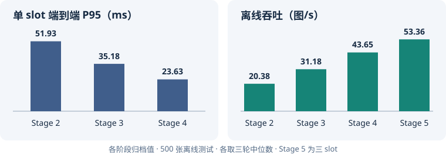
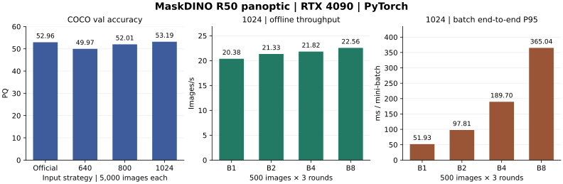
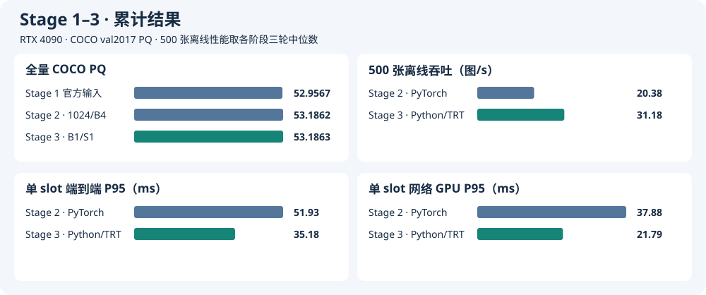
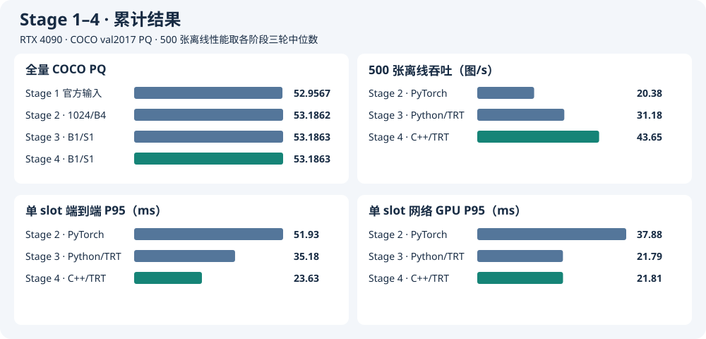
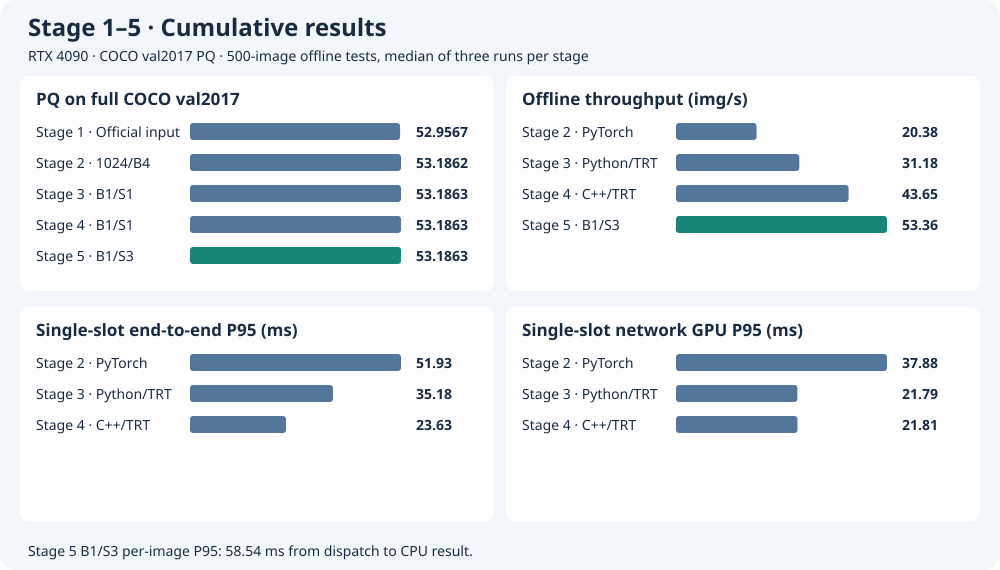
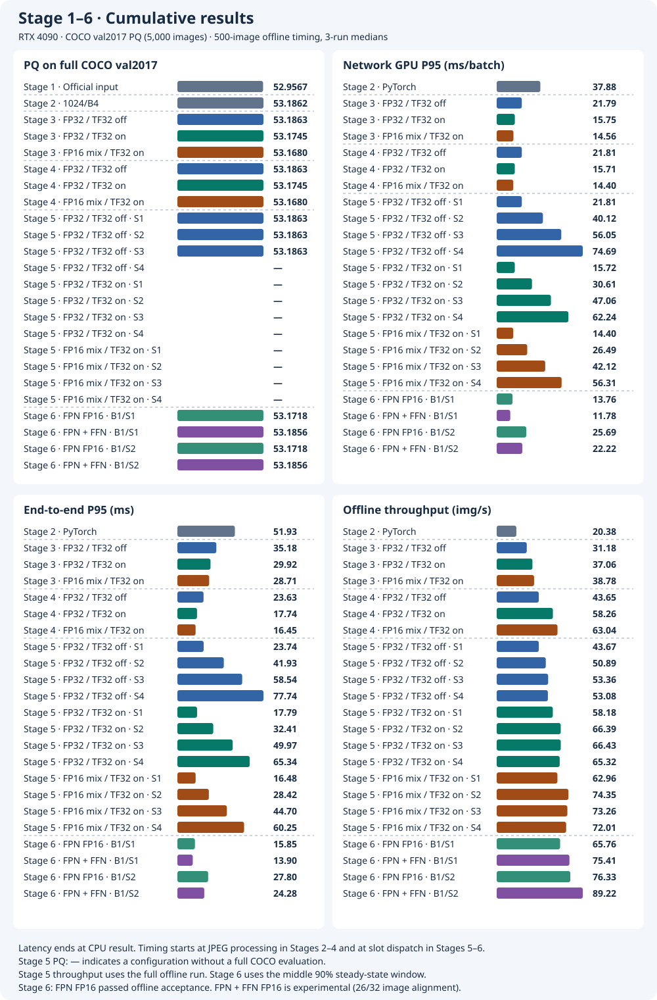

# MaskDINO-TensorRT

**English** · [简体中文](README.zh-CN.md)

**End-to-end GPU inference engineering for model deployment, profiling, optimization, and accuracy validation**

<table>
  <tr>
    <td align="center">
      <h2>−73.2%</h2>
      Single-slot end-to-end P95 latency 51.93 → 13.90 ms
    </td>
    <td align="center">
      <h2>4.37×</h2>
      Experimental peak offline throughput 20.38 → 89.02 images/s
    </td>
    <td align="center">
      <h2>−79.2%</h2>
      Single-slot peak process VRAM 5.19 → 1.08 GiB
    </td>
    <td align="center">
      <h2>53.1856</h2>
      Full COCO val2017 PQ Baseline 53.1863 (minimal Δ −0.0006)
    </td>
  </tr>
</table>

Compared with the PyTorch FP32 baseline (1024×1024, B1) on an RTX 4090; peak figures reflect the experimental Stage 6 FPN + Encoder FFN FP16 configuration.

[Official MaskDINO implementation](https://github.com/IDEA-Research/MaskDINO) · [Experiment environment and data](docs/experiment-environment.md)

## Engineering Highlights

1. **End-to-end C++/CUDA asynchronous pipeline and sync elimination (Stages 3–5).**
   Nsight Systems traced ~81 implicit stream synchronizations per image (**2,591 `cudaStreamSynchronize` calls** across 32 images) in Python postprocessing caused by boolean indexing and `.item()`. Rewriting pre- and postprocessing in native C++/CUDA with exact Pillow bilinear/rounding semantics reduced intermediate stream syncs to **0**, cut GPU postprocessing time from **4.34 ms to 0.11 ms**, and lowered single-slot peak process VRAM from **5.19 GiB to 1.24 GiB** (further reduced to **1.08 GiB** in Stage 6). Multi-slot scheduling with independent execution contexts and CUDA streams achieved **37.32%** cross-stream kernel overlap.
2. **Nsight Compute (NCU) kernel-level bottleneck attribution (Stage 6).**
   Combined `trtexec` layer profiling, Nsight Systems (NVTX/SQLite), and Nsight Compute hardware counters to diagnose operator hotspots:
   - **FPN 3×3 convolution:** Identified that the FP32 Winograd tactic had `0%` Tensor Core activity and `3.27 GiB` L2 lookup traffic per launch (`74.2%` of peak L2 throughput). Switching this layer to FP16 implicit GEMM raised Tensor pipe activity to `89.1%`, cut L2 lookup traffic to `0.87 GiB`, and saved a net `0.42 ms` after boundary cast/reformat costs.
   - **Encoder FFN (12× GEMM):** Found that TF32 GEMMs used `238` registers/thread (limiting residency to `2 CTA/SM`, `14.7%` achieved occupancy) with `65%–67%` of active cycles stalled on `math-pipe throttle`. Switching to FP16 tactics with output fusion reduced single-block DRAM traffic from `517.0 MiB` to `316.5 MiB` and saved a net `2.09 ms` across six blocks.
3. **Controlled A/B methodology and tactic-drift debugging (Stages 3 & 6).**
   During single-node ONNX precision surgery, cross-swapping `logits` and `masks` tensors alongside **Engine Inspector** diffs revealed that modifying one FPN convolution caused tactic drift in 4 unrelated backbone convolutions. Reusing a shared **TensorRT Timing Cache** locked non-target tactics and restored `32/32` per-image agreement, enforcing strict single-variable control.
4. **Reproducible benchmarking and automated regression pipeline (Stages 1–6).**
   Built a two-tier correctness gate (32-image pixel/IoU behavioral alignment + 5,000-image full COCO val2017 PQ evaluation) and used 3-round rotated execution orders to eliminate thermal bias. Developed Python + SQLite automation scripts to correlate NVTX ranges with low-level CUDA kernel launches, aggregate NCU counters, and generate visual reports.

## Inference Performance Comparison

Fix the input at **1024×1024, batch 1** and use PyTorch FP32 with the same letterbox input as the baseline. Performance figures are medians of three runs on the same 500 JPEGs. Parentheses show improvements over the PyTorch baseline.

| Stage & configuration (1024×1024, Batch 1) | Pre/Post | Full COCO PQ | Single-slot E2E P95 ↓ | Peak offline throughput ↑ | Single-slot process VRAM ↓ | Per-image check (32 images) |
| --- | --- | ---: | ---: | ---: | ---: | --- |
| **Stage 2 · PyTorch FP32 baseline** (TF32 off) | Python | 53.1863 | 51.93 ms | 20.38 images/s (S1) | 5.19 GiB | Baseline |
| **Stage 3 · TensorRT FP32** (TF32 off) | Python | 53.1863 | 35.18 ms (−32.2%) | 31.18 images/s (1.53×, S1) | 4.98 GiB | **32/32 passed** (vs. PyTorch) |
| **Stage 4/5 · TensorRT FP32** (TF32 off) | **C++/CUDA** | 53.1863 | **23.63 ms** (−54.5%) | **53.36 images/s** (2.62×, S3) | **1.24 GiB** | **32/32 passed** (100% pixel match) |
| **Stage 4/5 · TensorRT FP32** (TF32 on) | C++/CUDA | 53.1745 | 17.74 ms (−65.8%) | 66.43 images/s (3.26×, S3) | 1.24 GiB | 27/32 passed (ΔPQ −0.0117) |
| **Stage 4/5 · Full mixed precision** (TF32 on) | C++/CUDA | 53.1680 | 16.45 ms (−68.3%) | 74.35 images/s (3.65×, S2) | 1.15 GiB | 16/32 passed (ΔPQ −0.0182) |
| **Stage 6 · Targeted FPN FP16** (accepted) | C++/CUDA | 53.1718 | 15.85 ms (−69.5%) | 76.24 images/s (3.74×, S2) | 1.15 GiB | **32/32 passed** (vs. mixed control) |
| **Stage 6 · FPN + 6-layer FFN FP16** (experimental) | C++/CUDA | **53.1856** | **13.90 ms** (−73.2%) | **89.02 images/s** (4.37×, S2) | **1.08 GiB** | 26/32 passed (ΔPQ −0.0006, vs. FPN) |

**Measurement scope.** The table uses archived results from the RTX 4090 at 1024×1024 and B1. In Stages 2–4, single-slot P95 spans the start of processing an in-memory JPEG to the availability of the CPU segmentation map and segment metadata; Stages 5–6 start timing at dispatch to a slot (covering full processing plus slot dispatch overhead). Throughput divides the number of images completed after warmup by full-run wall-clock time, using Stage 2/3 single-pipeline runs, the peak from the Stage 5 S1–S4 offline screen, and Stage 6 B1/S2 results. The VRAM column reports B1/S1 peak inference-process memory sampled by PID via NVML (Stage 3 process VRAM comes from the Stage 4 same-session rerun; see [Stage 5](#peak-process-gpu-memory-1) and [Stage 6](#stage-6--profile-and-further-optimize-tensorrt-layers) for multi-slot VRAM).

**Accuracy reference.** Full PQ uses PyTorch FP32 B1 with identical letterbox inputs (53.186252) as the baseline across all 5,000 images in COCO val2017. In Stages 3–5, per-image pass counts are measured against PyTorch FP32 (native C++/CUDA outputs match same-engine Python outputs 32/32 pixel-for-pixel). In Stage 6, FPN and FFN per-image checks are measured against the shared-cache mixed-precision control engine and the accepted FPN engine, respectively. See [Stage 3](#stage-3--convert-the-network-to-tensorrt) and [Stage 6](#stage-6--profile-and-further-optimize-tensorrt-layers).

## Technical Roadmap

1. [Stage 1](#stage-1--reproduce-original-model-accuracy) · Reproduce the COCO PQ score with the official PyTorch configuration.
2. [Stage 2](#stage-2--adapt-preprocessing-and-establish-a-performance-baseline) · Switch preprocessing to letterbox, select 1024×1024 / B1 as the deployment baseline, and select 32 alignment images and 500 timing samples.
3. [Stage 3](#stage-3--convert-the-network-to-tensorrt) · Export ONNX, integrate the MSDeformAttn plugin, build TensorRT engines, replace the network backend, and screen precision policies.
4. [Stage 4](#stage-4--implement-pre--and-postprocessing-in-ccuda) · Implement C++/CUDA pre- and postprocessing and compare three engines with a single slot.
5. [Stage 5](#stage-5--run-requests-concurrently-with-multiple-cuda-streams) · Overlap GPU work with multiple CUDA streams and compare S1–S4 throughput for each engine.
6. [Stage 6](#stage-6--profile-and-further-optimize-tensorrt-layers) · Profile TensorRT layer by layer to locate hotspots and validate targeted mixed precision for FPN and encoder FFNs.

Stage 3 uses Python pre- and postprocessing. Stage 4 uses C++/CUDA pre- and postprocessing. Stage 5 shows peak offline throughput for the three engines (S3 / S3 / S2). Stage 6 shows **B1/S1 P95** and **B1/S2 full-run throughput** for FPN FP16 and for FPN with FFN FP16 added. The FFN candidate passed 26/32 per-image checks. Regenerate the chart with `python3 docs/plot-roadmap.py`.

## Stage 1 · Reproduce Original Model Accuracy

Evaluate all 5,000 COCO 2017 validation images on an RTX 4090 with the official MaskDINO R50 panoptic configuration and weights. The model and its pre- and postprocessing run through the official `train_net.py`. Detectron2's `COCOPanopticEvaluator` calls COCO panopticapi to compute PQ.

| Source | PQ | PQ Things | PQ Stuff |
| --- | ---: | ---: | ---: |
| [RTX 4090 measurement](stage1/results/official-r50-20261106-6eb01c1.log) | **52.9567** | 58.9645 | 43.8884 |
| [Official MaskDINO Model Zoo](https://github.com/IDEA-Research/MaskDINO/blob/3831d8514a3728535ace8d4ecc7d28044c42dd14/README.md#coco-panoptic-segmentation) | 53.0 | — | — |

Measured PQ rounds to **53.0** at the one-decimal precision used in the official table. Predictions cover all 5,000 ground-truth image IDs.

[Stage 1 reproduction instructions](stage1/README.md) · [Environment, data, and weights](docs/experiment-environment.md)

## Stage 2 · Adapt Preprocessing and Establish a Performance Baseline

To support fixed-shape batches across different source resolutions, letterbox preprocessing resizes images proportionally and pads them to a square. Segmentation outputs are restored to the original image coordinates. The 1024 input scored **1.1742 PQ points** above 800 and became the deployment size. [32 alignment images and 500 timing samples](stage2/sample.json)

### Full COCO PQ

| Input | Batch | PQ | PQ Things | PQ Stuff | ΔPQ vs. Stage 1 | Images evaluated |
| --- | ---: | ---: | ---: | ---: | ---: | ---: |
| Stage 1 official input | 1 | 52.9567 | 58.9645 | 43.8884 | — | 5,000 |
| 640×640 | 4 | 49.9662 | 54.8245 | 42.6330 | −2.9905 | 5,000 |
| 800×800 | 4 | 52.0120 | 57.3157 | 44.0065 | −0.9447 | 5,000 |
| 1024×1024 | 4 | **53.1862** | 59.0272 | 44.3697 | +0.2295 | 5,000 |

### RTX 4090 Performance Comparison

All configurations use the same 500-image list and FP32. Each configuration runs three times with 20 warmup batches per run. The table reports the median of the three runs. Throughput divides the full-run image count by wall-clock time. Both latency and throughput use an offline workload.

| Input | Batch | Network GPU P50 / P95 (ms/batch) | End-to-end P50 / P95 (ms/batch) | Offline end-to-end throughput (images/s) | Peak allocated / reserved (GiB) |
| --- | ---: | ---: | ---: | ---: | ---: |
| 800×800 | 1 | 26.49 / 26.77 | 35.02 / 37.85 | 28.35 | 2.07 / 3.92 |
| 800×800 | 4 | 87.61 / 88.14 | 122.15 / 127.34 | 32.72 | 2.37 / 4.83 |
| **1024×1024** | **1** | 37.77 / 37.88 | 48.79 / 51.93 | 20.38 | 2.58 / 4.71 |
| 1024×1024 | 2 | 71.22 / 71.44 | 93.47 / 97.81 | 21.33 | 2.74 / 5.59 |
| 1024×1024 | 4 | 138.83 / 139.37 | 183.56 / 189.70 | 21.82 | 3.06 / 4.91 |
| 1024×1024 | 8 | 264.16 / 274.32 | 355.51 / 365.04 | 22.56 | 5.06 / 7.25 |

The table and the right-hand chart measure batch end-to-end latency from the start of in-memory JPEG processing to the availability of the last image's CPU output.

[Stage 2 reproduction instructions and raw results](stage2/README.md)

## Stage 3 · Convert the Network to TensorRT

Keep Python pre- and postprocessing and replace the network backend with TensorRT using MSDeformAttn PluginV3. [Stage 3 build, precision screening, and profiling](stage3/README.md)

**32-image alignment.** All three engines are compared against PyTorch FP32 B1 with identical inputs. A pass requires ≥99.9% pixel-level category agreement, a match for every segment, and same-class IoU ≥0.98. FP32 (TF32 off) passes **32/32**. FP32 (TF32 on) passes **27/32**, with all five failures below the category agreement threshold. FP16 mixed precision (TF32 on) passes **16/32**, with **91.63%** category agreement on the worst image and one unmatched segment on each side. [Per-image results and full PQ](stage3/README.md#b1s1-precision-policy-screening)

**Select by acceptance criteria.** Only FP32 (TF32 off) meets the per-image agreement thresholds against PyTorch. If acceptance requires only that PQ, PQ Things, and PQ Stuff each fall by at most **0.05 points** against PyTorch FP32 on the same 5,000 COCO val2017 inputs, all three engines pass and both TF32-on configurations remain performance candidates.

PQ retains the official Stage 1 inputs and Stage 2 1024/B4 for historical reference. Performance starts with Stage 2 1024/B1 PyTorch. All three Stage 3 engines use B1/S1 and the same 500 JPEGs. [Performance of the three Stage 3 engines](stage3/README.md#offline-performance-of-the-three-engines)

### Peak GPU-Wide Memory

Fix 1024×1024 and B1/S1 with Python pre- and postprocessing. NVML samples GPU-wide memory every 20 ms, including the desktop and other processes. The table reports the median of the observed peaks across three runs. The two TF32-on configurations come from follow-up measurements. [FP32 baseline](stage3/README.md#performance) · [Follow-up precision measurements](stage3/README.md#offline-performance-of-the-three-engines)

| Backend | Peak GPU-wide memory (GiB) |
| --- | ---: |
| PyTorch FP32 | 5.79 |
| TensorRT FP32 (TF32 off) | 5.59 |
| TensorRT FP32 (TF32 on) | 5.59 |
| TensorRT FP16 mixed precision (TF32 on) | 5.49 |

## Stage 4 · Implement Pre- and Postprocessing in C++/CUDA

Reuse the Stage 3 engines, decode JPEGs in C++, and use CUDA for resizing, padding, normalization, mask restoration, and panoptic merging. Synchronize the stream to return the CPU results. [Reproduction, same-run comparison, and Nsight timeline](stage4/README.md)

Stage 3 and Stage 4 both use B1/S1 and show the results for Python and C++/CUDA pre- and postprocessing, respectively.

### Peak Process GPU Memory

Fix 1024×1024 and B1/S1. NVML samples the inference process's GPU memory by PID every 20 ms, covering the network, pre- and postprocessing, and CUDA context. The table reports the median of the observed peaks across three runs. The first three rows are from the same benchmark session. The last two come from the paired native-pipeline precision comparison. [Same-session performance and memory](stage4/README.md#rtx-4090-performance) · [Paired native-pipeline precision comparison](stage4/README.md#b1s1-precision-policy-comparison)

| Inference pipeline | Peak process GPU memory (GiB) |
| --- | ---: |
| PyTorch FP32 | 5.19 |
| Python pre- and postprocessing + TensorRT FP32 (TF32 off) | 4.98 |
| C++/CUDA pre- and postprocessing + TensorRT FP32 (TF32 off) | 1.24 |
| C++/CUDA pre- and postprocessing + TensorRT FP32 (TF32 on) | 1.24 |
| C++/CUDA pre- and postprocessing + TensorRT FP16 mixed precision (TF32 on) | 1.15 |

## Stage 5 · Run Requests Concurrently With Multiple CUDA Streams

Each slot owns an execution context, CUDA stream, and writable buffers. Nsight Systems shows cross-stream overlap during **37.32%** of TensorRT kernel-active time for FP32/TF32 off at B1/S3. [Timeline and raw reports](stage5/README.md#nsight-systems)

[Stage 5 concurrency settings, sustained offline benchmark, and precision comparison](stage5/README.md)

Stage 5 shows 12 configurations from the 500-image offline screen. Per-image P95 starts at dispatch to a slot. Stages 2–4 start at the beginning of in-memory JPEG processing. Both end when CPU results are ready. Stage 5 full COCO PQ covers S1–S3 for FP32/TF32 off. Other configurations are marked `—`. All 12 passed the 32-image check. [Correctness and full evaluation](stage5/README.md#correctness) · [Offline screening for three precision policies](stage5/README.md#b1--s1s4-screen-for-three-precision-policies)

### Peak Process GPU Memory

Fix B1 and sample the inference process with NVML every 20 ms. Report the median of three per-run peaks in GiB. [Throughput, per-image P95, and GPU memory chart](stage5/results/precision-comparison.svg)

| Engine | S1 | S2 | S3 | S4 |
| --- | ---: | ---: | ---: | ---: |
| FP32 / TF32 off | 1.24 | 1.79 | 2.34 | 2.89 |
| FP32 / TF32 on | 1.24 | 1.79 | 2.34 | 2.89 |
| FP16 mixed precision / TF32 on | 1.15 | 1.70 | 2.26 | 2.81 |

## Stage 6 · Profile and Further Optimize TensorRT Layers

RTX 4090, 1024×1024, B1. TensorRT layer profiling ranked the FPN convolution as the most expensive single layer (0.903 ms) and the 12 encoder FFN GEMMs as the largest cumulative hotspot (3.675 ms, 24.3%).

### Optimization 1 · Single-Layer FPN FP16

FP32 Winograd reached **74.2% of peak L2 throughput** with no Tensor Core activity. FP16 implicit GEMM activated Tensor Cores and cut L2 lookup traffic **3.27 → 0.87 GiB per launch**. The convolution saved **0.65 ms**, or **0.42 ms** across the branch after cast, layout conversion and GroupNorm costs. The shared-cache pair passed **32/32** and full COCO PQ (**53.1718**). [Kernel evidence](stage6/README.md#36-fpn-kernel-profiling) · [Accuracy and tactic debugging](stage6/fpn-half-ab.md)

### Optimization 2 · Encoder FFN FP16

The TF32 GEMMs had 238 registers/thread and **65–67% math-pipe throttle** in the profiled block. FP16 tactics and output fusion cut that block's measured DRAM traffic **517.0 → 316.5 MiB**. Across six blocks, Nsight Systems attributes **2.09 ms** saved to the FFN and its boundaries. Full COCO PQ was **53.1856**, with **26/32** per-image passes. FFN remains experimental. [Kernel evidence](stage6/README.md#ffn-kernel-profiling) · [Six failing images](stage6/ffn-full-half.md)

| Native offline A/B | B1/S1 end-to-end P95 | B1/S2 full-run throughput |
| --- | ---: | ---: |
| FPN FP16 (accepted) | 16.27 → 15.85 ms (**−2.6%**) | 74.10 → 76.24 images/s (**+2.9%**) |
| FFN FP16 on top of FPN (experimental) | 16.10 → 13.90 ms (**−13.7%**) | 76.22 → 89.02 images/s (**+16.8%**) |

### Cumulative Stage 1–6 Comparison

End-to-end P95 starts at in-memory JPEG processing in Stages 2–4 and at dispatch to a slot in Stages 5–6. Both end when CPU results are ready. Offline throughput consistently uses full-run wall-clock time after warmup. Optimization gains come from same-session A/B comparisons.

Regenerate the cumulative charts with `python3 docs/plot-roadmap.py --cumulative-only`.

[Full Stage 6 experiments, evidence, reproduction, and limitations](stage6/README.md)

## Repository Structure

| Directory | Contents |
| --- | --- |
| [maskdino/](maskdino/) | Pinned upstream source, PyTorch environment, and CUDA extension compatibility patch |
| [stage1/](stage1/README.md) | Official evaluation entry point, reproduction commands, and results |
| [stage2/](stage2/README.md) | Square-input PyTorch inference, full PQ, and performance samples |
| [stage3/](stage3/README.md) | Single-slot TensorRT FP32 acceptance and Nsight baseline |
| [stage4/](stage4/README.md) | Native TensorRT/CUDA single-request pipeline and full evaluation |
| [stage5/](stage5/README.md) | B1 multi-slot execution, Nsight timelines, and the scheduler shared by two stages |
| [stage6/](stage6/README.md) | Layer profiling and FPN and encoder FFN precision experiments |
| [docs/](docs/) | Environment, data, and weights |

Building the image checks out the pinned revision of the official MaskDINO source.

## License

[Apache-2.0](LICENSE) · [Third-party components and licenses](maskdino/THIRD_PARTY_NOTICES.md)
