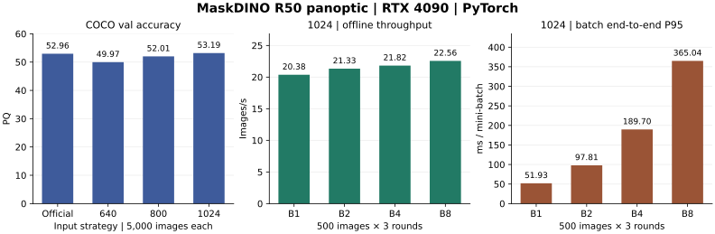
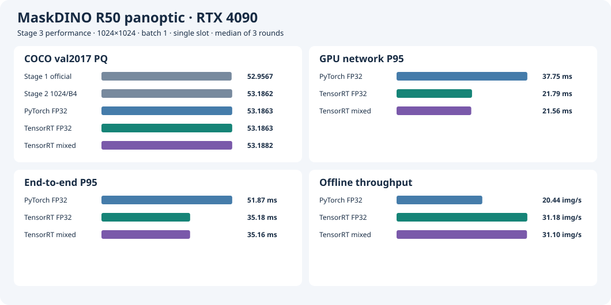
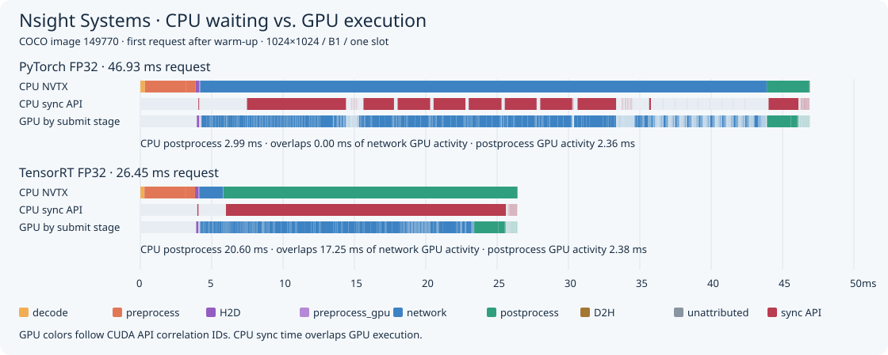
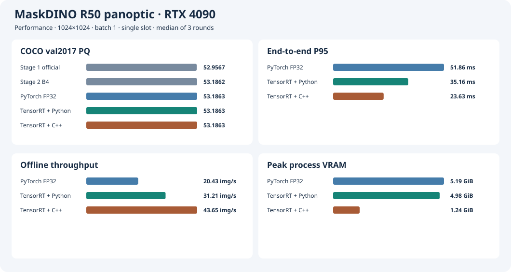
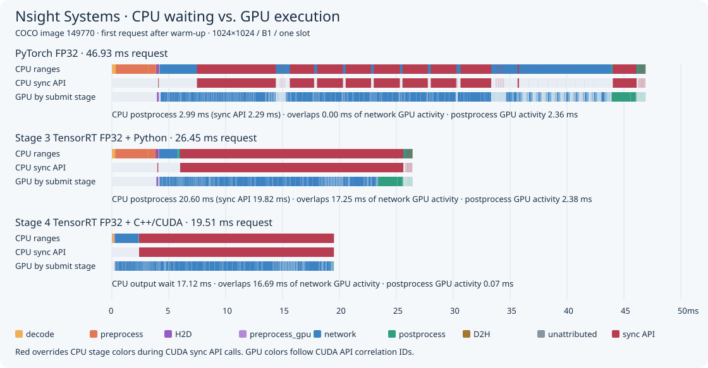
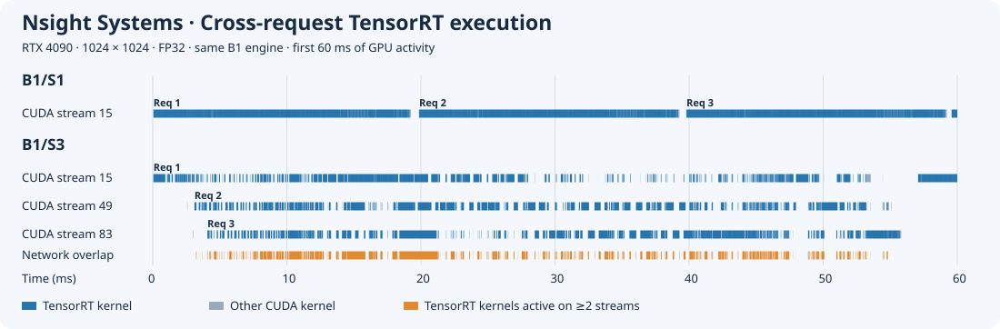
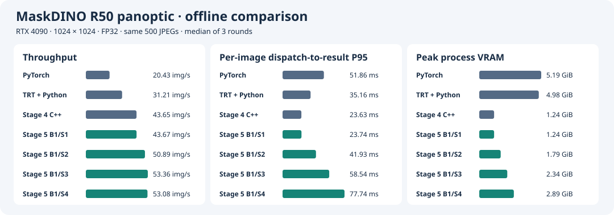
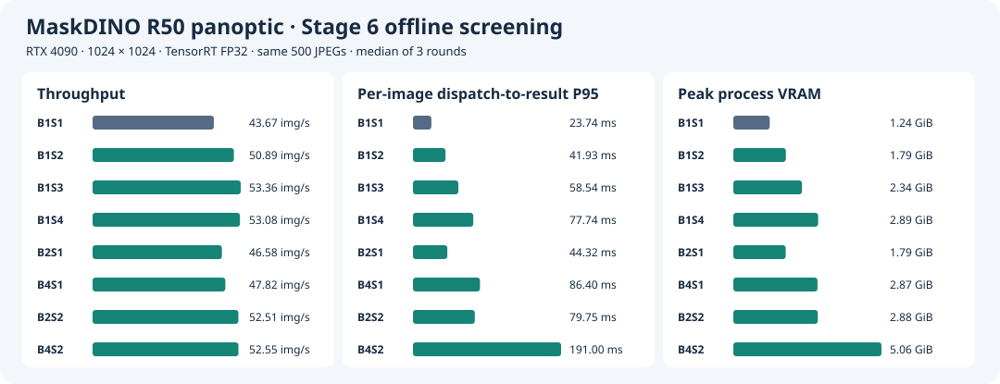

# MaskDINO-TensorRT

本项目以 MaskDINO R50 全景分割为例，在 GeForce RTX 4090 PC 上将官方 PyTorch 推理迁移到 TensorRT 和 C++/CUDA，记录从复现模型精度、建立性能基线，到优化 GPU 流水线并按负载选型的过程。[MaskDINO 官方实现](https://github.com/IDEA-Research/MaskDINO) · [RTX 4090 规格](https://www.nvidia.com/en-us/geforce/graphics-cards/40-series/rtx-4090/) · [实验环境](docs/experiment-environment.md)

在输入尺寸为 **1024×1024、FP32、batch 1的配置下，相比方形输入的 PyTorch 基线，C++/CUDA + TensorRT 将端到端 P95 从 **51.86 ms 降至 23.63 ms**，多slot并发将离线吞吐从 **20.43 提升到 53.36 图/s**。两条路径在 5,000 张 COCO 2017 panoptic 验证图上的 PQ 均为 **53.1863**（无任何精度损失）。[PyTorch 基线 PQ](stage3/README.md#全量准确率) · [C++/CUDA 验收与性能对照](stage4/README.md)

## 技术路线

1. **复现原始模型精度。** 用官方配置和权重跑完 COCO 2017 panoptic 验证集的 5,000 张图，复现官方 PQ。[Stage 1](stage1/README.md)
2. **调整推理输入并建立性能基线。** 对比方形输入尺寸和 batch 大小，确定后续 TensorRT 对照使用的 1024×1024、B1 PyTorch 基线。[Stage 2](stage2/README.md)
3. **将网络转换为 TensorRT。** 导出 ONNX，接入 MSDeformAttn 插件并构建 FP32 engine，通过逐图对齐和全量 PQ 验证转换结果。[Stage 3](stage3/README.md)
4. **用 C++/CUDA 实现前后处理。** 打通从内存 JPEG 到 CPU 全景分割图和 segment metadata 的原生推理流水线。[Stage 4](stage4/README.md)
5. **用多 CUDA stream 实现异步并发。** 为每个 slot 分配独立的 execution context、stream 和可写缓冲区，用 Nsight Systems 验证 GPU 执行重叠。[Stage 5](stage5/README.md)
6. **对比 batch × slot 组合并按负载选型。** 对比 B1 多 slot 和更大 batch 的离线吞吐与显存，再用在线请求回放评估排队、凑批和 P99。[Stage 6](stage6/README.md)

## TODO

- **定位 FP16 精度回退。** 追踪 backbone 降精度后的误差，检验 Top-K 候选变化对分割结果的影响，验证可用的混合精度范围。[混合精度问题记录](stage3/mixed-precision.md)
- **基于 profiling 进一步优化。** 用 Nsight Systems 定位 CPU/GPU 空闲和同步等待，用 TensorRT profiling 定位热点层，再用 Nsight Compute 分析关键 kernel 的执行效率、内存带宽和资源利用率。通过对照实验验证优化对端到端性能和准确率的影响。

## Stage 1 · 官方 PyTorch 基线

在 RTX 4090 上使用 MaskDINO 官方 R50 panoptic 配置和权重评估 COCO 2017 val 的 5,000 张图片。模型和前后处理走官方 `train_net.py`，PQ 由 Detectron2 的 `COCOPanopticEvaluator` 调用 COCO panopticapi 计算。

| 来源 | PQ | PQ Things | PQ Stuff |
| --- | ---: | ---: | ---: |
| [RTX 4090 实测](stage1/results/official-r50-20261106-6eb01c1.log) | **52.9567** | 58.9645 | 43.8884 |
| [MaskDINO 官方 Model Zoo](https://github.com/IDEA-Research/MaskDINO/blob/3831d8514a3728535ace8d4ecc7d28044c42dd14/README.md#coco-panoptic-segmentation) | 53.0 | — | — |

实测 PQ 按官方表格的一位小数精度为 **53.0**，预测覆盖全部 5,000 个真值图像 ID。

[Stage 1 复现步骤](stage1/README.md) · [验收 tag `stage1-official-pytorch`](https://github.com/Parker-Lyu/MaskDINO-TensorRT/tree/stage1-official-pytorch) · [环境、数据与权重](docs/experiment-environment.md)

## Stage 2 · 方形输入与 PyTorch 性能基线

本阶段为 TensorRT 建立可复用的输入规格和 PyTorch benchmark。按以下顺序完成五项工作。

1. **统一输入形状。** 等比缩放到指定长边，右侧和底部填充到正方形，让同一尺寸的图片可以直接组成 batch。后处理裁掉填充区域，再恢复到原图坐标。
2. **固定两套样本。** 32 张用于验证预处理几何和跨 batch 的数值及分割输出，500 张用于重复测量性能。两套 ID 均保存在[样本清单](stage2/sample.json)。
3. **比较三档准确率。** 640、800、1024 均用 FP32、B4 跑完整 COCO 2017 val。1024 的 PQ 最高，800 作为速度对照。
4. **对比 800 与 1024 的性能。** 两档均测 B1 和 B4。1024 比 800 高 **1.1742 PQ**，B1 的端到端 P95 多 **14.08 ms**。为优先保留准确率，选定 **1024×1024** 作为后续基线尺寸。
5. **补齐 1024 的 batch 数据。** 增测 B2 和 B8。B8 相比 B1 的离线吞吐提高 **10.7%**，P95 从 **51.93 ms** 增到 **365.04 ms**，因此 TensorRT 优先优化 **1024/B1**。

### 全量 COCO PQ

| 输入 | Batch | PQ | PQ Things | PQ Stuff | 相对 Stage 1 ΔPQ | 覆盖图数 |
| --- | ---: | ---: | ---: | ---: | ---: | ---: |
| Stage 1 官方输入 | 1 | 52.9567 | 58.9645 | 43.8884 | — | 5,000 |
| 640×640 | 4 | 49.9662 | 54.8245 | 42.6330 | −2.9905 | 5,000 |
| 800×800 | 4 | 52.0120 | 57.3157 | 44.0065 | −0.9447 | 5,000 |
| 1024×1024 | 4 | **53.1862** | 59.0272 | 44.3697 | +0.2295 | 5,000 |

### RTX 4090 性能对照

每组使用同一份 500 张清单、FP32，每轮预热 20 个 batch，共测三轮。表中为三轮中位数。吞吐按整轮完成图数除以墙钟时间，延迟和吞吐均使用离线负载。

| 输入 | Batch | 网络 GPU P50 / P95（ms/批） | 端到端 P50 / P95（ms/批） | 离线端到端吞吐（图/s） | 峰值 allocated / reserved（GiB） |
| --- | ---: | ---: | ---: | ---: | ---: |
| 800×800 | 1 | 26.49 / 26.77 | 35.02 / 37.85 | 28.35 | 2.07 / 3.92 |
| 800×800 | 4 | 87.61 / 88.14 | 122.15 / 127.34 | 32.72 | 2.37 / 4.83 |
| **1024×1024** | **1** | 37.77 / 37.88 | 48.79 / 51.93 | 20.38 | 2.58 / 4.71 |
| 1024×1024 | 2 | 71.22 / 71.44 | 93.47 / 97.81 | 21.33 | 2.74 / 5.59 |
| 1024×1024 | 4 | 138.83 / 139.37 | 183.56 / 189.70 | 21.82 | 3.06 / 4.91 |
| 1024×1024 | 8 | 264.16 / 274.32 | 355.51 / 365.04 | 22.56 | 5.06 / 7.25 |

表格和右图均按批统计端到端延迟，从该批开始处理内存 JPEG，计到最后一张图的 CPU 输出就绪。

[Stage 2 复现步骤、运行版本与原始结果](stage2/README.md) · 验收 tag `stage2-pytorch-square`

## Stage 3 · TensorRT 单请求后端

本阶段在固定 **1024×1024、batch=1、单 slot** 下，将 MaskDINO 网络替换为 TensorRT FP32，以 PyTorch FP32 为对照量化准确率和性能变化。两组均关闭 TF32，共用 Stage 2 的预处理和 panoptic 后处理。

1. 固定 RTX 4090 环境、权重与 COCO 清单，导出 opset 17 的 FP32 ONNX，验证 NVIDIA MSDA v2 插件并构建 engine。
2. 使用相同的输入 tensor 完成 32 张数值与分割对齐，再分别运行 5,000 张全量 COCO panoptic 验收，检查预测 ID 的唯一性和完整性。
3. 使用同一份 500 张清单，每轮预热 20 次、测三轮。另用 32 张图采集 Nsight Systems trace。下表性能为三轮中位数。

| 网络后端 | PQ / PQ_th / PQ_st | 网络 GPU P50 / P95（ms） | 端到端 P50 / P95（ms） | 吞吐（图/s） | 整卡采样峰值（GiB） |
| --- | ---: | ---: | ---: | ---: | ---: |
| PyTorch FP32 | 53.1863 / 59.0273 / 44.3696 | 37.58 / 37.75 | 48.68 / 51.87 | 20.44 | 5.79 |
| TensorRT FP32 | 53.1863 / 59.0273 / 44.3696 | 20.65 / 21.79 | 31.91 / 35.18 | 31.18 | 5.59 |

TensorRT FP32 使网络 P95 降低 **42.3%**、端到端 P95 降低 **32.2%**、吞吐提高 **52.5%**。

混合精度在较大范围使用 FP16 时测试数值误差较大，暂不纳入后续优化，待进一步定位原因。 [问题记录](stage3/mixed-precision.md)

Nsight Systems 原始报告 · [TensorRT FP32（GPU 分阶段）](stage3/results/trace-fp32-gpu-projection/trace.nsys-rep) · [PyTorch FP32](stage3/results/trace-pytorch-nvtx/trace.nsys-rep)

[Stage 3 复现步骤、原始结果与 Nsight 分析](stage3/README.md) · 验收 tag `stage3-fp32-accepted`

## Stage 4 · C++/CUDA 单请求流水线

复用 Stage 3 的 **1024×1024、FP32、batch 1、单 slot** TensorRT engine。C++ 从内存 JPEG 开始，CUDA 完成 resize、padding、归一化、mask 恢复和 panoptic 合并，最后一次 stream 同步交付 CPU map 和 segment metadata。原生推理进程独立运行，Python 用于评估与实验驱动。

| 路径 | 网络 GPU P50 / P95（ms） | 端到端 P50 / P95（ms） | 吞吐（图/s） | 进程显存采样峰值（GiB） |
| --- | ---: | ---: | ---: | ---: |
| PyTorch FP32 | 37.57 / 37.81 | 48.70 / 51.86 | 20.43 | 5.19 |
| Python + TensorRT FP32 | 20.63 / 21.76 | 31.89 / 35.16 | 31.21 | 4.98 |
| C++/CUDA + 同一 TensorRT engine | 21.56 / 21.81 | 22.92 / 23.63 | 43.65 | 1.24 |

在 RTX 4090 上按同一顺序各跑 500 张、三轮。相对 Python/TensorRT，原生链路的端到端 P95 降低 **32.8%**，吞吐增加 **39.8%**，同口径 NVML 进程显存采样峰值降低 **75.1%**。32 张对齐的类别图、segment IoU 和 metadata 均与 Stage 3 一致。完整 COCO val2017 覆盖 5,000 张，PQ / PQ_th / PQ_st 为 **53.186256 / 59.027261 / 44.369645**，三项与 Stage 3 的差异均小于 0.000001 点。

下图对比同一张 COCO 图像的三路 Nsight Systems 时间线。CPU 轨道上的红色表示 CUDA 同步调用，GPU 轨道上的绿色表示后处理活动。

Nsight Systems 原始报告 · [C++/CUDA + TensorRT FP32（GPU 分阶段）](stage4/results/trace-native-gpu-projection/trace.nsys-rep)

[Stage 4 复现、逐轮数据与 Nsight 报告](stage4/README.md) · 验收 tag `stage4-native-fp32-accepted`

## Stage 5 · B1 多 slot 并发推理

复用 Stage 4 的 B1 engine 和 C++/CUDA 前后处理。每个 slot 独立持有 execution context、CUDA stream 和可写缓冲区。同一 B1 engine 下，Nsight Systems 显示 B1/S3 有 **37.32% 的 TensorRT kernel 活跃时间**存在跨 stream 重叠。

B1/S3 图中前三个请求的首条网络 kernel 在 **0.06–4.08 ms** 启动，末条在 **53.22–55.73 ms** 结束。三个请求的首末区间有 **49.15 ms** 的交集，三条 stream 实际同时执行网络 kernel 的时间合计 **9.28 ms**。该图展示饱和离线负载下的开头 60 ms。

500 张筛选测了 **B1/S1–S4**。S4 的吞吐与 S3 接近，逐图 P95 和显存继续上升。B1 的 Nsight 报告覆盖 S1 和 S3。更大的 B8 是 [Stage 6 的 batch 配置](stage6/README.md#batch-与-slot-配置筛选)。

每轮 17,500 张的离线长测中，**B1/S3** 的稳态吞吐为 **53.22 图/s（+21.7%）**。相比 B1/S1，逐图 P95 从 **23.68** 升至 **58.31 ms**，进程峰值显存从 **1.24** 升至 **2.34 GiB**。B1/S1、B1/S2、B1/S3 各通过完整 COCO val2017，三项 PQ 与 Stage 4 一致。

[Stage 5 生命周期、复现与 Nsight 原始报告](stage5/README.md)

## Stage 6 · Batch × Slot 与负载选型

Stage 5 固定 B1，验证了多个 slot 的并发收益。Stage 6 进一步比较**在单个 slot 内增大 batch，能否超过 B1 多 slot，或者在两者组合后继续提高吞吐**。离线关心固定任务集的完成时间、稳态吞吐和显存。在线关心请求陆续到达时，批处理收益能否抵消排队和凑批对 P99 的影响。

固定 RTX 4090、1024×1024、TensorRT FP32（关闭 TF32）、权重和 C++/CUDA 前后处理。所有配置都从内存 JPEG 生成 CPU panoptic map 和 segment metadata。B 表示 engine 的固定 batch 大小，S 表示并发 slot 数。B2/B4/B8 分别构建 engine，因而 batch 对照包含对应 engine 的 tactic 选择。

### 离线筛选与长测

各组用同一份预载的 500 张 JPEG 跑三轮，轮换配置顺序。图中为三轮中位数，吞吐按 500 张全部完成的墙钟时间计算，逐图 P95 从 batch 派发计到该图的 CPU 结果就绪。带星号的 B8/S1、B8/S2 来自各自的补测。

1. **固定 S1 扫 batch。** B1/S1、B2/S1、B4/S1 的吞吐分别为 **43.67、46.58、47.82 图/s**。B4 相比 B2 还有 **2.7%** 的收益，因此补测 B8/S1。同轮 B4/S1 到 B8/S1 只从 **47.70** 升到 **48.76 图/s**，逐图 P95 从 **86.46** 升到 **169.60 ms**，峰值显存从 **2.87** 升到 **5.82 GiB**。 [初筛数据](stage6/results/screen/summary.json) · [B8/S1 补测](stage6/results/screen-b8/summary.json)
2. **固定 batch 增加到 S2，再和 B1 多 slot 对照。** 先测 B2/S2 和 B4/S2，用各自的 S1 判断多 slot 是否仍有增益，再与同轮 B1/S3 比较。两组联合配置分别达到 **52.51、52.55 图/s**，B1/S3 为 **53.36 图/s**，且逐图 P95 和显存均更低。进一步补测 B8/S2，同轮 B1/S3 仍以 **53.70 vs 52.67 图/s**、**2.34 vs 10.72 GiB** 领先。 [联合初筛](stage6/results/screen/summary.json) · [B8/S2 补测](stage6/results/screen-b8-joint/summary.json)

另用同一份 32 张清单采集 Nsight Systems。B2/S2 和 B1/S3 的首末 GPU kernel 窗口分别为 **610.60、607.37 ms**，整条流水线的跨 stream kernel 重叠比例分别为 **26.7%、38.0%**。正确性检查覆盖逐图输出、尾批和在线超时回退。 [联合配置 Nsight](stage6/README.md#联合配置的-nsight-采集) · [正确性记录](stage6/README.md#正确性)

**离线选 B1/S3。** 在每轮 17,500 张、各三轮的长测中，B1/S3 相比 B1/S1 的稳态吞吐从 **43.74 提高到 53.22 图/s（+21.7%）**，总完成时间从 **400.18 缩短到 328.78 s（−17.8%）**，两组各完成 52,500 张、零失败。最终使用的 B1/S1、S2、S3 均通过全量 COCO 2017 panoptic 验证，三项 PQ 与 Stage 4 一致。 [离线长测](stage5/README.md#离线长测) · [全量 PQ](stage5/README.md#正确性)

### 在线回放与选型

**怎么测。** 回放覆盖匀速、泊松和周期突发。配对比较使用相同的图片顺序和到达时间表。从计划到达计到 CPU 结果就绪，按请求统计 P99。

**怎么筛。** B1 测 1–3 个 slot，B2 用来检验双图凑批。在平均 22 请求/s 的同一突发序列上，B1/S2 的 P99 为 **114.67 ms**，两个 B2 配置均超过 **135 ms**。B1/S3 在 20 请求/s 的泊松和突发补扫中也慢于 B1/S2，因此只保留 **B1/S1 和 B1/S2** 做三轮验证。 [粗扫与凑批扫描](stage6/README.md#在线粗扫)

**怎么选。** 目标是在满足 P99 预算的前提下节省显存。配置须三轮均达标、零拒绝、零错误且队列无持续积压。两组都通过时，优先选进程峰值显存更低的 **B1/S1**（1.24 GiB，B1/S2 为 1.79 GiB）。

| 到达负载 | P99 预算（ms） | 每轮时长 | B1/S1 最差 P99（ms） | B1/S2 最差 P99（ms） | 选型与依据 |
| --- | ---: | ---: | ---: | ---: | --- |
| 匀速 25 请求/s | 30 | 420 s | 24.57 | 仅做短测 | **B1/S1** 三轮达标 |
| 泊松 20 请求/s | 100 | 525 s | 83.06 | 79.52 | 两组达标，选显存更低的 **B1/S1** |
| 周期突发，平均 15 请求/s | 100 | 180 s | 100.007 | 92.46 | B1/S1 有一轮略超预算，选 **B1/S2** |
| 泊松 5 请求/s | 50 | 180 s | 45.85 | 44.48 | 两组达标，选显存更低的 **B1/S1** |
| 周期突发，平均 5 请求/s | 50 | 180 s | 46.47 | 45.00 | 两组达标，选显存更低的 **B1/S1** |

匀速 25 请求/s 的同序列短测为 15 秒、375 个请求，B1/S1 和 B1/S2 的 P99 分别为 24.73 和 28.17 ms。该负载只对 B1/S1 做了三轮长测。 [匀速短测](stage6/results/pilot-uniform/summary.jsonl)

[在线长测数据（每轮超过 10,000 请求）](stage6/results/long-capacity.json) · [180 秒缩短验证数据](stage6/results/compact-capacity.json)

[Stage 6 batch 筛选、在线回放与选型](stage6/README.md) · [Stage 5 和 6 拆分前的历史验收 tag `stage5-batch-slots-accepted`](https://github.com/Parker-Lyu/MaskDINO-TensorRT/tree/stage5-batch-slots-accepted)

## 仓库结构

| 目录 | 内容 |
| --- | --- |
| [maskdino/](maskdino/) | 固定上游源码版本、PyTorch 环境和 CUDA 扩展兼容补丁 |
| [stage1/](stage1/) | 官方评估入口、复现命令和结果 |
| [stage2/](stage2/) | 方形 PyTorch 推理、全量 PQ 和性能样本 |
| [stage3/](stage3/) | 单 slot TensorRT FP32 验收与 Nsight 基线 |
| [stage4/](stage4/) | 原生 TensorRT/CUDA 单请求流水线与全量评估 |
| [stage5/](stage5/) | B1 多 slot、Nsight 时间线及两阶段共用的调度器 |
| [stage6/](stage6/) | 固定 batch、联合配置、在线回放与选型 |
| [docs/](docs/) | 环境、数据及权重说明 |

构建镜像时会检出指定版本的官方 MaskDINO 源码。

## 许可证

[Apache-2.0](LICENSE) · [第三方组件与许可](maskdino/THIRD_PARTY_NOTICES.md)
