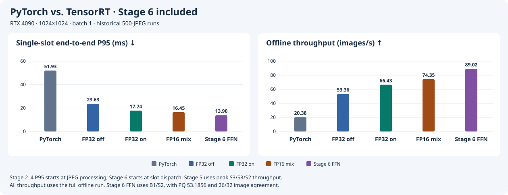
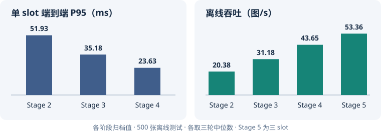
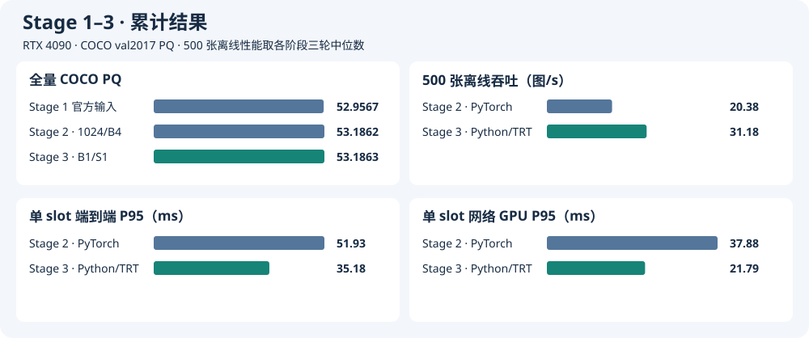
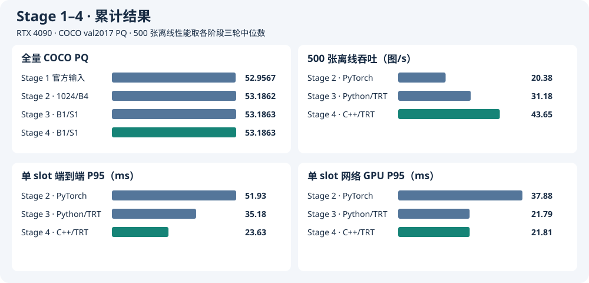
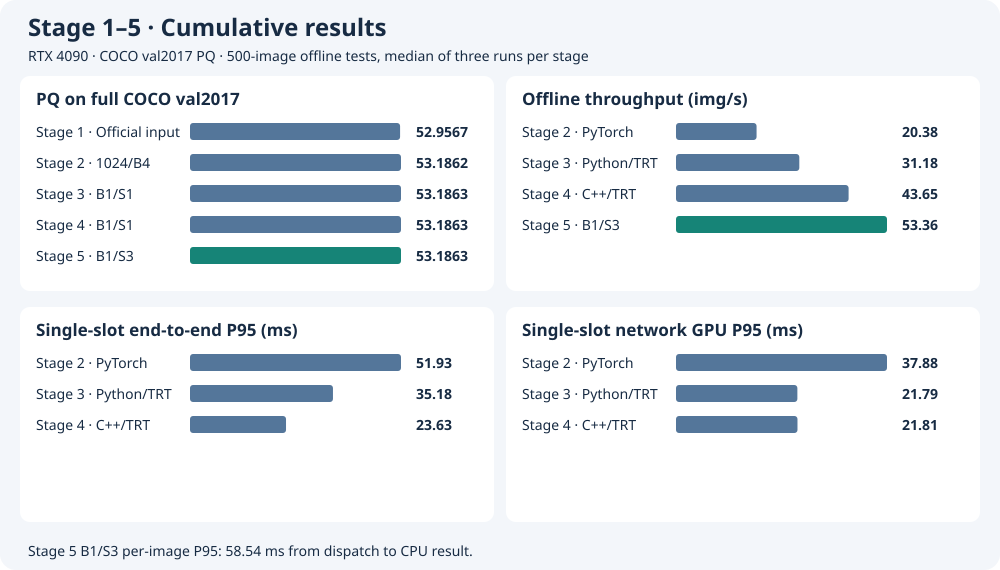

# MaskDINO-TensorRT

在 RTX 4090 上将 MaskDINO R50 全景分割从 PyTorch 迁移到 TensorRT，逐步优化网络、C++/CUDA 前后处理和多 CUDA stream 调度。[MaskDINO 官方实现](https://github.com/IDEA-Research/MaskDINO) · [实验环境与数据](docs/experiment-environment.md)

## 推理性能对比

固定 **1024×1024、batch 1**，以使用相同 letterbox 输入的 PyTorch FP32 为基线。性能取同一份 500 张 JPEG 的三轮中位数，括号内为相对 PyTorch 的改善。  
TensorRT FP32（TF32 on）和TensorRT FP16 混合精度（TF32 on）虽然有较低的精度损失，但是在 COCO 验证集上的 PQ 得分，仍然**高于**官方源码报告的 53.0 。

| 模型 / Engine | 全量 COCO PQ | 单 slot 端到端 P95 ↓ | 峰值离线吞吐 ↑ | 精度损失 |
| --- | ---: | ---: | ---: | --- |
| PyTorch FP32 基线（TF32 off） | 53.1863 | 51.93 ms | 20.38 图/s（单路） | 基线 |
| TensorRT FP32（TF32 off） | 53.1863 | **23.63 ms**（缩短 28.30 ms / 54.5%） | **53.36 图/s**（2.62×，S3） | PQ 持平（四位小数），逐图 32/32 通过 |
| TensorRT FP32（TF32 on） | 53.1745 | **17.74 ms**（缩短 34.19 ms / 65.8%） | **66.43 图/s**（3.26×，S3） | PQ 降 0.0117 点，逐图 27/32 通过 |
| TensorRT FP16 混合精度（TF32 on） | 53.1680 | **16.45 ms**（缩短 35.48 ms / 68.3%） | **74.35 图/s**（3.65×，S2） | PQ 降 0.0182 点，逐图 16/32 通过，最差类别一致率 91.63% |

P95 从处理内存 JPEG 计到 CPU 分割图和 segment metadata 就绪，TensorRT 取 Stage 4 单 slot 结果。吞吐取 Stage 5 的 S1–S4 初筛峰值，S 为并发 slot 数。表中倍数为跨阶段归档对比。  
PQ 取 PyTorch B1 和 Stage 4 原生链路各自的 COCO val2017 全量评估（5,000 张）。逐图通过数取 Stage 3 的 32 张筛选，三种 engine 统一与 PyTorch 对比。  
## 技术路线

1. [Stage 1](stage1/README.md) · 用官方 PyTorch 配置复现 COCO PQ 得分。
2. [Stage 2](stage2/README.md) · 修改预处理为使用 letterbox，选定输入尺寸 1024×1024 / B1 作为部署基线，并选定32张对齐数据和500张计时样本。
3. [Stage 3](stage3/README.md) · 导出 ONNX，接入 MSDeformAttn 插件，构建trt engine, 替换网络后端并筛选精度策略。
4. [Stage 4](stage4/README.md) · 用 C++/CUDA 实现前后处理，在单 slot 下对比三种 engine。
5. [Stage 5](stage5/README.md) · 用多 CUDA stream 重叠 GPU 工作，对比各 engine 的 S1–S4 吞吐。
6. [Stage 6](stage6/README.md) · 逐层定位 TensorRT 热点，验证 FPN 和 encoder FFN 的局部混合精度。

Stage 3 使用 Python 前后处理，Stage 4 使用 C++/CUDA 前后处理，Stage 5 展示各自吞吐峰值（S3 / S3 / S2）。README 图表可用 `python3 docs/plot-roadmap.py` 重绘。

## Stage 1 · 复现原始模型精度

在 RTX 4090 上使用 MaskDINO 官方 R50 panoptic 配置和权重评估 COCO 2017 val 的 5,000 张图片。模型和前后处理走官方 `train_net.py`，PQ 由 Detectron2 的 `COCOPanopticEvaluator` 调用 COCO panopticapi 计算。

| 来源 | PQ | PQ Things | PQ Stuff |
| --- | ---: | ---: | ---: |
| [RTX 4090 实测](stage1/results/official-r50-20261106-6eb01c1.log) | **52.9567** | 58.9645 | 43.8884 |
| [MaskDINO 官方 Model Zoo](https://github.com/IDEA-Research/MaskDINO/blob/3831d8514a3728535ace8d4ecc7d28044c42dd14/README.md#coco-panoptic-segmentation) | 53.0 | — | — |

实测 PQ 按官方表格的一位小数精度为 **53.0**，预测覆盖全部 5,000 个真值图像 ID。

[Stage 1 复现步骤](stage1/README.md) · [环境、数据与权重](docs/experiment-environment.md)

## Stage 2 · 调整预处理方法并建立性能基线

为了业务推理时使用batch，调整预处理方法，用 letterbox 将输入图片等比缩放并填充到正方形，再将分割输出恢复到原图坐标。1024 相比 800 高 **1.1742 PQ**，选为部署尺寸。。[32 张对齐与 500 张计时样本](stage2/sample.json)

### 全量 COCO PQ

| 输入 | Batch | PQ | PQ Things | PQ Stuff | 相对 Stage 1 ΔPQ | 覆盖图数 |
| --- | ---: | ---: | ---: | ---: | ---: | ---: |
| Stage 1 官方输入 | 1 | 52.9567 | 58.9645 | 43.8884 | — | 5,000 |
| 640×640 | 4 | 49.9662 | 54.8245 | 42.6330 | −2.9905 | 5,000 |
| 800×800 | 4 | 52.0120 | 57.3157 | 44.0065 | −0.9447 | 5,000 |
| 1024×1024 | 4 | **53.1862** | 59.0272 | 44.3697 | +0.2295 | 5,000 |

### RTX 4090 性能对照

每组使用同一份 500 张清单、FP32，每轮预热 20 个 batch，共测三轮。表中为三轮中位数。吞吐按整轮完成图数除以墙钟时间，延迟和吞吐均使用离线负载。

| 输入 | Batch | 网络 GPU P50 / P95（ms/批） | 端到端 P50 / P95（ms/批） | 离线端到端吞吐（图/s） | 峰值 allocated / reserved（GiB） |
| --- | ---: | ---: | ---: | ---: | ---: |
| 800×800 | 1 | 26.49 / 26.77 | 35.02 / 37.85 | 28.35 | 2.07 / 3.92 |
| 800×800 | 4 | 87.61 / 88.14 | 122.15 / 127.34 | 32.72 | 2.37 / 4.83 |
| **1024×1024** | **1** | 37.77 / 37.88 | 48.79 / 51.93 | 20.38 | 2.58 / 4.71 |
| 1024×1024 | 2 | 71.22 / 71.44 | 93.47 / 97.81 | 21.33 | 2.74 / 5.59 |
| 1024×1024 | 4 | 138.83 / 139.37 | 183.56 / 189.70 | 21.82 | 3.06 / 4.91 |
| 1024×1024 | 8 | 264.16 / 274.32 | 355.51 / 365.04 | 22.56 | 5.06 / 7.25 |

表格和右图均按批统计端到端延迟，从该批开始处理内存 JPEG，计到最后一张图的 CPU 输出就绪。

[Stage 2 复现步骤与原始结果](stage2/README.md)

## Stage 3 · 将网络转换为 TensorRT

保留 Python 前后处理，将网络替换为 TensorRT，使用 MSDeformAttn PluginV3。[Stage 3 构建、精度筛选与性能分析](stage3/README.md)

**32 张逐图对齐。** 三种 engine 都与同输入的 PyTorch FP32 B1 比较。通过条件为像素类别一致率 ≥99.9%、所有 segment 成功配对且同类 IoU ≥0.98。FP32（TF32 off）通过 **32/32**。FP32（TF32 on）通过 **27/32**，5 张失败图均触发了类别一致率门槛。FP16 混合精度（TF32 on）通过 **16/32**，最差图的类别一致率为 **91.63%**，两边各有一个未配对的 segment。[逐图结果与全量 PQ](stage3/README.md#b1s1-精度策略筛选)

**按验收承诺选型。** 如果要求逐图输出满足上述 PyTorch 一致性门槛，只有 FP32（TF32 off）通过。如果只要求在 5,000 张 COCO val2017 上，PQ、PQ Things 和 PQ Stuff 相对同输入的 PyTorch FP32 各下降不超过 **0.05 点**，三种 engine 均达标，两种 TF32 on 配置可继续纳入性能选型。

PQ 保留 Stage 1 官方输入和 Stage 2 1024/B4 作为历史参考。性能从 Stage 2 的 1024/B1 PyTorch 开始，Stage 3 三种 engine 均使用 B1/S1 和同一份 500 张 JPEG。[Stage 3 三种 engine 的性能](stage3/README.md#三种-engine-的离线性能)

### 整卡峰值显存

固定 1024×1024、B1/S1，使用 Python 前后处理。NVML 每 20 ms 采样整卡显存，包含桌面等其他进程的占用，取每轮观测峰值的三轮中位数。两种 TF32 on 配置来自后续补测。[FP32 基线](stage3/README.md#性能) · [精度策略补测](stage3/README.md#三种-engine-的离线性能)

| 后端 | 整卡峰值显存（GiB） |
| --- | ---: |
| PyTorch FP32 | 5.79 |
| TensorRT FP32（TF32 off） | 5.59 |
| TensorRT FP32（TF32 on） | 5.59 |
| TensorRT FP16 混合精度（TF32 on） | 5.49 |

## Stage 4 · 用 C++/CUDA 实现前后处理

复用 Stage 3 的 engine，用 C++ 解码 JPEG，用 CUDA 完成 resize、padding、归一化、mask 恢复和 panoptic 合并，最后同步 stream 交付 CPU 结果。[复现、同轮对照与 Nsight 时间线](stage4/README.md)

Stage 3 和 Stage 4 均使用 B1/S1，分别展示 Python 与 C++/CUDA 前后处理的结果。

### 进程峰值显存

固定 1024×1024、B1/S1。NVML 每 20 ms 按 PID 采样推理进程显存，覆盖网络、前后处理与 CUDA 上下文，取每轮观测峰值的三轮中位数。前三行来自同轮复测，后两行来自原生链路精度配对。[同轮性能与显存](stage4/README.md#rtx-4090-性能) · [原生链路精度配对](stage4/README.md#b1s1-精度策略对照)

| 推理链路 | 进程峰值显存（GiB） |
| --- | ---: |
| PyTorch FP32 | 5.19 |
| Python 前后处理 + TensorRT FP32（TF32 off） | 4.98 |
| C++/CUDA 前后处理 + TensorRT FP32（TF32 off） | 1.24 |
| C++/CUDA 前后处理 + TensorRT FP32（TF32 on） | 1.24 |
| C++/CUDA 前后处理 + TensorRT FP16 混合精度（TF32 on） | 1.15 |

## Stage 5 · 用多 CUDA stream 实现异步并发

每个 slot 独立持有 execution context、CUDA stream 和可写缓冲区。Nsight Systems 显示，FP32/TF32 off 在 B1/S3 时有 **37.32%** 的 TensorRT kernel 活跃时间存在跨 stream 重叠。[时间线与原始报告](stage5/README.md#nsight-systems)

[Stage 5 并发配置、离线长测与精度对照](stage5/README.md)

Stage 5 展示 12 组 500 张离线初筛结果。逐图 P95 从派发到 slot 起算，Stage 2–4 从处理内存 JPEG 起算，均计到 CPU 结果就绪。Stage 5 的全量 COCO PQ 覆盖 FP32/TF32 off 的 S1–S3，其余配置以 `—` 标示，12 组均通过 32 张逐图检查。[正确性与全量评估](stage5/README.md#正确性) · [三种精度的离线筛选](stage5/README.md#三种精度的-b1--s1s4-筛选)

### 进程峰值显存

固定 B1，由 NVML 每 20 ms 采样推理进程，取每轮峰值的三轮中位数，单位为 GiB。[吞吐、逐图 P95 与显存对照图](stage5/results/precision-comparison.svg)

| Engine | S1 | S2 | S3 | S4 |
| --- | ---: | ---: | ---: | ---: |
| FP32 / TF32 off | 1.24 | 1.79 | 2.34 | 2.89 |
| FP32 / TF32 on | 1.24 | 1.79 | 2.34 | 2.89 |
| FP16 混合精度 / TF32 on | 1.15 | 1.70 | 2.26 | 2.81 |

## Stage 6 · 逐层 profiling 与局部混合精度

固定已验收的 FP16 B1 模型并用共享 timing cache 重建配对。将 FPN 的一个 3×3 卷积切到 FP16 Tensor Core 后，B1/S1 的端到端 P95 从 **16.27 降至 15.85 ms**，B1/S2 的稳态吞吐从 **74.21 提高至 76.33 图/s**。两个配置各完成 5,000 张 COCO val2017 的评估，PQ 均为 **53.1718**。FPN 实验验收提交为 `5f7b57f`。 [逐层 profiling](stage6/layer-profile.md) · [配对计时与全量 PQ](stage6/fpn-half-ab.md)

六层 encoder FFN 的两个 Linear 全部切到 FP16 后，B1/S1 端到端 P95 为 **13.90 ms**，B1/S2 稳态吞吐为 **89.22 图/s**。全量 PQ 为 **53.1856**，两种 slot 的逐图对齐均为 **26/32**，保留为实验配置。 [FFN 离线 A/B](stage6/ffn-full-half.md)

## 仓库结构

| 目录 | 内容 |
| --- | --- |
| [maskdino/](maskdino/) | 固定上游源码版本、PyTorch 环境和 CUDA 扩展兼容补丁 |
| [stage1/](stage1/) | 官方评估入口、复现命令和结果 |
| [stage2/](stage2/) | 方形 PyTorch 推理、全量 PQ 和性能样本 |
| [stage3/](stage3/) | 单 slot TensorRT FP32 验收与 Nsight 基线 |
| [stage4/](stage4/) | 原生 TensorRT/CUDA 单请求流水线与全量评估 |
| [stage5/](stage5/) | B1 多 slot、Nsight 时间线及两阶段共用的调度器 |
| [stage6/](stage6/) | 逐层 profiling、FPN 与 encoder FFN 精度实验 |
| [docs/](docs/) | 环境、数据及权重说明 |

构建镜像时会检出指定版本的官方 MaskDINO 源码。

## 许可证

[Apache-2.0](LICENSE) · [第三方组件与许可](maskdino/THIRD_PARTY_NOTICES.md)
