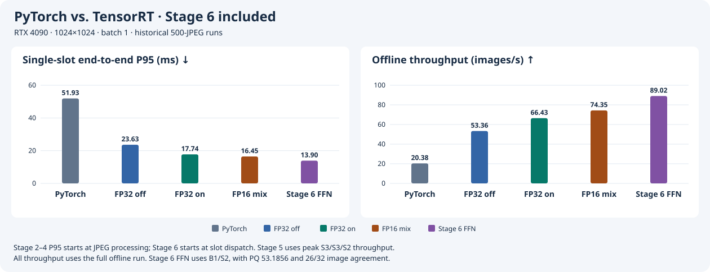
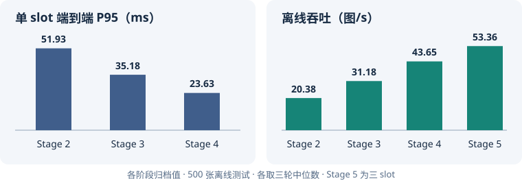
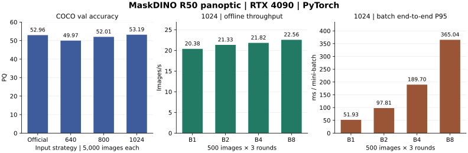
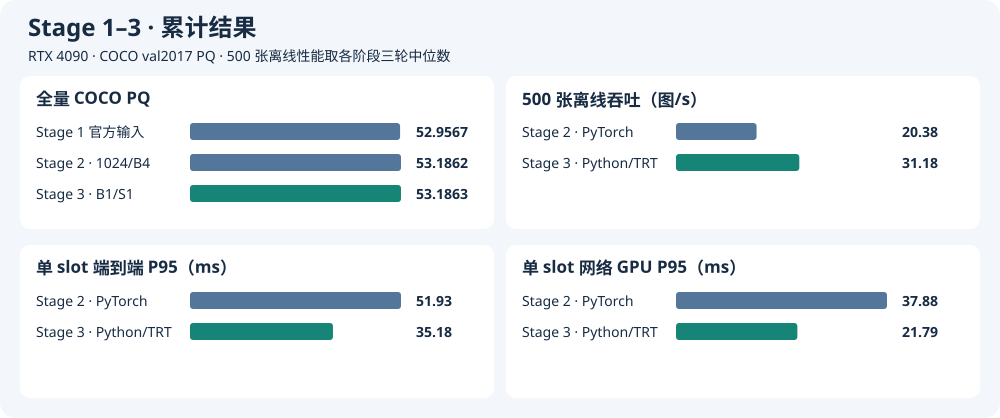
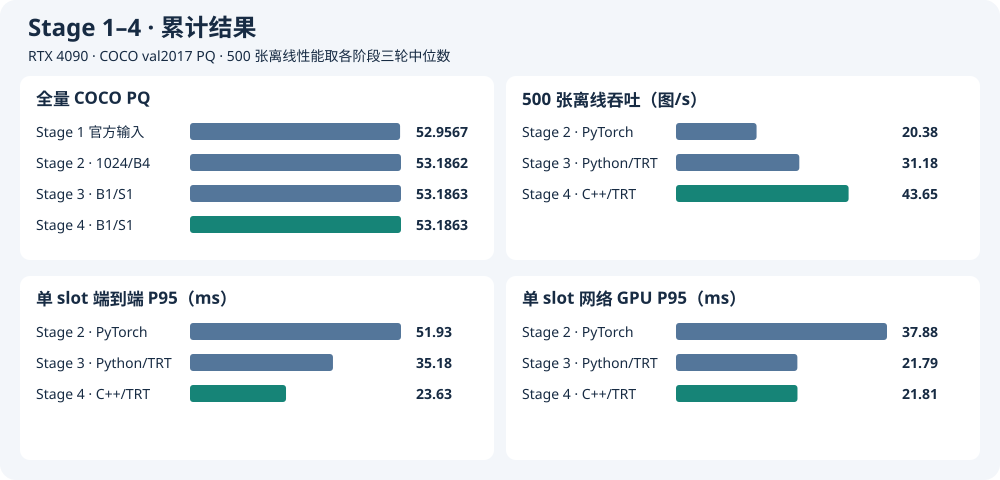
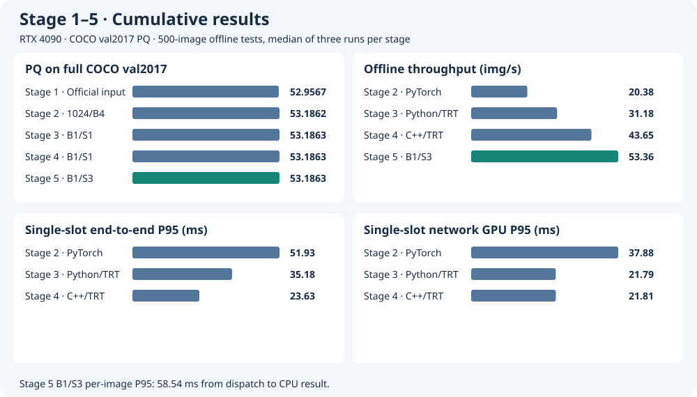
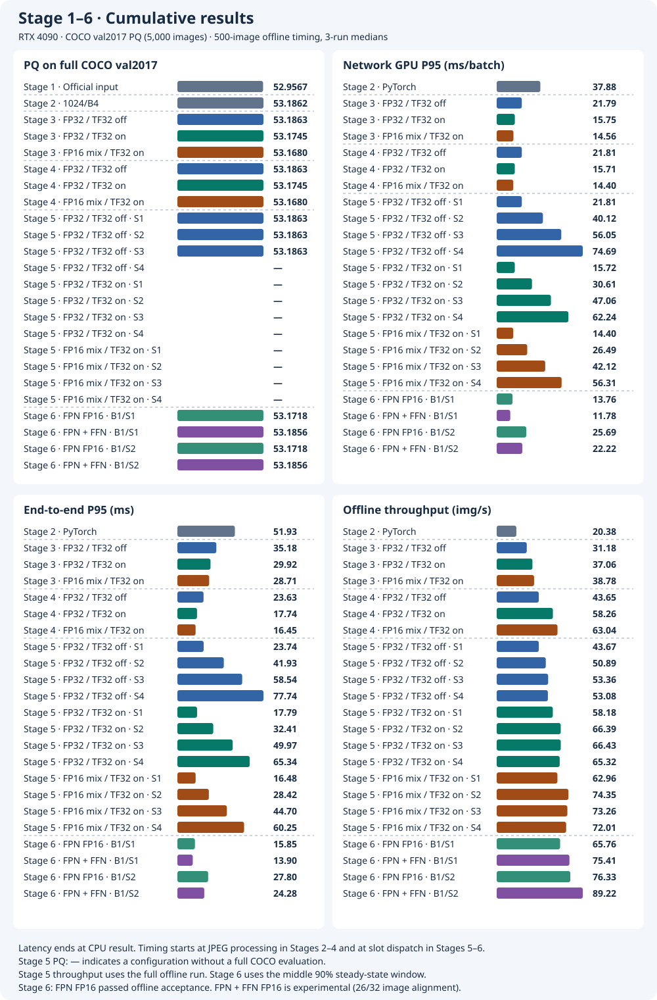

# MaskDINO-TensorRT

[English](README.md) · **简体中文**

**端到端 GPU 推理工程实践：模型部署、性能分析、优化与精度验证**

<table>
  <tr>
    <td align="center">
      <h2>2.62×</h2>
      TensorRT FP32 离线吞吐
    </td>
    <td align="center">
      <h2>4.37×</h2>
      实验峰值离线吞吐
    </td>
    <td align="center">
      <h2>降低 73.2%</h2>
      实验配置的单 slot P95 延迟
    </td>
  </tr>
</table>

以 RTX 4090 上的 PyTorch FP32 为基线。

[MaskDINO 官方实现](https://github.com/IDEA-Research/MaskDINO) · [实验环境与数据](docs/experiment-environment.zh-CN.md)

## 工程亮点（Engineering Highlights）

1. **TensorRT 集成（TensorRT Integration）：** 定位并修复 ONNX 导出中的常量设备兼容问题；集成 MSDeformAttn PluginV3，构建 TensorRT Engine，并验证插件数值及模型输出。
2. **原生推理链路（Native Inference Pipeline）：** 使用 C++/CUDA 实现 JPEG 解码后的预处理、分割后处理与结果恢复，管理 GPU / pinned host 缓冲区，完成 TensorRT 异步执行及 CPU 全景分割图和 segment metadata 交付。
3. **并发与性能分析（Concurrency & Profiling）：** 采用独立 execution context、CUDA stream 和缓冲区的多 slot 调度；结合 Nsight Systems、Nsight Compute 与 TensorRT 逐层 Profiling，分析 GPU 执行重叠、延迟、吞吐及算子热点。
4. **精度优化与故障归因（Precision Optimization & Debugging）：** 针对 FPN 卷积和 Encoder FFN 进行局部 FP16 实验；排查 TensorRT tactic 变化，结合逐图对齐与 COCO 全量 PQ 验证性能收益和精度风险。

## 推理性能对比

固定 **1024×1024、batch 1**，以使用相同 letterbox 输入的 PyTorch FP32 为基线。性能取同一份 500 张 JPEG 的三轮中位数，括号内为相对 PyTorch 的改善。

| 模型 / Engine | 全量 COCO PQ | 单 slot 端到端 P95 ↓ | 整轮离线吞吐 ↑ | 精度损失 |
| --- | ---: | ---: | ---: | --- |
| PyTorch FP32 基线（TF32 off） | 53.1863 | 51.93 ms | 20.38 图/s（单路） | 基线 |
| TensorRT FP32（TF32 off） | 53.1863 | **23.63 ms**（缩短 28.30 ms / 54.5%） | **53.36 图/s**（2.62×，S3） | PQ 持平（四位小数），逐图 32/32 通过 |
| TensorRT FP32（TF32 on） | 53.1745 | **17.74 ms**（缩短 34.19 ms / 65.8%） | **66.43 图/s**（3.26×，S3） | PQ 降 0.0117 点，逐图 27/32 通过 |
| TensorRT FP16 混合精度（TF32 on） | 53.1680 | **16.45 ms**（缩短 35.48 ms / 68.3%） | **74.35 图/s**（3.65×，S2） | PQ 降 0.0182 点，逐图 16/32 通过，最差类别一致率 91.63% |
| Stage 6 · FPN + Encoder FFN FP16（TF32 on） | **53.1856** | **13.90 ms**（缩短 38.03 ms / 73.2%） | **89.02 图/s**（4.37×，S2） | PQ 降 0.0006 点；相对已验收 FPN Engine 逐图 26/32 通过，最差类别一致率 85.68% |

**统计口径：** 表格均为 RTX 4090、1024×1024、B1 下的归档实验结果。PyTorch 与 Stage 4 单 slot 的 P95 从开始处理内存 JPEG 计到 CPU 分割图和 segment metadata 就绪，Stage 6 的 P95 从请求派发到 slot 起算。吞吐均按预热后整轮完成图数除以墙钟时间，分别取 Stage 2 单路、Stage 5 的 S1–S4 离线初筛峰值和 Stage 6 的 B1/S2 结果。

**精度口径：** 全量 PQ 使用相同 letterbox 输入的 PyTorch FP32 B1 作为基线，在 COCO val2017 的 5,000 张图上计算。前面 TensorRT 精度策略的逐图通过数取 Stage 3 对 PyTorch 的 32 张检查；Stage 6 FFN 的 **26/32** 则是与已验收 FPN Engine 的 32 张逐图检查，详见 [Stage 3](#stage-3--将网络转换为-tensorrt) 和 [Stage 6](#stage-6--tensorrt-逐层-profiling-与进一步优化)。

## 技术路线

1. [Stage 1](#stage-1--复现原始模型精度) · 用官方 PyTorch 配置复现 COCO PQ 得分。
2. [Stage 2](#stage-2--调整预处理方法并建立性能基线) · 修改预处理为使用 letterbox，选定输入尺寸 1024×1024 / B1 作为部署基线，并选定32张对齐数据和500张计时样本。
3. [Stage 3](#stage-3--将网络转换为-tensorrt) · 导出 ONNX，接入 MSDeformAttn 插件，构建TensorRT Engine, 替换网络后端并筛选精度策略。
4. [Stage 4](#stage-4--用-ccuda-实现前后处理) · 用 C++/CUDA 实现前后处理，在单 slot 下对比三种 engine。
5. [Stage 5](#stage-5--用多-cuda-stream-实现异步并发) · 用多 CUDA stream 重叠 GPU 工作，对比各 engine 的 S1–S4 吞吐。
6. [Stage 6](#stage-6--tensorrt-逐层-profiling-与进一步优化) · 逐层定位 TensorRT 热点，验证 FPN 和 encoder FFN 的局部混合精度。

Stage 3 使用 Python 前后处理，Stage 4 使用 C++/CUDA 前后处理，Stage 5 展示三种 Engine 的离线吞吐峰值（S3 / S3 / S2）。Stage 6 展示 FPN 与进一步叠加 FFN FP16 的 **B1/S1 P95** 和 **B1/S2 整轮吞吐**，FFN 逐图一致性为 26/32。图表可用 `python3 docs/plot-roadmap.py` 重绘。

## Stage 1 · 复现原始模型精度

在 RTX 4090 上使用 MaskDINO 官方 R50 panoptic 配置和权重评估 COCO 2017 val 的 5,000 张图片。模型和前后处理走官方 `train_net.py`，PQ 由 Detectron2 的 `COCOPanopticEvaluator` 调用 COCO panopticapi 计算。

| 来源 | PQ | PQ Things | PQ Stuff |
| --- | ---: | ---: | ---: |
| [RTX 4090 实测](stage1/results/official-r50-20261106-6eb01c1.log) | **52.9567** | 58.9645 | 43.8884 |
| [MaskDINO 官方 Model Zoo](https://github.com/IDEA-Research/MaskDINO/blob/3831d8514a3728535ace8d4ecc7d28044c42dd14/README.md#coco-panoptic-segmentation) | 53.0 | — | — |

实测 PQ 按官方表格的一位小数精度为 **53.0**，预测覆盖全部 5,000 个真值图像 ID。

[Stage 1 复现步骤](stage1/README.zh-CN.md) · [环境、数据与权重](docs/experiment-environment.zh-CN.md)

## Stage 2 · 调整预处理方法并建立性能基线

为为了支持固定形状批处理，并统一不同原始分辨率的输入，调整预处理方法，用 letterbox 将输入图片等比缩放并填充到正方形，再将分割输出恢复到原图坐标。1024 相比 800 高 **1.1742 PQ**，选为部署尺寸。[32 张对齐与 500 张计时样本](stage2/sample.json)

### 全量 COCO PQ

| 输入 | Batch | PQ | PQ Things | PQ Stuff | 相对 Stage 1 ΔPQ | 覆盖图数 |
| --- | ---: | ---: | ---: | ---: | ---: | ---: |
| Stage 1 官方输入 | 1 | 52.9567 | 58.9645 | 43.8884 | — | 5,000 |
| 640×640 | 4 | 49.9662 | 54.8245 | 42.6330 | −2.9905 | 5,000 |
| 800×800 | 4 | 52.0120 | 57.3157 | 44.0065 | −0.9447 | 5,000 |
| 1024×1024 | 4 | **53.1862** | 59.0272 | 44.3697 | +0.2295 | 5,000 |

### RTX 4090 性能对照

每组使用同一份 500 张清单、FP32，每轮预热 20 个 batch，共测三轮。表中为三轮中位数。吞吐按整轮完成图数除以墙钟时间，延迟和吞吐均使用离线负载。

| 输入 | Batch | 网络 GPU P50 / P95（ms/批） | 端到端 P50 / P95（ms/批） | 离线端到端吞吐（图/s） | 峰值 allocated / reserved（GiB） |
| --- | ---: | ---: | ---: | ---: | ---: |
| 800×800 | 1 | 26.49 / 26.77 | 35.02 / 37.85 | 28.35 | 2.07 / 3.92 |
| 800×800 | 4 | 87.61 / 88.14 | 122.15 / 127.34 | 32.72 | 2.37 / 4.83 |
| **1024×1024** | **1** | 37.77 / 37.88 | 48.79 / 51.93 | 20.38 | 2.58 / 4.71 |
| 1024×1024 | 2 | 71.22 / 71.44 | 93.47 / 97.81 | 21.33 | 2.74 / 5.59 |
| 1024×1024 | 4 | 138.83 / 139.37 | 183.56 / 189.70 | 21.82 | 3.06 / 4.91 |
| 1024×1024 | 8 | 264.16 / 274.32 | 355.51 / 365.04 | 22.56 | 5.06 / 7.25 |

表格和右图均按批统计端到端延迟，从该批开始处理内存 JPEG，计到最后一张图的 CPU 输出就绪。

[Stage 2 复现步骤与原始结果](stage2/README.zh-CN.md)

## Stage 3 · 将网络转换为 TensorRT

保留 Python 前后处理，将网络替换为 TensorRT，使用 MSDeformAttn PluginV3。[Stage 3 构建、精度筛选与性能分析](stage3/README.zh-CN.md)

**32 张逐图对齐。** 三种 engine 都与同输入的 PyTorch FP32 B1 比较。通过条件为像素类别一致率 ≥99.9%、所有 segment 成功配对且同类 IoU ≥0.98。FP32（TF32 off）通过 **32/32**。FP32（TF32 on）通过 **27/32**，5 张失败图均触发了类别一致率门槛。FP16 混合精度（TF32 on）通过 **16/32**，最差图的类别一致率为 **91.63%**，两边各有一个未配对的 segment。[逐图结果与全量 PQ](stage3/README.zh-CN.md#b1s1-精度策略筛选)

**按验收承诺选型。** 如果要求逐图输出满足上述 PyTorch 一致性门槛，只有 FP32（TF32 off）通过。如果只要求在 5,000 张 COCO val2017 上，PQ、PQ Things 和 PQ Stuff 相对同输入的 PyTorch FP32 各下降不超过 **0.05 点**，三种 engine 均达标，两种 TF32 on 配置可继续纳入性能选型。

PQ 保留 Stage 1 官方输入和 Stage 2 1024/B4 作为历史参考。性能从 Stage 2 的 1024/B1 PyTorch 开始，Stage 3 三种 engine 均使用 B1/S1 和同一份 500 张 JPEG。[Stage 3 三种 engine 的性能](stage3/README.zh-CN.md#三种-engine-的离线性能)

### 整卡峰值显存

固定 1024×1024、B1/S1，使用 Python 前后处理。NVML 每 20 ms 采样整卡显存，包含桌面等其他进程的占用，取每轮观测峰值的三轮中位数。两种 TF32 on 配置来自后续补测。[FP32 基线](stage3/README.zh-CN.md#性能) · [精度策略补测](stage3/README.zh-CN.md#三种-engine-的离线性能)

| 后端 | 整卡峰值显存（GiB） |
| --- | ---: |
| PyTorch FP32 | 5.79 |
| TensorRT FP32（TF32 off） | 5.59 |
| TensorRT FP32（TF32 on） | 5.59 |
| TensorRT FP16 混合精度（TF32 on） | 5.49 |

## Stage 4 · 用 C++/CUDA 实现前后处理

复用 Stage 3 的 engine，用 C++ 解码 JPEG，用 CUDA 完成 resize、padding、归一化、mask 恢复和 panoptic 合并，最后同步 stream 交付 CPU 结果。[复现、同轮对照与 Nsight 时间线](stage4/README.zh-CN.md)

Stage 3 和 Stage 4 均使用 B1/S1，分别展示 Python 与 C++/CUDA 前后处理的结果。

### 进程峰值显存

固定 1024×1024、B1/S1。NVML 每 20 ms 按 PID 采样推理进程显存，覆盖网络、前后处理与 CUDA 上下文，取每轮观测峰值的三轮中位数。前三行来自同轮复测，后两行来自原生链路精度配对。[同轮性能与显存](stage4/README.zh-CN.md#rtx-4090-性能) · [原生链路精度配对](stage4/README.zh-CN.md#b1s1-精度策略对照)

| 推理链路 | 进程峰值显存（GiB） |
| --- | ---: |
| PyTorch FP32 | 5.19 |
| Python 前后处理 + TensorRT FP32（TF32 off） | 4.98 |
| C++/CUDA 前后处理 + TensorRT FP32（TF32 off） | 1.24 |
| C++/CUDA 前后处理 + TensorRT FP32（TF32 on） | 1.24 |
| C++/CUDA 前后处理 + TensorRT FP16 混合精度（TF32 on） | 1.15 |

## Stage 5 · 用多 CUDA stream 实现异步并发

每个 slot 独立持有 execution context、CUDA stream 和可写缓冲区。Nsight Systems 显示，FP32/TF32 off 在 B1/S3 时有 **37.32%** 的 TensorRT kernel 活跃时间存在跨 stream 重叠。[时间线与原始报告](stage5/README.zh-CN.md#nsight-systems)

[Stage 5 并发配置、离线长测与精度对照](stage5/README.zh-CN.md)

Stage 5 展示 12 组 500 张离线初筛结果。逐图 P95 从派发到 slot 起算，Stage 2–4 从处理内存 JPEG 起算，均计到 CPU 结果就绪。Stage 5 的全量 COCO PQ 覆盖 FP32/TF32 off 的 S1–S3，其余配置以 `—` 标示，12 组均通过 32 张逐图检查。[正确性与全量评估](stage5/README.zh-CN.md#正确性) · [三种精度的离线筛选](stage5/README.zh-CN.md#三种精度的-b1--s1s4-筛选)

### 进程峰值显存

固定 B1，由 NVML 每 20 ms 采样推理进程，取每轮峰值的三轮中位数，单位为 GiB。[吞吐、逐图 P95 与显存对照图](stage5/results/precision-comparison.svg)

| Engine | S1 | S2 | S3 | S4 |
| --- | ---: | ---: | ---: | ---: |
| FP32 / TF32 off | 1.24 | 1.79 | 2.34 | 2.89 |
| FP32 / TF32 on | 1.24 | 1.79 | 2.34 | 2.89 |
| FP16 混合精度 / TF32 on | 1.15 | 1.70 | 2.26 | 2.81 |

## Stage 6 · TensorRT 逐层 Profiling 与进一步优化

RTX 4090，1024×1024，B1。TensorRT 逐层采样发现，FPN 卷积是最慢的单层（0.903 ms），Encoder FFN 的 12 个 GEMM 是最大的累计热点（3.675 ms，占 24.3%）。

### 优化一：FPN 单层 FP16

FP32 Winograd 达到 **74.2% 的 L2 峰值吞吐**，Tensor Core 活跃度为 0%。切换 FP16 implicit GEMM 后启用 Tensor Core，单次 launch 的 L2 查询流量 **3.27 → 0.87 GiB**。卷积毛省 **0.65 ms**，计入 cast、布局重排和 GroupNorm 后 FPN 分支净省 **0.42 ms**。共享 Cache 配对通过 **32/32** 逐图检查及全量 COCO PQ 验收（**53.1718**）。 [Kernel 证据](stage6/README.zh-CN.md#36-fpn-kernel-profiling) · [精度与 tactic 排查](stage6/fpn-half-ab.zh-CN.md)

### 优化二：Encoder FFN FP16

代表性 block 的 TF32 GEMM 每线程占用 238 个寄存器，**65–67% 的活跃 warp 周期在等 math pipe**。FP16 tactic 和输出融合将该 block 实测 DRAM 流量从 **517.0 降至 316.5 MiB**。Nsight Systems 将六层合计 **2.09 ms** 的净收益归到 FFN 及其边界。全量 COCO PQ 为 **53.1856**，逐图仅 **26/32** 通过，仍为实验配置。 [Kernel 证据](stage6/README.zh-CN.md#ffn-kernel-profiling) · [六张失败图](stage6/ffn-full-half.zh-CN.md)

| 原生离线配对 | B1/S1 端到端 P95 | B1/S2 全程吞吐 |
| --- | ---: | ---: |
| FPN FP16（已验收） | 16.27 → 15.85 ms（**−2.6%**） | 74.10 → 76.24 图/s（**+2.9%**） |
| 在 FPN 上叠加 FFN FP16（实验） | 16.10 → 13.90 ms（**−13.7%**） | 76.22 → 89.02 图/s（**+16.8%**） |

### Stage 1–6 累计对比

端到端 P95 在 Stage 2–4 从开始处理内存 JPEG 起算，在 Stage 5–6 从派发到 slot 起算，均计到 CPU 结果就绪。离线吞吐统一按预热后的整轮墙钟时间统计，优化收益以同轮 A/B 为准。

运行 `python3 docs/plot-roadmap.py --cumulative-only` 可重绘累计图。

[Stage 6 完整实验流程、证据、复现与局限](stage6/README.zh-CN.md)

## 仓库结构

| 目录 | 内容 |
| --- | --- |
| [maskdino/](maskdino/) | 固定上游源码版本、PyTorch 环境和 CUDA 扩展兼容补丁 |
| [stage1/](stage1/README.zh-CN.md) | 官方评估入口、复现命令和结果 |
| [stage2/](stage2/README.zh-CN.md) | 方形 PyTorch 推理、全量 PQ 和性能样本 |
| [stage3/](stage3/README.zh-CN.md) | 单 slot TensorRT FP32 验收与 Nsight 基线 |
| [stage4/](stage4/README.zh-CN.md) | 原生 TensorRT/CUDA 单请求流水线与全量评估 |
| [stage5/](stage5/README.zh-CN.md) | B1 多 slot、Nsight 时间线及两阶段共用的调度器 |
| [stage6/](stage6/README.zh-CN.md) | 逐层 profiling、FPN 与 encoder FFN 精度实验 |
| [docs/](docs/) | 环境、数据及权重说明 |

构建镜像时会检出指定版本的官方 MaskDINO 源码。

## 许可证

[Apache-2.0](LICENSE) · [第三方组件与许可](maskdino/THIRD_PARTY_NOTICES.zh-CN.md)
