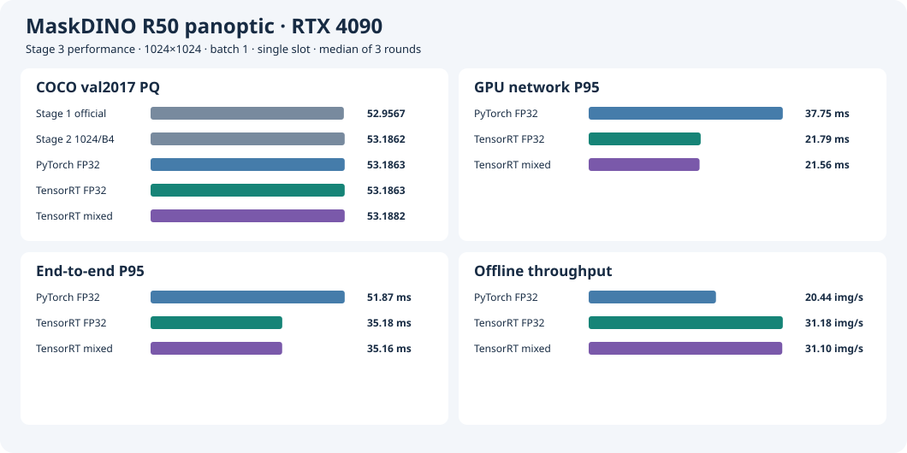
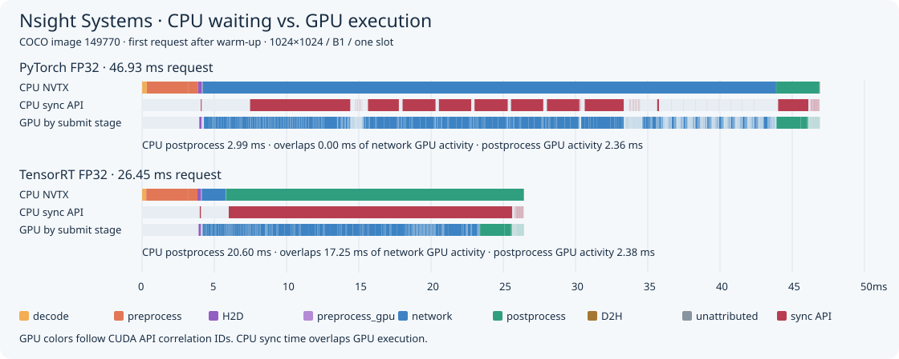

# Stage 3 · Convert the Network to TensorRT

**English** · [简体中文](README.zh-CN.md)

Fix MaskDINO R50 panoptic, 1024×1024, batch=1, and one slot. Preprocessing, normalization, panoptic postprocessing, and the COCO evaluator reuse Stage 2 implementations. The PyTorch FP32 reference and initial TensorRT FP32 acceptance runs disable TF32. The comparison also includes two policies that allow TF32.

## Acceptance Criteria

- Reuse the 32-image Stage 2 validation list. Report maximum absolute error, mean absolute error, and relative L2 for logits, masks, and boxes per image. Tensor shapes must match and all values must be finite. If direct mask relative L2 exceeds 0.02, use Hungarian matching based on downsampled mask cosine distance and class probability distance, and report matched errors. Matching is diagnostic only. Postprocessing uses the original outputs.
- Category-map comparisons include void and distinguish things from stuff. Match same-class segments one-to-one in descending IoU order. Record whether original metadata matches, IoU for each match, and unmatched counts. FP32 requires at least 99.9% per-image category agreement, a match for every segment, and IoU of at least 0.98. For anomalies, save inputs, output tensors, panoptic maps, metadata, and difference images.
- All 5,000 prediction IDs must be unique and match ground truth. FP32 may lose at most 0.05 points each in PQ, PQ_th, and PQ_st against PyTorch B1. Stage 2 B4 PQ of 53.1862 is a separate reference.
- Run each backend on the Stage 2 500-image benchmark list in the same order, with 20 warmups per run and three runs total. End-to-end timing spans in-memory JPEG to CPU panoptic map and metadata availability. Use CUDA events for GPU network time. NVML samples GPU-wide memory every 20 ms, including TensorRT allocations and desktop usage. Record the observed peak.
- Capture Nsight Systems separately. NVTX covers decoding, preprocessing, H2D, GPU normalization, the network, postprocessing, and D2H.

See [Stage 6](../stage6/README.md) for layer profiling and further optimization of the accepted mixed-precision B1 engine.

## Reproduction

Run from a clean commit on the 4090. Prepare the Stage 2 image and data and set `MASKDINO_CHECKPOINT` to the checkpoint path. Use a new ID for each run. Logs and artifacts are in `stage3/runs/<ID>/`. Inside the container, read previous artifacts under `/project/stage3/runs/<ID>/`.

```bash
export MASKDINO_IMAGE=maskdino:stage1
export MASKDINO_CHECKPOINT=/path/to/maskdino_r50_panoptic.pth
data=/path/to/coco2017-panoptic-val
runs=/project/stage3/runs

# Use an unused run ID for each reproduction run.
bash stage3/run.sh "$data" constants-raw repro-constants
bash stage3/run.sh "$data" constants-fixed repro-constants --cpu-constants
bash stage3/run.sh "$data" export-fp32-raw export --backend fp32
bash stage3/run.sh "$data" export-fp32-fixed export --backend fp32 --cpu-constants
bash stage3/run.sh "$data" msda plugin-test
bash stage3/run.sh "$data" build-fp32 build --backend fp32 --onnx "$runs/export-fp32-fixed/network.onnx"
bash stage3/run.sh "$data" align-fp32 align --backend fp32 --engine "$runs/build-fp32/network.engine"
bash stage3/run.sh "$data" pt-pq evaluate
bash stage3/run.sh "$data" fp32-pq evaluate --backend fp32 --engine "$runs/build-fp32/network.engine"
python3 stage3/summarize.py stage3/runs/{pt-pq,fp32-pq}/result.json

for round in 1 2 3; do
  if (( round == 2 )); then order=(fp32 pytorch); else order=(pytorch fp32); fi
  for backend in "${order[@]}"; do
    args=()
    if [[ "$backend" == fp32 ]]; then args=(--engine "$runs/build-fp32/network.engine"); fi
    bash stage3/run.sh "$data" "perf-$backend-r$round" benchmark --backend "$backend" "${args[@]}"
  done
done

```

The unpatched constant reproducer and full export are expected to exit with SIGSEGV. Keep both logs. Each run records the commit, image ID, command, and asset hashes. Generate complete COCO JPEG and PNG SHA-256 manifests from the dataset root with the commands below, then compare their digests with the [environment record](results/environment.json).

```bash
for asset in val2017 panoptic_val2017; do
  find "$asset" -maxdepth 1 -type f -print0 | LC_ALL=C sort -z | xargs -0 sha256sum > "/tmp/stage3-$asset.sha256"
  wc -l "/tmp/stage3-$asset.sha256"
  sha256sum "/tmp/stage3-$asset.sha256"
done
```

## RTX 4090 Run Records

- PyTorch B1 full PQ ran at `9d79baa`. It covered all 5,000 prediction IDs with PQ / PQ_th / PQ_st of 53.186252 / 59.027259 / 44.369638. This accuracy reference uses the default PyTorch stream. The formal benchmark uses the same single explicit stream setup for both backends. [Raw PyTorch B1 records](results/pt-pq/)
- FP32 export, the CUDA constant reproducer, and standalone plugin validation ran at `b4c5eb3`. The unfixed minimal reproducer crashed during ONNX Slice shape inference, and full export also triggered SIGSEGV. The fix moves only exporter-accessed constant attributes to the CPU. The model and inputs stay on the GPU. The minimal reproducer moves 2 attributes and the full FP32 export moves 21. [Minimal reproduction log](results/constants-raw/console.log) · [Full export failure log](results/export-fp32-raw/console.log) · [Fixed export details](results/export-fp32-fixed/export.json)
- NVIDIA MSDA v2 matches the upstream CUDA operator elementwise on random FP32 samples. The samples use 4 scales, 21,760 spatial locations, 8 heads, 32 channels per head, and 300 queries, with some out-of-bounds sampling coordinates. The maximum absolute error between CUDA and grid-sample is \(6.67\times 10^{-7}\). [Official NVIDIA plugin](https://github.com/NVIDIA/TensorRT/tree/main/plugin/multiscaleDeformableAttnPlugin) · [Numerical validation](results/msda/result.json)
- FP32 engine build and 32-image alignment ran at `dd6213a`. Fixed inputs and outputs are all FP32. Engine Inspector confirms 6 encoder and 9 decoder PluginV3 layers, with INT32 shapes and starts inputs. TF32 and auxiliary streams are disabled, and workspace is capped at 4 GiB. [Build details](results/build-fp32/build.json) · [Layer details](results/build-fp32/layers.json)
- All 32 images passed and all metadata matched. The lowest category agreement was 99.99873% and the minimum same-class segment IoU was 0.999608. In 3 images a pair of queries swapped order. Direct mask relative L2 was 4.33%–5.55%, falling to about 0.0003%–0.0013% after matching. [Per-image tensors and postprocessing data](results/align-fp32/result.json)
- The first TensorRT PQ run failed on the first image. Freeing PyTorch network GPU memory deleted `sem_seg_head.num_classes`, which postprocessing reads. Moving the network module to CPU preserved the same postprocessing method and metadata, and the rerun passed. TensorRT FP32 covered 5,000 unique IDs with PQ / PQ_th / PQ_st of 53.186256 / 59.027261 / 44.369646. [Initial failure log](results/fp32-pq-initial-failure/console.log) · [Rerun results](results/fp32-pq-rerun/result.json)

### Mixed-Precision Investigation

Failing samples, comparisons with narrower FP16 scopes, reproduction commands, and unverified hypotheses are archived separately. [Mixed-precision investigation notes](mixed-precision.md)

### Full-Set Accuracy

| 1024×1024 backend | Batch | PQ | PQ_th | PQ_st | Unique prediction IDs |
| --- | ---: | ---: | ---: | ---: | ---: |
| PyTorch FP32 | 1 | 53.186252 | 59.027259 | 44.369638 | 5,000 |
| TensorRT FP32 | 1 | 53.186256 | 59.027261 | 44.369646 | 5,000 |
| Stage 2 PyTorch FP32, historical reference | 4 | 53.186242 | 59.027230 | 44.369656 | 5,000 |

All three TensorRT FP32 PQ metrics meet the acceptance criteria. Each differs from PyTorch B1 by less than 0.00001 points. [FP32 acceptance record](results/pq-fp32-gate.json) · [Stage 2 B4 full evaluation](../stage2/results/evaluate/1024-4/result.json)

Full experiment outputs are on the 4090 at `/home/parker/Code/MaskDINO-TensorRT-stage3/stage3/runs/`, including ONNX, engines, prediction JSON, tensors from anomalous images, and both dataset file hash manifests. The repository archives logs, configurations, Engine Inspector output, metrics, difference images, and raw timing samples.

### Performance

The table compares PyTorch and TensorRT reruns from the same Stage 3 benchmark session to quantify the effect of replacing the network backend. Each backend completed 500 images per run in all three runs, with zero failures. Network GPU P50/P95 uses CUDA events. End-to-end timing runs from in-memory JPEG to CPU panoptic map and metadata. NVML samples GPU-wide memory every 20 ms. The table reports the median observed peak across three runs, including desktop processes and TensorRT allocations.

| Backend | Network P50 / P95 (ms) | End-to-end P50 / P95 (ms) | Throughput (images/s) | Observed GPU-wide peak (GiB) |
| --- | ---: | ---: | ---: | ---: |
| PyTorch FP32 | 37.58 / 37.75 | 48.68 / 51.87 | 20.44 | 5.79 |
| TensorRT FP32 | 20.65 / 21.79 | 31.91 / 35.18 | 31.18 | 5.59 |

- **TensorRT conversion gains.** FP32 conversion reduces network P95 by 15.97 ms (42.3%) and end-to-end P95 by 16.69 ms (32.2%), and increases throughput by 10.74 images/s (52.5%).

Both FP32 performance configurations ran at `18986d2`. [Acceptance summary and per-run ranges](results/summary.json)



### Nsight Systems Baseline

Both FP32 traces ran at `d56ac7a`, with 20 warmups each and the same 32-image list. They were captured separately from formal timings. The TensorRT trace uses the same engine as alignment, PQ, and performance runs. [PyTorch capture](results/trace-pytorch-rerun/) · [TensorRT capture](results/trace-fp32/)



The figure uses raw events from the Nsight Systems SQLite export and shows the same post-warmup COCO image, 149770, for both backends on a shared millisecond axis. The first row is colored by NVTX stage, with recorded CUDA synchronization API intervals overlaid in red. The second row isolates the same calls. CUDA correlation IDs link GPU activity to the NVTX stage that submitted it, and gray marks unattributed events. The three tracks can overlap, so their durations do not add up to end-to-end latency.

For this image, the TensorRT CPU postprocessing NVTX range lasts 20.60 ms, of which CUDA synchronization APIs occupy 19.82 ms. The range overlaps 17.25 ms of previously submitted network GPU activity and contains 2.38 ms of GPU activity submitted by postprocessing. The corresponding PyTorch figures are 2.99 ms, 2.29 ms, 0.00 ms, and 2.36 ms. Green in the first row marks wall-clock time in the postprocessing range outside recorded CUDA synchronization calls. The table covers all 32 images.

| Separate trace metric | PyTorch FP32 | TensorRT FP32 |
| --- | ---: | ---: |
| Share of request time with no recorded CUDA GPU activity | 26.4% | 24.1% |
| GPU activity attributed by CUDA API to network submissions, mean ms/image | 33.74 | 19.79 |
| GPU activity attributed by CUDA API to postprocessing submissions, mean ms/image | 4.33 | 4.34 |
| `cudaStreamSynchronize` calls in the network range | 2,432 | 0 |
| `cudaStreamSynchronize` calls in the postprocessing range | 2,591 | 2,591 |
| GPU activity in the final D2H range, mean ms/image | 0.045 | 0.045 |

TensorRT submits network work asynchronously. GPU network execution extends into the postprocessing NVTX range, and the 24.00 ms median host postprocessing range includes that wait. In both traces, GPU activity attributable to postprocessing is about 4.3 ms/image. CPU decoding and preprocessing take about 5.4 ms/image on average, with no CUDA GPU activity from the process during that time. Postprocessing makes about 81 stream synchronization calls per image. GPU boolean filtering and per-segment `.item()` calls are synchronization points to inspect in the source. [PyTorch aggregation](results/trace-pytorch-rerun/trace-summary.json) · [TensorRT aggregation](results/trace-fp32/trace-summary.json)

The repository includes two raw reports that open in Nsight Systems 2025.5.1 or newer. Each contains all 32 images from the same list. The capture directories also contain the report hash, `nsys stats`, and per-stage aggregates. SQLite exports remain in the corresponding run directories on the 4090. [Raw PyTorch FP32 report](results/trace-pytorch-rerun/trace.nsys-rep) · [Raw TensorRT FP32 report](results/trace-fp32/trace.nsys-rep)

```bash
bash stage3/run.sh "$data" trace-pytorch-rerun trace --backend pytorch
bash stage3/run.sh "$data" trace-fp32 trace --backend fp32 --engine "$runs/build-fp32/network.engine"
for id in trace-pytorch-rerun trace-fp32; do
  capture="stage3/runs/$id"
  nsys export --type=sqlite --output="$capture/trace.sqlite" "$capture/trace.nsys-rep"
  nsys stats --report nvtx_sum,cuda_gpu_kern_sum,cuda_api_sum,cuda_gpu_mem_time_sum "$capture/trace.sqlite"
  python3 stage3/trace_summary.py "$capture/trace.sqlite"
done
python3 stage3/trace_plot.py stage3/runs/{trace-pytorch-rerun,trace-fp32}/trace.sqlite \
  stage3/results/nsight-fp32-timeline.svg --show-cpu-sync
python3 stage3/summarize.py stage3/runs/{pt-pq,fp32-pq}/result.json \
  stage3/runs/perf-{pytorch,fp32}-r{1,2,3}/result.json > stage3/results/summary.json
python3 stage3/plot.py stage3/results
```

#### Recaptures With Explicit CPU Stage Names

Both FP32 traces were recaptured at `de2e61f` with the same 32-image list, 20 warmups, and the same TensorRT engine. Nsight Systems NVTX Range Summary now labels the ranges `CPU / network call (GPU may continue after return)` and `CPU / postprocess (includes CUDA waits)`. The first covers the host call, and the second covers host postprocessing code and its synchronization waits. To inspect one image, expand NVTX, CUDA API, and CUDA stream tracks together. The timeline and statistics above use the original acceptance captures.

- [Updated raw PyTorch FP32 report](results/trace-pytorch-nvtx/trace.nsys-rep) · [Statistics directory](results/trace-pytorch-nvtx/)
- [Updated raw TensorRT FP32 report](results/trace-fp32-nvtx/trace.nsys-rep) · [Statistics directory](results/trace-fp32-nvtx/)

```bash
bash stage3/run.sh "$data" trace-pytorch-nvtx trace --backend pytorch
bash stage3/run.sh "$data" trace-fp32-nvtx trace --backend fp32 --engine "$runs/build-fp32/network.engine"
```

### Raw GPU Reports by Stage

The Stage 3 Python pre- and postprocessing plus TensorRT FP32 pipeline was recaptured on the RTX 4090 at `d88ff9c`. It used the original engine, 1024×1024, B1, one slot, the same 32-image list, and 20 warmups. The NVTX labels are `TensorRT inference`, `postprocess`, and `D2H`, matching the latest Stage 4 raw report. Nsight GPU projection spans include gaps between GPU operations in the same stage.

| Stage | Median GPU projection span (ms/image) |
| --- | ---: |
| TensorRT inference | 19.879 |
| postprocess | 4.737 |
| D2H | 0.051 |

[Updated raw Nsight report](results/trace-fp32-gpu-projection/trace.nsys-rep) · [Nsight GPU Projection statistics](results/trace-fp32-gpu-projection/nsys-gpu-projection.txt)

Use the Stage 4 comparison entry point to reproduce the same Stage 3 pipeline and statistics. Set `data`, `engine`, and `MASKDINO_CHECKPOINT`, then run the commands below.

```bash
bash stage4/run.sh "$data" "$engine" trace-stage3-gpu-projection reference trace
```

## B1/S1 Precision Policy Screening

Compare historical FP32/TF32 off, FP32/TF32 on, and model-level FP16 autocast with TF32 on, using the same PyTorch pre- and postprocessing and PyTorch FP32 B1 reference. Both FP32 engines use the same FP32 ONNX. The mixed engine reuses the `mixed-scope=all` export and retains explicit FP32 regions. All three engines have FP32 input and three FP32 outputs. Both TF32-on builds allow FP32 operators to choose TF32 tactics and use a 4 GiB workspace, zero auxiliary streams, and TensorRT 10.14.1.48. In Engine Inspector, FP32/on has 245 tactic names containing `tf32`, and mixed/on has 125 containing `tf32` and 112 containing `f16f16`. [FP32/on build](results/precision/build-fp32-on/) · [Mixed/on build](results/precision/build-autocast-on/) · [Mixed ONNX export](results/export-mixed-rerun/export.json)

The common per-image thresholds are ≥99.9% category agreement, all segments matched, and same-class IoU ≥0.98. Each full-set metric may fall by at most 0.05 points against [PyTorch FP32 B1](results/pt-pq/result.json).

| Engine | Per-image passes | Lowest category agreement | PQ / PQ_th / PQ_st | ΔPQ / ΔPQ_th / ΔPQ_st (points) |
| --- | ---: | ---: | --- | --- |
| FP32 / TF32 off | 32/32 | 99.9987% | 53.186256 / 59.027261 / 44.369646 | +0.000005 / +0.000002 / +0.000008 |
| FP32 / TF32 on | 27/32 | 99.5868% | 53.174509 / 59.001049 / 44.379732 | −0.011743 / −0.026210 / +0.010094 |
| FP16 mixed precision / TF32 on | 16/32 | 91.6320% | 53.168045 / 59.007167 / 44.354277 | −0.018206 / −0.020092 / −0.015360 |

All three configurations cover **5,000** images and meet the full PQ thresholds. The 5 per-image failures for FP32/on are due solely to category agreement. Model-level autocast passes 26/32 with the original mixed backend thresholds (99% and 0.90) and 16/32 with the common thresholds. Both TF32-on policies remain performance candidates. Neither meets the strict per-image gate. [FP32/on per-image](results/precision/precision-align-on/result.json) · [FP32/on full evaluation](results/precision/precision-pq-on/result.json) · [Mixed/on per-image](results/precision/precision-align-autocast-on/result.json) · [Mixed/on full evaluation](results/precision/precision-pq-autocast-on/result.json)

### Build and Reproduction

Reuse the two existing TF32-on engines on the RTX 4090. Build logs record commit `7fb2a97` for FP32/on and `81a7d61` for mixed/on. Python per-image checks and COCO evaluation ran at `acaf623` with the same image, `sha256:24a707391a7592235352cb91d58e11da356aefe3f7512a698a5402671cd83d1e`. See [Stage 4 run provenance](../stage4/README.md#run-provenance-and-reproduction) for original ONNX and engines. Diagnostic tensors remain on the 4090 at `/home/parker/Code/MaskDINO-TensorRT-precision/repo/stage3/runs/`. Each `build.json` contains build checksums. `NVIDIA_TF32_OVERRIDE` was unset in the container.

Reuse `data`, `runs`, and the checkpoint path above. To rebuild both candidates, place existing FP32 and autocast ONNX files in `stage3/runs/precision-input-{fp32,mixed}/network.onnx`, respectively. If the same engines are available, copy `network.engine` and matching `build.json` to each build directory and start at `align`.

```bash
for backend in fp32 mixed; do
  build="precision-build-$backend-on"
  bash stage3/run.sh "$data" "$build" build --backend "$backend" --batch 1 \
    --tf32 on --onnx "$runs/precision-input-$backend/network.onnx"
  engine="$runs/$build/network.engine"
  bash stage3/run.sh "$data" "precision-align-$backend-on" align --backend "$backend" --engine "$engine"
  bash stage3/run.sh "$data" "precision-pq-$backend-on" evaluate --backend "$backend" --engine "$engine"
done
```

The per-image command saves complete results before returning a failure under the respective backend's thresholds. This round treats per-image differences as diagnostics, runs full PQ independently, and recalculates pass counts with common 99.9%/0.98 thresholds. See [Stage 4](../stage4/README.md#b1s1-precision-policy-comparison) for paired native B1/S1 benchmarks.

### Offline Performance of the Three Engines

Fix the RTX 4090, 1024×1024, B1/S1, Python pre- and postprocessing, and the same 500 in-memory JPEGs in order. Warm up 20 times per run. The table reports three-run medians. FP32/TF32 off uses historical acceptance data. The two TF32-on configurations were measured in the order FP32→mixed, mixed→FP32, and FP32→mixed. Each run completed 500 images with zero failures.

| Engine | Network GPU P95 (ms) | End-to-end P95 (ms) | Offline throughput (images/s) |
| --- | ---: | ---: | ---: |
| FP32 / TF32 off | 21.79 | 35.18 | 31.18 |
| FP32 / TF32 on | 15.75 | 29.92 | 37.06 |
| FP16 mixed precision / TF32 on | 14.56 | 28.71 | 38.78 |

Follow-up benchmarks ran from a clean checkout of `acaf623`, with driver 595.84, CUDA 13.0, TensorRT 10.14.1.48, and the same image as above. Both engine SHA-256 hashes match their respective full PQ runs. Per-run logs record checksums for the image, weights, COCO annotations, and sample list. [Historical TF32-off summary](results/summary.json) · [FP32/TF32-on summary](results/precision/benchmark/on-summary.json) · [Mixed/TF32-on summary](results/precision/benchmark/autocast-on-summary.json) · [Per-image timings and run logs](results/precision/benchmark/)

Reuse the engines and matching `build.json` from full PQ, placing them in `stage3/runs/precision-input-on/` and `stage3/runs/precision-input-autocast-on/`, respectively. Reuse the preceding `data`, `runs`, image, and weights configuration.

```bash
for round in 1 2 3; do
  if (( round == 2 )); then order=(autocast-on on); else order=(on autocast-on); fi
  for variant in "${order[@]}"; do
    backend=fp32
    if [[ "$variant" == autocast-on ]]; then backend=mixed; fi
    bash stage3/run.sh "$data" "precision-benchmark-20261110-$variant-r$round" benchmark \
      --backend "$backend" --engine "$runs/precision-input-$variant/network.engine"
  done
done

for variant in on autocast-on; do
  python3 stage3/summarize.py stage3/results/pt-pq/result.json \
    "stage3/results/precision/precision-pq-$variant/result.json" \
    stage3/runs/precision-benchmark-20261110-"$variant"-r{1,2,3}/result.json
done
```
