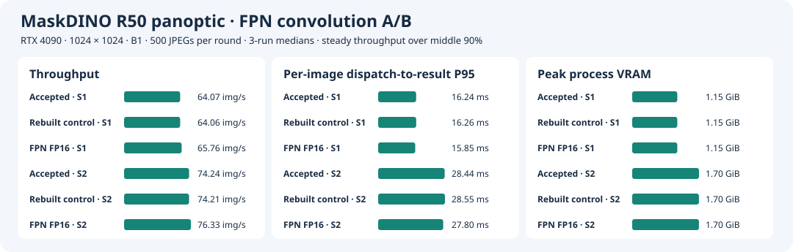

# FPN 3×3 卷积的单层 FP16 对照

[逐层 profiling](layer-profile.md) 将 `/sem_seg_head/layer_1/Conv` 定位为已验收 FP16 混合 B1 engine 中最贵的单层。该卷积在原 ONNX 中只通向最终 `masks`。候选只将这个卷积的输入和权重转成 FP16，并在原 GroupNorm 前将输出转回 FP32。图的其他权重、接口和精度策略沿用原模型。 [ONNX 改写入口](fpn_precision.py) · [原图数据流](results/layer-profile-b1/onnx-paths.txt)

## 无共享 cache 的首轮

RTX 4090、1024×1024、B1，使用参考镜像 `sha256:24a707391a7592235352cb91d58e11da356aefe3f7512a698a5402671cd83d1e`、驱动 595.84、CUDA Toolkit 13.0.88、TensorRT 10.14.1.48。原 ONNX 和权重由 [原构建日志](results/precision/build-autocast-on/console.log) 标识。以 Stage 6 已验收的 plan 为输出参照，同时从同一原 ONNX 重建控制组。新 plan 均从干净提交 `672f0aa` 构建。原生逐图与逐层微基准由 `d9e30d7` 运行，异常图的张量交叉对照由 `9237433` 运行。逐图检查前 GPU 空闲，构建和逐图采样中只出现本次进程。 [候选构建](results/fpn-half-ab/half-build/) · [对照构建](results/fpn-half-ab/control-build/) · [原生逐图记录](results/fpn-half-ab/alignment/console.log)

| 配置 | Conv（ms） | 局部 Add 至 GroupNorm/ReLU（ms） | 网络 GPU P50 / P95（ms） |
| --- | ---: | ---: | ---: |
| 已验收 | 0.906 | 1.280 | 14.091 / 14.105 |
| 重建对照 | 0.909 | 1.283 | 14.113 / 14.132 |
| 单卷积 FP16 | 0.251 | 0.819 | 13.696 / 13.712 |

固定原生预处理后的 COCO 149770，单 stream，预热 1 秒，计时至少 2 秒或 100 次，关闭计时循环的 H2D/D2H。Conv 与局部时间取 `--separateProfileRun` 的逐层均值，局部合计含相邻 Add、Cast、reformat 和 GroupNorm/ReLU 的归属层。网络时间来自独立的普通计时段，只覆盖网络。Inspector 确认候选从 FP32 Winograd 切换至 FP16 Tensor Core，输入转换约 0.094 ms，输出转换融合到 GroupNorm 的相关 kernel。 [逐层原始结果](results/fpn-half-ab/profile/)

重建对照通过 32/32。候选 S1、S2 均通过 31/32，两个 slot 配置的 32 份 map 和 metadata 逐字节一致。COCO `470924` 的类别一致率为 99.7614%，比参照少一个 segment（72 → 71）。使用原生后处理交叉替换输出，已验收或重建对照的 logits 配候选 masks 都保留 72 个 segment，候选 logits 配任意一组 masks 都只得到 71 个。该异常由候选 plan 的 logits 触发。虽然 ONNX 的改动只在 mask 分支，首次两个新 plan 的 Inspector 仍显示四个 backbone 卷积使用了不同的 tactic。 [S1 逐图](results/fpn-half-ab/alignment/fpn-half-align-s1/validation.json) · [S2 逐图](results/fpn-half-ab/alignment/fpn-half-align-s2/validation.json) · [张量交叉对照](results/fpn-half-ab/profile/470924-probe.json)

## 共享 timing cache 的配对

从干净提交 `54e6f15` 用原 ONNX 构建对照，再将同一份 cache 交给单卷积候选。对照输出 cache 的 SHA-256 与候选输入 cache 一致。Inspector 中两份 plan 有 60 个同名卷积或池化层，其中唯一更换 tactic 的是目标卷积。对 `470924`，候选相对重建对照的 logits 和 boxes 逐元素一致，mask 的相对 L2 为 0.001342。九种 logits × masks 组合均保留 72 个 segment。该图的复查支持将首轮异常归到重建后的非目标路径。 [重建对照](results/fpn-half-ab/cached/control/build.json) · [候选](results/fpn-half-ab/cached/fpn-half/build.json) · [张量交叉对照](results/fpn-half-ab/cached/ab/470924-probe.json)

共享 cache 后，目标卷积的逐层均值从 **0.9035 降至 0.2505 ms**，从相邻 Add 到 GroupNorm/ReLU 的合计从 **1.2786 降至 0.8203 ms**。同输入普通网络计时的 GPU P95 为 14.1567 → 13.7502 ms。逐层诊断按同一边界汇总，正式原生计时单独运行。 [共享 cache 逐层明细](results/fpn-half-ab/summary.json)

### 原生 500 图性能

沿用 Stage 6 的 32 张对齐与 500 张计时清单，候选 B1/S1 和 B1/S2 相对已验收 B1 均通过 32/32。统一要求类别一致率至少 99.9%、所有 segment 均配对、同类 IoU 至少 0.98。正式计时按三轮轮换三套 plan 的顺序，每个 slot 预热 20 批。每轮从派发到 CPU panoptic map 和 metadata 就绪记墙钟，网络段用 CUDA events，稳态吞吐取墙钟中间 90%，显存取 NVML 20 ms 的进程采样峰值。18 轮均完成 500 张，零失败。 [对齐与计时原始结果](results/fpn-half-ab/cached/ab/) · [GPU 进程采样](results/fpn-half-ab/cached/compute-processes.csv)

| Plan | 配置 | 网络 GPU P50 / P95（ms） | 端到端 P50 / P95（ms） | 稳态吞吐（图/s） | 峰值显存（GiB） |
| --- | --- | ---: | ---: | ---: | ---: |
| 已验收 | B1/S1 | 14.13 / 14.17 | 15.64 / 16.24 | 64.07 | 1.15 |
| 共享 cache 对照 | B1/S1 | 14.14 / 14.17 | 15.64 / 16.27 | 64.06 | 1.15 |
| 单卷积 FP16 | B1/S1 | **13.73 / 13.76** | **15.24 / 15.85** | **65.76** | 1.15 |
| 已验收 | B1/S2 | 24.75 / 26.32 | 26.81 / 28.44 | 74.24 | 1.70 |
| 共享 cache 对照 | B1/S2 | 24.84 / 26.38 | 26.83 / 28.55 | 74.21 | 1.70 |
| 单卷积 FP16 | B1/S2 | **24.05 / 25.69** | **26.10 / 27.80** | **76.33** | 1.70 |

以上取逐轮中位数。相对共享 cache 对照，候选 B1/S1 的端到端 P95 缩短 **0.42 ms（2.6%）**，B1/S2 的稳态吞吐提高 **2.13 图/s（2.9%）**。这两项在三轮配对中方向一致。显存未观测到实质变化。 [逐轮与中位数](results/fpn-half-ab/summary.json)



### 全量 COCO PQ

共享 cache 候选的 B1/S1 和 B1/S2 各处理 5,000 张 COCO val2017 图片，全部预测 ID 唯一且完整，零运行失败。两个配置的三项分数一致，均满足相对同输入 PyTorch FP32 B1 每项最多下降 0.05 点的门槛。

| 原生配置 | 覆盖 | PQ | PQ Things | PQ Stuff | 相对 PyTorch 三项变化（点） |
| --- | ---: | ---: | ---: | ---: | --- |
| 单卷积 FP16，B1/S1 | 5,000 | 53.17180 | 59.01222 | 44.35606 | −0.01446 / −0.01504 / −0.01357 |
| 单卷积 FP16，B1/S2 | 5,000 | 53.17180 | 59.01222 | 44.35606 | −0.01446 / −0.01504 / −0.01357 |

验收范围为 RTX 4090 的 B1/S1、B1/S2 逐图、全量 PQ 和 500 张离线配对，标记为 `stage3-fpn-fp16-accepted`。在线 P99 和长时间离线吞吐待测。 [S1 结果](results/fpn-half-ab/pq/b1s1/validation.json) · [S2 结果](results/fpn-half-ab/pq/b1s2/validation.json) · [完整评估日志](results/fpn-half-ab/pq/console.log)

## 复现入口

使用 [逐层实验](layer-profile.md#复现) 的输入与镜像，另准备原混合 B1 ONNX、已验收 engine 目录（含 `build.json`）、Stage 6 的 `previous` 目录和 COCO 数据。正式运行从干净 checkout 启动，确认 GPU 空闲。以下命令使用新输出目录，先改写 ONNX，再在两次构建间共享 cache。

```bash
root="$PWD"
export MASKDINO_IMAGE=sha256:24a707391a7592235352cb91d58e11da356aefe3f7512a698a5402671cd83d1e
original=/path/to/mixed-b1/network.onnx
shipped=/path/to/accepted-b1
previous=/path/to/fp16-native-reference
data=/path/to/coco2017-panoptic-val
run="$root/stage3/runs/fpn-cache-repro"
mkdir -p "$(dirname "$run")"
mkdir "$run"
mkdir "$run"/{control,fpn-half,ab}
cp "$original" "$run/control.onnx"
docker run --rm --network=none --user "$(id -u):$(id -g)" -e HOME=/tmp \
  -v "$root:/project:ro" -v "$run:/run" --entrypoint python "$MASKDINO_IMAGE" \
  /project/stage3/fpn_precision.py /run/control.onnx /run/fpn-half.onnx

common=(--rm --gpus all --pid=host --ipc=host --network=none --user "$(id -u):$(id -g)"
  -e HOME=/tmp -e OMP_NUM_THREADS=1 -e DETECTRON2_DATASETS=/coco
  -v "$root:/project:ro" -v "$data:/coco:ro")
for name in control fpn-half; do
  docker run "${common[@]}" -v "$run:/run" -v "$run/$name:/run-output" \
    --entrypoint bash "$MASKDINO_IMAGE" -ec '
      export PYTHONPATH="/project:$PWD${PYTHONPATH:+:$PYTHONPATH}"
      python -m stage3.run build --backend mixed --tf32 on --batch 1 \
        --onnx "/run/$1.onnx" --timing-cache /run/paired.cache
    ' bash "$name"
done

docker run "${common[@]}" -v "$run/ab:/output" -v "$previous:/previous:ro" \
  -v "$shipped:/plans/shipped:ro" -v "$run/control:/plans/control:ro" \
  -v "$run/fpn-half:/plans/fpn-half:ro" --entrypoint bash "$MASKDINO_IMAGE" -ec '
    export PYTHONPATH="/project:$PWD${PYTHONPATH:+:$PYTHONPATH}"
    bash /project/stage5/build.sh /output
    python -u -m stage3.fpn_ab
  '

bash stage5/run.sh "$data" "$previous" "$run/fpn-half/network.engine" \
  fpn-cache-repro-pq pq 1s1 1s2 --pq-reference pytorch
```

单层微基准另起进程，在上述镜像内加载三套 plan，使用已生成的 `149770.f32`。异常图复查复用 `stage4/build.sh` 生成的 `restore-check.so`，以及原生预处理生成的 `470924.f32`。

```bash
trtexec --loadEngine=/plans/fpn-half/network.engine --loadInputs=image:/inputs/149770.f32 \
  --infStreams=1 --noDataTransfers --warmUp=1000 --duration=2 --iterations=100 \
  --percentile=50,95 --separateProfileRun --dumpProfile --exportProfile=fpn-half.layers.json

python -m stage3.fpn_probe /inputs/470924.f32 480 640 768 1024 \
  /previous/perf-native-r1/things.txt /output/restore-check.so \
  /plans/{shipped,control,fpn-half}/network.engine --output /output/470924-probe.json
```

完整 run 目录位于 4090 的 `/home/parker/Code/MaskDINO-TensorRT-layer-profile-20261110/repo/`，对应 `stage3/runs/fpn-cache-pair` 和 `stage5/runs/fpn-cache-pq`。原生逐请求数据使用固定 JPEG 清单和同一 C++ 二进制。
