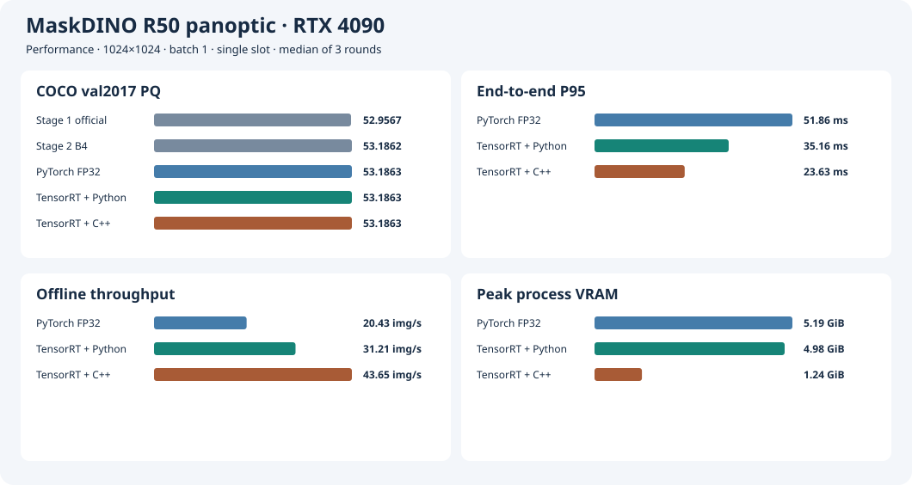
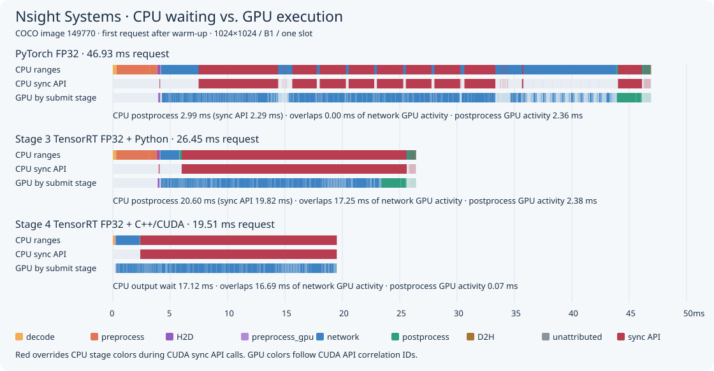

# Stage 4 · Implement Pre- and Postprocessing in C++/CUDA

**English** · [简体中文](README.zh-CN.md)

Reuse the Stage 3 MaskDINO R50 panoptic TensorRT engines. Fix 1024×1024, batch 1, one slot, and one explicit CUDA stream. The migration baseline disables TF32, and two additional precision policies allow it. The native entry point, `maskdino-native`, reads in-memory JPEGs and returns a CPU int32 panoptic map and segment metadata. The runtime links TensorRT, CUDA, libjpeg, NVML, and system libraries. Python handles orchestration, the reference pipeline, alignment, and COCO evaluation.

## Implementation and Acceptance

1. Decode RGB with libjpeg on the CPU and apply EXIF orientation. CUDA resizes with Pillow-compatible pixel centers, bilinear filter support, and two uint8 rounding steps. It then pads the right and bottom with 128 and normalizes to NCHW FP32. It retains the Stage 2 long-side size and ties-to-even rounding. RGB values, valid dimensions, and input tensors match elementwise across 32 COCO and 14 synthetic JPEGs. The synthetic JPEGs cover orientations 1–8, downscaling, grayscale, and CMYK. [Per-image data](results/native-check/preprocess.jsonl)
2. CUDA restores masks with `align_corners=False`. For each original image pixel, first find the bilinear neighbors on the cropped 1024 grid, then compute those grid values from the 256×256 mask. This preserves the order of both interpolations and the intermediate crop. All 7 synthetic CUDA and PyTorch comparisons match elementwise. [Interpolation checks](results/native-check/restore.jsonl)
3. CUDA filters queries with `sigmoid(logit) > 0.25` and assigns pixels using the product of mask probability and softmax probability at temperature 0.06. Ties go to the earliest query. Apply area thresholds of `mask probability >= 0.5` and `assigned / original >= 0.8`, number segments in query order, and merge same-class stuff. The final stream synchronization waits for the map and metadata to reach the CPU.
4. Compare the full native pipeline and same-tensor postprocessing separately on the Stage 2 list of 32 images. Both require ≥99.9% category agreement, all segments matched, and same-class IoU ≥0.98 per image. The first version failed on 4 images, and the same-tensor comparison reproduced the differences. Stage 3 uses `SEMANTIC_CE_LOSS=false`, so all 133 output columns are valid categories. The first CUDA version incorrectly filtered the last valid category, 132. After correction, both comparisons pass 32/32, with 100% category agreement and segment IoU for every image and identical metadata. [First version](results/native-align/result.json) · [Same-tensor diagnosis](results/isolate/result.json) · [After correction](results/native-align-fixed/result.json)
5. Use 7 additional synthetic cases for elementwise checks covering empty candidates, a classification score of exactly 0.25, a mask threshold of exactly 0.5, class 132, pixel score ties, coverage equal to and below 0.8, and merging same-class stuff. All 32 alignment images and these checks passed on rerun at `9fe64e5`. [Edge cases and rerun results](results/native-boundaries-fixed/result.json)
6. Use the full COCO 2017 panoptic validation set. Require 5,000 unique prediction IDs matching ground truth and a drop of at most 0.05 points each in PQ, PQ_th, and PQ_st relative to Stage 3 FP32.

## Reproduction

Use the [Stage 3 reference environment](../stage3/results/environment.json). Formal runs use an RTX 4090. Prepare the same image, checkpoint, dataset directory, and Stage 3 FP32 engine. The launcher verifies input assets, requires a clean Git checkout, and writes the run commit, image ID, command, and checksum summary to `stage4/runs/<ID>/console.log`. Use each run ID only once.

```bash
export MASKDINO_IMAGE=maskdino:stage1
export MASKDINO_CHECKPOINT=/path/to/maskdino_r50_panoptic.pth
data=/path/to/coco2017-panoptic-val
engine=/path/to/stage3/runs/build-fp32/network.engine

bash stage4/run.sh "$data" "$engine" native-check native check
bash stage4/run.sh "$data" "$engine" native-align-fixed native align
for round in 1 2 3; do
  case "$round" in
    1) order=(pytorch reference native) ;;
    2) order=(reference native pytorch) ;;
    3) order=(native pytorch reference) ;;
  esac
  for backend in "${order[@]}"; do
    bash stage4/run.sh "$data" "$engine" "perf-$backend-r$round" "$backend" benchmark
  done
done
bash stage4/run.sh "$data" "$engine" trace-reference reference trace
bash stage4/run.sh "$data" "$engine" trace-native native trace
bash stage4/run.sh "$data" "$engine" native-pq native evaluate

python3 stage4/summarize.py stage4/results
python3 stage3/trace_plot.py stage3/runs/{trace-pytorch-rerun,trace-fp32}/trace.sqlite \
  stage4/results/nsight-timeline.svg --native stage4/runs/trace-native/trace.sqlite \
  --labels 'PyTorch FP32' 'Stage 3 TensorRT FP32 + Python' --split-legacy-output --show-cpu-sync
```

Plotting commands read archived `result.json` files and SQLite from capture directories. The native build targets sm_89. Validation and evaluation tools use the same Stage 1 development image. To call the native executable directly, use the generated COCO thing list and TSV image list. See the [native entry point](main.cu) for arguments and the [dynamic linking record](results/native-align-fixed/runtime-libraries.txt) for runtime dependencies.

## Full-Set Accuracy

| TensorRT FP32 pipeline | PQ | PQ_th | PQ_st | Unique prediction IDs |
| --- | ---: | ---: | ---: | ---: |
| Stage 3 Python pre- and postprocessing | 53.186256 | 59.027261 | 44.369646 | 5,000 |
| Stage 4 C++/CUDA | 53.186256 | 59.027261 | 44.369645 | 5,000 |

Prediction IDs for all 5,000 images match ground truth exactly. Each PQ difference is less than 0.000001 points, meeting the 0.05-point acceptance limit. Inference generated all maps and metadata at `22dc649`. The first scoring attempt passed the original COCO `id` directly to the evaluator, which expects `image_id`. Commit `ec0f13d` fixed the field mapping and scored the same predictions. [Inference records](results/native-pq/console.log) · [Scoring records](results/native-pq/evaluation.log) · [Metrics and differences](results/native-pq/result.json)

All formal benchmarks, Nsight captures, and the first corrected 32-image alignment ran at `22dc649`. Initial preprocessing and interpolation checks ran at `7bf1b65`, and their implementation was reused. `/home/parker/Code/MaskDINO-TensorRT-stage4-formal/stage4/runs/` on the RTX 4090 retains predictions, CUDA executables, and raw SQLite. All JPEGs and PNGs in both dataset directories match the Stage 3 SHA-256 manifests. [Dataset verification](results/dataset-verification.txt)

## Timing and GPU Memory Definitions

Run each of the three pipelines three times, rotating execution order. Repeat the first image for 20 warmups, then measure the same 500 Stage 2 images in order, with JPEGs preloaded in memory. CUDA events bracket network execution. End-to-end wall-clock time spans in-memory JPEG to CPU map and metadata availability. Steady-state throughput divides completions in the full measurement window by wall-clock time. Writing evaluation outputs and computing PQ happen in separate runs.

All three pipelines sample NVML CUDA compute process entries by host PID. The container uses the host PID namespace. Sample at 20 ms intervals and record the observed inference process peak, including the network, pre- and postprocessing, and CUDA context. The table reports three-run medians in GiB. Stage 2 PyTorch allocator allocated/reserved figures and Stage 3 GPU-wide usage retain their original definitions.

### RTX 4090 Performance

PyTorch and Python/TensorRT in the table were rerun alongside the native pipeline during Stage 4.

| Pipeline | Network GPU P50 / P95 (ms) | End-to-end P50 / P95 (ms) | Throughput (images/s) | Observed peak process GPU memory (GiB) |
| --- | ---: | ---: | ---: | ---: |
| PyTorch FP32 | 37.57 / 37.81 | 48.70 / 51.86 | 20.43 | 5.19 |
| Python pre- and postprocessing + TensorRT FP32 | 20.63 / 21.76 | 31.89 / 35.16 | 31.21 | 4.98 |
| C++/CUDA + the same TensorRT engine | 21.56 / 21.81 | 22.92 / 23.63 | 43.65 | 1.24 |

Against the Python/TensorRT pipeline rerun in this stage, the native pipeline reduces end-to-end P95 by **32.8%**, raises throughput by **39.8%**, and reduces observed peak process GPU memory by **75.1%**. Network P95 increases by 0.05 ms and P50 by 0.93 ms. All nine runs completed 500 images with zero failures. [Per-run summary](results/summary.json)



## B1/S1 Precision Policy Comparison

Fix the RTX 4090, 1024×1024, one slot, native C++/CUDA pre- and postprocessing, and the same 500 JPEGs. Reuse two existing paired native experiments. Each pair uses 20 warmups per run, alternating reference and candidate over three rounds. Every run completes 500 images with zero failures. The table reports three-run medians. Both pairs have their own FP32/TF32-on data, and differences are calculated within each pair.

| Paired comparison | Engine | Network GPU P95 (ms) | End-to-end P95 (ms) | Offline throughput (images/s) | Peak process GPU memory (MiB) |
| --- | --- | ---: | ---: | ---: | ---: |
| TF32 toggle | FP32 / TF32 off | 21.73 | 23.59 | 43.71 | 1,270 |
| TF32 toggle | FP32 / TF32 on | 15.71 | 17.74 | 58.26 | 1,270 |
| Model-level autocast | FP32 / TF32 on | 15.71 | 17.74 | 58.27 | 1,270 |
| Model-level autocast | FP16 mixed precision / TF32 on | 14.40 | 16.45 | 63.04 | 1,176 |

Allowing TF32 reduces FP32 end-to-end P95 by **24.8%** and increases throughput by **33.3%**. With TF32 allowed in both configurations, model-level autocast cuts end-to-end P95 by another **1.29 ms** and increases throughput by **8.2%**. [TF32 per-run summary](results/precision/tf32-pair/summary.json) · [Autocast per-run summary](results/precision/autocast-pair/summary.json)

### Python and C++/CUDA Outputs From the Same Engine

Generate Python and native C++/CUDA outputs with the same candidate engine. The follow-up reuses the original 32 native predictions and adds Python predictions, same-tensor postprocessing comparisons, and 7 postprocessing edge-case checks. FP32/off uses the historically accepted engine. The two TF32-on candidates completed same-engine checks at `125f8a5` and `cc64d1b`, respectively.

| Engine | Python vs. native per-image passes | Same-tensor postprocessing passes | Minimum category agreement / same-class IoU | Metadata match |
| --- | ---: | ---: | --- | ---: |
| [FP32 / TF32 off](results/native-align-fixed/result.json) | 32/32 | 32/32 | 100% / 1.0 | 32/32 |
| [FP32 / TF32 on](results/precision/precision-align-on/result.json) | 32/32 | 32/32 | 100% / 1.0 | 32/32 |
| [FP16 mixed precision / TF32 on](results/precision/precision-align-autocast-on/result.json) | 32/32 | 32/32 | 100% / 1.0 | 32/32 |

The largest absolute difference across the three PQ metrics between native and Python full-set results is below 0.000002 points for both candidates.

### Cross-Precision Differences in the Native Pipeline

The following comparison fixes native pre- and postprocessing and changes the engine. Per-image checks require ≥99.9% category agreement, all segments matched, and same-class IoU ≥0.98. Each full-set PQ metric may fall by at most 0.05 points against [Stage 3 PyTorch FP32 B1](../stage3/results/pt-pq/result.json).

| Configuration | Native per-image reference | Per-image passes | Lowest category agreement | PQ / PQ_th / PQ_st | ΔPQ / ΔPQ_th / ΔPQ_st vs. PyTorch |
| --- | --- | ---: | ---: | --- | --- |
| FP32 / TF32 on | FP32 / TF32 off | 27/32 | 99.5868% | 53.174508 / 59.001047 / 44.379732 | −0.011744 / −0.026211 / +0.010094 |
| FP16 mixed precision / TF32 on | FP32 / TF32 on | 15/32 | 91.6264% | 53.168045 / 59.007167 / 44.354277 | −0.018207 / −0.020092 / −0.015361 |

Both candidates cover **5,000** unique ground-truth image IDs and pass all three full PQ thresholds. The 5 TF32-on per-image failures concern category agreement only. All segments match and meet the IoU threshold. Mixed precision has 9 images with unmatched segments or IoU below 0.98, with the lowest category agreement on `435081`. [TF32 per-image results and difference images](results/precision/tf32-pair/) · [Autocast per-image results and difference images](results/precision/autocast-pair/)

### Run Provenance and Reproduction

Runs used an RTX 4090 on 2026-11-10 with driver 595.84, CUDA 13.0, and TensorRT 10.14.1.48. The two native pairs ran at `26f56c8` and `81a7d61`, respectively. Full commits and image IDs are in the logs. The TF32 pair uses off/on engines built from the same FP32 ONNX. Its TF32-off engine SHA differs from the earlier native acceptance engine. The mixed-precision pair reuses the TF32-on engine. Original engines and predictions are on the 4090 under `/home/parker/Code/MaskDINO-TensorRT-stage7/repo/`, in `stage3/runs/stage7-build-{off,on,autocast-on}/` and `stage7/runs/{tf32-pair,autocast-tf32-on}/`. [TF32 native run log](results/precision/tf32-pair/console.log) · [Autocast native run log](results/precision/autocast-pair/console.log) · [Paired off build record](results/precision/tf32-pair/build-off/)

For reproduction, reuse the image, weights, data, and engines from the [Stage 3 precision builds](../stage3/README.md#b1s1-precision-policy-screening). Put each engine beside its matching `build.json` and run the commands below. For each native pair, alternate reference and candidate timing runs in that order for three rounds.

```bash
bash stage4/run.sh "$data" "$engine" precision-align-new native align
bash stage4/run.sh "$data" "$engine" precision-pq-new native evaluate
bash stage4/run.sh "$data" "$engine" precision-perf-r1 native benchmark
```

## Nsight Systems

The timeline aligns the [two Stage 3 FP32 baselines](../stage3/README.md#nsight-systems-baseline) with the formal Stage 4 native trace on one axis. All three captures use the same 32 COCO images and 20 warmups. The figure shows image 149770, the first after warmup. The first row is colored by NVTX stage with CUDA synchronization API ranges overlaid in red. The second row isolates those calls. CUDA correlation IDs group GPU activity by submitting stage. Prepare the first two SQLite exports using the Stage 3 reproduction commands and export `stage4/runs/trace-native/trace.nsys-rep` the same way before plotting.



The table uses the Python reference and native traces from the formal Stage 4 experiment, with 32 images per pipeline.

| 32-image trace metric | Python + TensorRT | C++/CUDA + TensorRT |
| --- | ---: | ---: |
| Mean GPU network activity (ms/image) | 20.14 | 20.49 |
| Mean GPU postprocessing activity (ms/image) | 4.34 | 0.11 |
| `cudaStreamSynchronize` calls in H2D / postprocessing / D2H | 32 / 2,591 / 32 | 0 / 0 / 32 |
| Share of request time with no recorded CUDA GPU activity | 24.0% | 6.9% |
| Mean final GPU D2H activity (ms/image) | 0.045 | 0.044 |

Native postprocessing reads TensorRT outputs directly, processes only queries that pass filtering, fuses both interpolations with pixel assignment, and generates the final ID map and metadata on the GPU. The CPU submits postprocessing and D2H together, then waits for the entire stream at the final D2H. The original trace wraps the final copy and synchronization in one D2H NVTX range. The figure separates them for the native pipeline using SQLite CUDA API events. Across 32 images, median combined CPU submission time for two `cudaMemcpyAsync` calls is **0.004 ms/image**. Median CPU wait in `cudaStreamSynchronize` is **20.53 ms/image**. The final GPU D2H copy averages **0.044 ms/image**. For the first image in the figure, a 17.12 ms wait overlaps 16.69 ms of GPU network activity. [Python aggregation](results/trace-reference/trace-summary.json) · [C++ aggregation](results/trace-native/trace-summary.json)

### GPU Statistics by Stage in the Standard Asynchronous Pipeline

The native pipeline was recaptured on the RTX 4090 at `deea1d2` using the same engine, the same 32 images in order, and 20 warmups. It uses standard `native trace` mode, which synchronizes once per image at output delivery. NVTX stages are `TensorRT inference`, `postprocess`, and `D2H`.

Nsight's `nvtx_gpu_proj_sum` associates NVTX stages with GPU work via CUDA submission calls. It measures projection spans from the first GPU operation in a stage to the end of the last, including gaps between operations. The table reads the `Proj Med` and `Proj Avg` columns. Expand GPU stream kernel and memory tracks in the GUI to inspect actual GPU operations.

| Stage | Median GPU projection span (ms/image) | Mean GPU projection span (ms/image) |
| --- | ---: | ---: |
| TensorRT inference | 20.264 | 20.692 |
| postprocess | 0.083 | 0.116 |
| D2H | 0.050 | 0.045 |

[Raw Nsight report](results/trace-native-gpu-projection/trace.nsys-rep) · [Nsight GPU Projection statistics](results/trace-native-gpu-projection/nsys-gpu-projection.txt) · [Summary by GPU activity attribution](results/trace-native-gpu-projection/trace-summary.json)

The current Stage 4 archive includes the raw report above. The equivalent Python/TensorRT capture is in the [Stage 3 GPU report by stage](../stage3/results/trace-fp32-gpu-projection/trace.nsys-rep).
