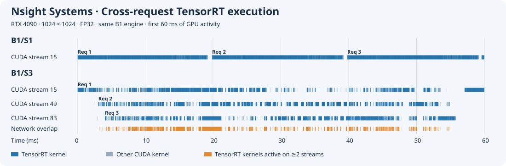
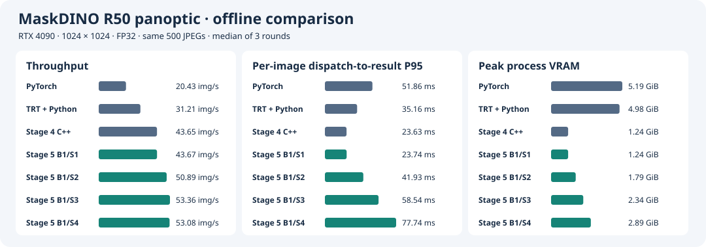
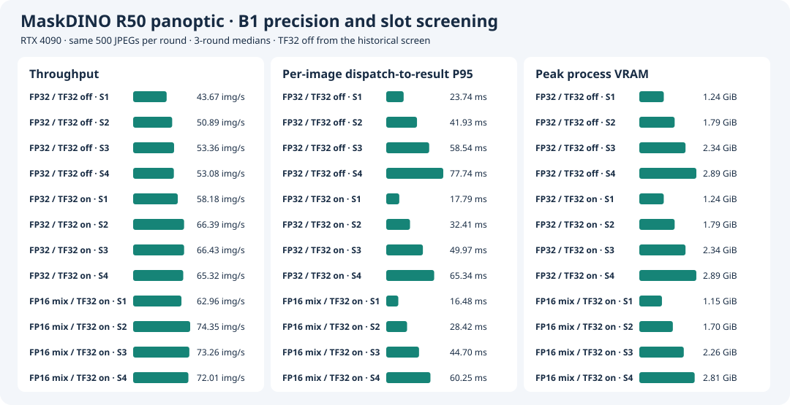

# Stage 5 · Run Requests Concurrently With Multiple CUDA Streams

**English** · [简体中文](README.zh-CN.md)

Fix the RTX 4090, MaskDINO R50 panoptic, and 1024×1024. Reuse the Stage 4 B1 engine and C++/CUDA pre- and postprocessing. Each request reads one in-memory JPEG and returns an original-size CPU panoptic map and segment metadata. Fix batch at 1 and sweep only the slot count. Start with the FP32/TF32-off pipeline reference, then compare two precision policies that allow TF32. Historical batch and online workload selection is in `stage6/README.md` at commit `fcc7dc9`. [Stage 6](../stage6/README.md) on this branch continues with network hotspots and targeted mixed precision.

## Slot Lifecycle

All workers in a process share a deserialized engine. Each slot has a long-lived CPU worker with its own CUDA stream, TensorRT execution context, writable I/O, pre- and postprocessing workspaces, and pinned staging buffers. The worker submits preprocessing, `enqueueV3`, postprocessing, and D2H on its slot's stream. After waiting for the final D2H, it copies the map and metadata into a CPU result object and reuses the slot. Other workers can submit or collect results during the wait. The runtime requires zero engine auxiliary streams. The overlap in the chart comes from independent request slots. [Scheduler](main.cu) · [Native runtime](../stage4/runtime.cu)

## Nsight Systems

Capture each trace independently from `c8d4796` using the same 32 COCO images and 20 warmup batches per slot. The two traces show the first 60 ms from their respective first GPU kernels. Blue denotes kernels linked by CUDA correlation ID to the `TensorRT inference` NVTX range on the same CPU thread. Gray marks other kernels. Orange marks intervals with TensorRT kernels running on at least two streams at once. Request numbers follow the start order of inference submission ranges in each trace.



Three different workers pick up the first three B1/S3 requests when the saturated offline queue starts. Times below are relative to the first GPU kernel in that trace. Each span begins with the request's first TensorRT kernel and ends with its last.

| Request | CUDA stream | First network kernel start (ms) | Last network kernel end (ms) |
| --- | ---: | ---: | ---: |
| Req 1 | 15 | 0.06 | 53.22 |
| Req 2 | 49 | 3.11 | 54.84 |
| Req 3 | 83 | 4.08 | 55.73 |

The three request spans intersect for **49.15 ms**. Based on actual kernel intervals for the first three requests, exactly two streams ran network kernels at once for **13.91 ms**, and all three ran at once for **9.28 ms**.

The table covers the full trace. The denominator for each overlap percentage is the time during which at least one kernel in the corresponding category was active. Kernel idle time is measured from the first to the last kernel.

| 32-image trace metric | B1/S1 | B1/S3 |
| --- | ---: | ---: |
| CUDA streams with kernels | 1 | 3 |
| First-to-last kernel window (ms) | 704.10 | 607.37 |
| Kernel idle time (ms) | 52.11 | 7.58 |
| Multi-stream kernel overlap (full pipeline) | 0.0% | 38.0% |
| Multi-stream kernel overlap (TensorRT network only) | 0.00% | 37.32% |
| Median per-request TensorRT GPU projection span (ms) | 19.95 | 53.22 |
| `cudaStreamSynchronize` calls | 32 | 32 |

Each configuration runs 16,608 kernels, 16,416 of them associated with TensorRT inference. B1/S3 completes the total GPU work sooner while increasing the network projection span per request. The GPU projection span includes gaps between the first and last GPU operations. [B1/S1 raw report](results/trace/b1s1.nsys-rep) · [B1/S3 raw report](results/trace/b1s3.nsys-rep) · [Full-pipeline overlap summary](results/trace/b1s3.overlap.json)

## RTX 4090 Performance and Accuracy

### 500-Image Offline Screen

Runs used `ecf9e25`. The table reports three-run medians, with 500 images and zero failures per run. The same JPEG list is preloaded before timing, with 20 warmup batches per slot. Per-image P95 spans slot dispatch to CPU result availability. Peak process GPU memory is sampled by NVML every 20 ms.

| Configuration | Throughput (images/s) | Per-image P95 (ms) | Peak process GPU memory (GiB) |
| --- | ---: | ---: | ---: |
| B1/S1 | 43.67 | 23.74 | 1.24 |
| B1/S2 | 50.89 | 41.93 | 1.79 |
| B1/S3 | 53.36 | 58.54 | 2.34 |
| B1/S4 | 53.08 | 77.74 | 2.89 |

In the same session, Stage 4 native B1/S1 reached 43.77 images/s and the new scheduler at B1/S1 reached 43.67 images/s. Relative to the new scheduler at B1/S1, B1/S3 increased throughput by 22.2%. S4 further increased latency and GPU memory use, so S3 advanced to the sustained offline benchmark. [Per-run B1 results](results/screen/summary.json)



### Sustained Offline Benchmark

At `c8d4796`, repeat the same 500-image list 35 times. Run each configuration three times with 17,500 images per run and rotate execution order. Steady-state throughput uses the middle 90% of total completion time. The table reports three-run medians.

| Configuration | Steady-state throughput (images/s) | Total completion time (s) | Per-image P95 (ms) | Peak process GPU memory (GiB) | Failures across three runs |
| --- | ---: | ---: | ---: | ---: | ---: |
| B1/S1 | 43.74 | 400.18 | 23.68 | 1.24 | 0 / 52,500 |
| B1/S3 | 53.22 | 328.78 | 58.31 | 2.34 | 0 / 52,500 |

B1/S3 improves steady-state throughput by **21.7%** and reduces total completion time for the fixed workload by **17.8%**. [Per-run results](results/offline/summary.json) · [Per-request log checksums](results/offline/raw.sha256)

### Correctness

The 32-image alignment uses Stage 4 category agreement, segment matching, and IoU thresholds. B1/S1, S2, S3, and S4 all pass. The full B1/S1, S2, and S3 evaluations ran at `c8d4796` and each covered 5,000 unique COCO prediction IDs. All three produced PQ / PQ_th / PQ_st of **53.186256 / 59.027261 / 44.369645**, matching Stage 4. Per-image logs are stored in `stage6/results/check/console.log` and `stage6/results/check-b8/b1s3/validation.json` at `fcc7dc9`. [Full PQ](results/pq/)

### B1 × S1–S4 Screen for Three Precision Policies

Compare FP32/TF32 off, FP32/TF32 on, and model-level autocast FP16/TF32 on at 1024×1024 with C++/CUDA pre- and postprocessing and a saturated offline workload. For each of the two follow-up candidates, rotate S1–S4 order across three runs. Each run preloads the same 500 JPEGs in the same order and warms up with 20 batches per slot. P95 spans slot dispatch to CPU result availability. Throughput uses full-run wall-clock time. NVML samples peak process GPU memory every 20 ms. FP32/off uses the historical screen above, which allows comparison of scaling trends within each group. The policies were measured in separate groups, so differences between policies describe cross-group measurements.

| Precision policy | Slot | Throughput (images/s) | Per-image P95 (ms) | Peak process GPU memory (GiB) | Per-image check |
| --- | ---: | ---: | ---: | ---: | ---: |
| FP32 / TF32 off | S1 | 43.67 | 23.74 | 1.24 | 32/32 |
| FP32 / TF32 off | S2 | 50.89 | 41.93 | 1.79 | 32/32 |
| FP32 / TF32 off | S3 | 53.36 | 58.54 | 2.34 | 32/32 |
| FP32 / TF32 off | S4 | 53.08 | 77.74 | 2.89 | 32/32 |
| FP32 / TF32 on | S1 | 58.18 | 17.79 | 1.24 | 32/32 |
| FP32 / TF32 on | S2 | 66.39 | 32.41 | 1.79 | 32/32 |
| FP32 / TF32 on | S3 | 66.43 | 49.97 | 2.34 | 32/32 |
| FP32 / TF32 on | S4 | 65.32 | 65.34 | 2.89 | 32/32 |
| FP16 mixed precision / TF32 on | S1 | 62.96 | 16.48 | 1.15 | 32/32 |
| FP16 mixed precision / TF32 on | S2 | 74.35 | 28.42 | 1.70 | 32/32 |
| FP16 mixed precision / TF32 on | S3 | 73.26 | 44.70 | 2.26 | 32/32 |
| FP16 mixed precision / TF32 on | S4 | 72.01 | 60.25 | 2.81 | 32/32 |

The two follow-up groups completed **12,000** timed image requests with zero failures. FP32/on reached **66.39** and **66.43 images/s** at S2 and S3, respectively. S2 had **17.56 ms** lower per-image P95 and **0.55 GiB** lower peak process GPU memory. Mixed/on peaked at **74.35 images/s** at S2, **18.1%** above its S1 throughput.

Follow-up runs used `cc64d1b`, an RTX 4090, driver 595.84, CUDA 13.0, TensorRT 10.14.1.48, and the Stage 4 reference container. For each candidate, use its own Stage 4 B1/S1 native predictions as the reference. S1–S4 require ≥99.9% category agreement, all segments matched, and same-class IoU ≥0.98. [FP32/on per-image results](results/precision/on/check/) · [FP32/on per-run timings](results/precision/on/screen/) · [Mixed/on per-image results](results/precision/autocast-on/check/) · [Mixed/on per-run timings](results/precision/autocast-on/screen/)



### Reproduce the Precision Screen

Reuse the image, data, and engines from the [Stage 3 candidate builds](../stage3/README.md#b1s1-precision-policy-screening). Select one candidate at a time. Set `previous/native-align-fixed` to the directory containing its 32 Stage 4 native predictions, and put `manifest.tsv` and `things.txt` from the Stage 4 native benchmark in `previous/perf-native-r1`. Place the files in the directories actually mounted. The follow-up reused both Stage 4 native references to avoid regenerating predictions and repeating native timings.

```bash
bash stage5/run.sh "$data" "$previous" "$engine" precision-check-new check 1s1 1s2 1s3 1s4
bash stage5/run.sh "$data" "$previous" "$engine" precision-screen-new screen 1s1 1s2 1s3 1s4 --skip-stage4
python3 -m stage5.plot stage5/results --precision-comparison stage5/results/precision-comparison.svg
```

Per-request TSVs, acceptance JSON, and run logs are in the results directories. Full predictions and run directories remain on the 4090 host at `/home/parker/Code/MaskDINO-TensorRT-precision/native-repo/stage5/runs/`.

## Reproduction

Use a clean checkout on the RTX 4090. Reuse the [Stage 3 reference image](../stage3/results/environment.json), COCO data, original checkpoint, and fixed B1 engine. Set `previous` to the [Stage 4 formal run directory](../stage4/README.md#reproduction), which must contain `perf-native-r1` and `native-align-fixed`. Use each run ID only once. The commands below use the [launcher](run.sh) shared by both stages.

```bash
export MASKDINO_IMAGE=maskdino:stage1
data=/path/to/coco2017-panoptic-val
engine=/path/to/stage3/runs/build-fp32/network.engine
previous=/path/to/stage4/runs

bash stage5/run.sh "$data" "$previous" "$engine" slots-check check 1s1 1s2 1s3 1s4
bash stage5/run.sh "$data" "$previous" "$engine" slots-screen screen 1s1 1s2 1s3 1s4
bash stage5/run.sh "$data" "$previous" "$engine" slots-offline offline 1s1 1s3 --repeats 35
bash stage5/run.sh "$data" "$previous" "$engine" slots-pq pq 1s1 1s2 1s3
bash stage5/run.sh "$data" "$previous" "$engine" slots-trace trace 1s1 1s3
```

To redraw the timeline from existing reports, export SQLite offline. The commands below use the Nsight Systems CLI and Python 3.

```bash
for config in b1s1 b1s3; do
  nsys export --type=sqlite --output="/tmp/$config.sqlite" "stage5/results/trace/$config.nsys-rep"
done
python3 -m stage5.trace_plot /tmp/b1s1.sqlite /tmp/b1s3.sqlite stage5/results/nsight-slot-overlap.svg
```

The 500-image screen, sustained benchmark, PQ evaluation, and traces use results from before the stage split. The relevant run commits are listed in each section. See the [acceptance tag `stage5-batch-slots-accepted`](https://github.com/Parker-Lyu/MaskDINO-TensorRT/tree/stage5-batch-slots-accepted/stage5) for historical entry points, logs, and layout.
