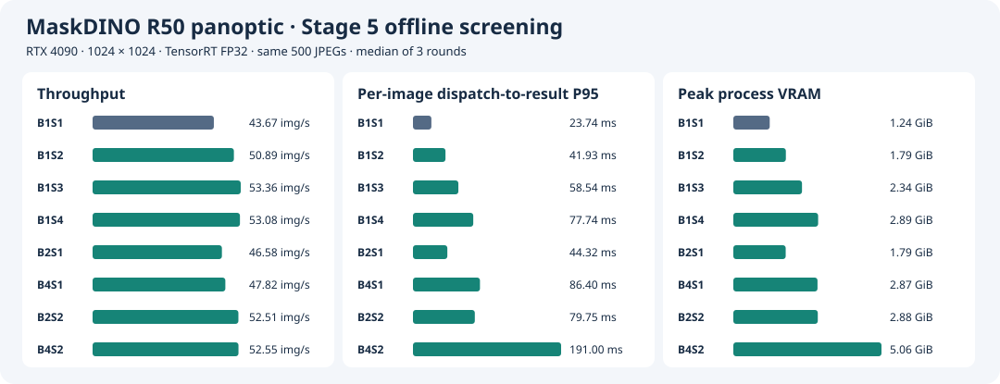

# Stage 5 · 多 slot 与 batch 联合优化

固定 RTX 4090、MaskDINO R50 panoptic、1024×1024、TensorRT FP32、关闭 TF32、相同权重和 Stage 4 C++/CUDA 前后处理。每个请求对应一张内存 JPEG，输出原图尺寸 CPU panoptic map 和 segment metadata。比较两种运行目标。

- **在线**在给定 P99、失败率和显存预算下，找到可持续的最大请求率。轻载先测 B1/S1 的响应速度，再看增加 slot 或小 batch 是否扩大达标负载区间。
- **离线**在显存与正确性约束内最大化稳态吞吐，并报告固定任务集的总完成时间。B1 多 slot、较大 batch 单 slot 和二者组合都参与比较。

## 复现入口

在 RTX 4090 上使用干净 checkout。沿用 [Stage 3 参考镜像](../stage3/results/environment.json)、COCO 数据、原始权重、固定 B1 engine 和 [Stage 4 正式运行目录](../stage4/README.md#复现)。`previous` 需要包含 `perf-native-r1` 和 `native-align-fixed` 的 manifest、原生基准程序与逐图预测。

```bash
export MASKDINO_IMAGE=maskdino:stage1
export MASKDINO_CHECKPOINT=/path/to/maskdino_r50_panoptic.pth
data=/path/to/coco2017-panoptic-val
engine=/path/to/stage3/runs/build-fp32/network.engine
previous=/path/to/stage4/runs

for b in 2 4 8; do
  bash stage3/run.sh "$data" "export-b$b" export --backend fp32 --cpu-constants --batch "$b"
  bash stage3/run.sh "$data" "build-b$b" build --backend fp32 \
    --onnx "/project/stage3/runs/export-b$b/network.onnx" --batch "$b"
done
bash stage5/run.sh "$data" "$previous" "$engine" check-r1 check 1s1 1s2 1s4 2s1 2s2 4s1 4s2
bash stage5/run.sh "$data" "$previous" "$engine" screen-r1 screen 1s1 1s2 1s3 1s4 2s1 4s1 2s2 4s2
```

每个运行 ID 只能使用一次。所有计时模式的 500 张 JPEG 在计时前预载，COCO 评估独立运行。在线 `--shapes` 可选 `uniform`、`poisson` 和 `burst`，固定 `--rates`、`--seconds`、`--seeds` 后可回放相同的到达序列。配置写为 `1s3` 或 `2s2`。在线 B2 用 `--delays` 指定最大凑批等待（ms）。

## 5.1 · 建立对照与多 slot 生命周期

Stage 4 已验收的 B1/S1 提供参照。网络 P50/P95 21.56/21.81 ms，端到端 P50/P95 22.92/23.63 ms，43.65 图/s，进程采样峰值 1.24 GiB。Stage 2 的 B2/B4/B8 是 PyTorch 数据，仅用于确定探索范围。Stage 5 要补齐原生 TensorRT batch 实测。 [Stage 4 结果](../stage4/README.md#rtx-4090-性能) · [Stage 2 结果](../stage2/README.md)

1. 保留 Stage 4 原生 B1/S1 入口，用相同 engine、500 张清单、预热与计时口径，在 Stage 5 正式轮次同机重跑。再跑新调度器的 B1/S1，单列调度与结果交付开销，供后续横向比较。
2. 第一版采用一个 slot 对应一个长期运行的 worker。每个 slot 有独立的 CUDA stream、TensorRT execution context、可写 I/O、前后处理 scratch 和 pinned staging buffers。同一 batch 规格共享已反序列化的 engine。worker 等本 slot 最终 D2H 完成，将 map 和 metadata 交付给拥有其生命周期的 CPU 结果对象，随后归还 slot。主调度器可继续接收请求，其他 slot 可继续提交。固定 worker 模型后再比较 slot 数。
3. 多图 batch 单独生成固定形状 engine。B1/S* 复用 Stage 3 engine，B2/B4/B8 使用相同导出和构建策略，记录 engine hash 与构建参数。导出、插件与 I/O 首先验证 batch 维确实支持多图，前处理写入相应 NCHW 切片，后处理按每图的几何和输出索引恢复。不同 batch 的 engine 可能选择不同 tactics，实验归因到整套 batch 配置。
4. 在线只在 B2 进入候选时实现有界凑批。采用 FIFO，空闲 slot 在队头满两张或最老请求达到凑批截止时间时发车。超时单张走预热好的 B1 engine。slot 忙时，等待继续计入排队，凑批时限只约束人为等待。把 B1/B2 两套常驻 engine/context 的显存一起统计。离线尾批及全量评估余数也用固定形状小 batch 或 B1 处理，记录实际执行路径。

[Stage 4 原生运行时](../stage4/runtime.cu) · [NVIDIA TensorRT 跨请求多 stream 与 batch 指南](https://docs.nvidia.com/deeplearning/tensorrt/latest/performance/optimization.html)

## 5.2 · 分开扫变量，再测联合配置

B 表示固定 engine batch 大小，S 表示 slot 数。在线另外标明最大 batch、凑批时限及实际 batch 分布。

| 顺序 | 配置 | 进入下一步的条件 |
| --- | --- | --- |
| A · 单变量 slot | B1 × S1/S2/S3/S4 | 记录吞吐、服务延迟、显存。优先保留最小且带来可重复收益的 S，同时保留 B1/S1 |
| B · 单变量 batch | B1/B2/B4 × S1 | 记录每 batch 网络耗时、每图端到端耗时和吞吐。若 B4 仍有稳定增益且显存有余量，再测 B8 |
| C · 联合 | 首选 B2/S2、B4/S2，按 A/B 结果筛选 | 对照同 B 的 S1、同 S 的 B1。收益超过重复轮次的波动，且资源约束允许时，再增加 slot 或 batch |
| D · 场景复测 | 在线保留 B1/S1、B1 多 slot 和有希望的 B2 候选。离线保留吞吐与显存的有效候选 | 按各自负载完成验证，保留并报告无增益、失败或 OOM 的配置及原因 |

正式筛选沿用同一份 500 张内存 JPEG，候选轮换顺序测三轮。Stage 4 对照沿用 20 次单图预热，新配置每个 slot 和常用 engine 路径预热 20 批，记录实际数量。计时前让 GPU 进入稳定状态，报告逐轮数据与中位数。CUDA events 记录每次网络 enqueue 的 GPU P50/P95，单位 ms/batch。墙钟记录逐图端到端 P50/P95，筛选及离线的逐图延迟从所在 batch 被派发到 slot 开始，到该图 CPU 结果就绪。固定输入顺序、镜像、CPU worker 策略和资源采样方法，记录线程数随 slot 变化。若怀疑收益来自 CPU 解码并行，用单独的阶段计时和 trace 区分 CPU 并行与 GPU 重叠。

### 500 张离线筛选

RTX 4090 上由 `ecf9e25` 运行。表中为三轮中位数，每轮 500 张、零失败。Stage 5 延迟从 batch 派发算到该图 CPU 结果就绪。多 slot 行同时有多个 batch 在运行。

| 配置 | 吞吐（图/s） | 逐图 P95（ms） | 进程显存峰值（GiB） |
| --- | ---: | ---: | ---: |
| B1/S1 | 43.67 | 23.74 | 1.24 |
| B1/S2 | 50.89 | 41.93 | 1.79 |
| B1/S3 | 53.36 | 58.54 | 2.34 |
| B1/S4 | 53.08 | 77.74 | 2.90 |
| B2/S1 | 46.58 | 44.33 | 1.79 |
| B4/S1 | 47.82 | 86.40 | 2.87 |
| B2/S2 | 52.51 | 79.75 | 2.88 |
| B4/S2 | 52.55 | 191.00 | 5.06 |

同轮 Stage 4 原生程序的吞吐中位数是 43.77 图/s。新调度器 B1/S1 是 43.67 图/s。B1/S3 相比新调度器基准吞吐提高 22.2%，并以更低的显存取得略高于两组联合配置的吞吐。B4/S1 相比 B2/S1 仍有 2.7% 的收益，因此补测 B8。 [逐轮数据](results/screen/summary.json) · [运行记录](results/screen/console.log)



[Stage 4 与 Stage 5 同 500 张离线对照](results/comparison.svg)

B8/S1 补测为 **48.76 图/s**、逐图 P95 **169.60 ms**、进程峰值 **5.82 GiB**。同轮 B4/S1 为 47.70 图/s，B1/S3 为 53.03 图/s。500 张末尾的 4 张使用 B1，B8/S1 的显存峰值包含常驻 B1 回退路径。B8/S1 和 B1/S3 各通过 32/32 对齐。 [补测数据](results/screen-b8/summary.json) · [验收记录](results/check-b8/console.log)

B8/S2 联合补测为 **52.67 图/s**、逐图 P95 **339.09 ms**、进程峰值 **10.72 GiB**。同轮 B1/S3 为 **53.70 图/s**、P95 **57.51 ms**、峰值 **2.34 GiB**，因此选 B1/S3 进入离线长测。 [联合补测数据](results/screen-b8-joint/summary.json)


原生逐图验收中 B1/S1、B1/S2、B1/S4、B2/S1、B2/S2、B4/S1、B4/S2 均通过 32/32。B2/S2 超时回退测试也通过 32/32，实际发车 11 个 B2 批和 10 个 B1 批。 [验收记录](results/check/console.log)

## 5.3 · 在线容量与离线稳态

### 在线

- 用开放环路回放预生成到达时间，从计划到达时刻计到 CPU 结果可用。记录实际提交时刻和负载发生器偏差，以识别客户端发压瓶颈。请求生成独立于完成事件。相同负载点对所有候选复用图片顺序与到达序列。
- 先测低速均匀到达和单请求，再按 B1/S1 同轮饱和吞吐的 25%、50%、75%、90%、100%、110% 测固定种子的泊松到达。向上扩展到候选出现饱和，细扫通过与失败之间的区间。另测可复现的突发，例如每 10 秒中 1 秒以 2 倍目标平均速率到达、其余 9 秒以 8/9 倍到达。B2 初扫最大凑批等待 0、1、2、5 ms。
- 使用统一的有界 FIFO，并把容量和队满拒绝规则写入配置。保存到达、入队、发车、完成、失败等事件。报告端到端 P50/P95/P99、排队与凑批耗时、到达/完成速率、拒绝与错误数、队列深度走势、排空时间、实际 batch 分布和进程显存。按测量窗口内到达的请求归集，排空后结算，单列失败，避免因排除慢请求低估 P99。
- 对最终候选与基准，每个关键负载点以不同种子测三轮，每轮至少 10,000 个到达请求，且至少 5 分钟。以每轮 P99 都在预算内、零拒绝/错误、持续窗口队列无累积且完成率跟上到达率为通过条件。无业务 SLO 时，先用 30/50/100 ms 三档 P99 作为实验预算。分别报告平稳与突发到达下的最高通过实测点及相邻失败点。给不出上界时，只报告已验证的范围。

#### 在线粗扫

粗扫使用固定种子 47，每点 10 秒。表中为同一到达序列下的逐请求 P99，包含排队与实际凑批等待。B2 的最大凑批等待为 0 ms。

| 到达负载 | B1/S1 | B1/S2 | B1/S3 | B2/S1 | B2/S2 |
| --- | ---: | ---: | ---: | ---: | ---: |
| 泊松 21.9 请求/s | 124.42 | 116.86 | 116.99 | 124.07 | 132.28 |
| 泊松 32.8 请求/s | 180.97 | 139.59 | 151.56 | 174.57 | 160.88 |
| 泊松 48.2 请求/s | 963.10 | 225.67 | 229.10 | 514.59 | 254.18 |
| 突发 22 请求/s | 136.50 | 114.67 | 135.21 | 136.70 | 135.46 |
| 突发 33 请求/s | 497.95 | 311.60 | 314.07 | 474.65 | 387.84 |

每点仅约 100–500 个请求。短测用于筛候选和确定长测范围。两组 B2 在这些同序列点上均落后于 B1/S2。 [泊松原始汇总](results/pilot-poisson/summary.jsonl) · [突发原始汇总](results/pilot-burst/summary.jsonl)

补扫 5–20 请求/s 后，选 B1/S1 与 B1/S2 进入在线长测。B2 在 15 请求/s、凑批上限 0/1/2/5 ms 的回放中，最佳 P99 为 **64.95 ms**，同序列 B1/S1 为 **62.91 ms**。25 请求/s 匀速到达时，B1/S1 的 375 请求短测 P99 为 **24.73 ms**。54、58 请求/s 泊松粗扫中，B1/S3、B2/S2 均出现排队累积。 [低速回放](results/pilot-low/summary.jsonl) · [凑批扫描](results/pilot-delay/summary.jsonl) · [匀速回放](results/pilot-uniform/summary.jsonl) · [过载回放](results/pilot-ceiling/summary.jsonl)


### 离线

- 任务持续可取，使用相同任务序列和同一 CPU 结果消费方式。固定任务集的总完成时间从开始派发到最后一张 CPU 结果就绪，包含填充与排空。另报稳态墙钟窗口内完成图数除以时长，并记录窗口边界。
- 500 张用于初筛。对吞吐、显存有取舍的候选和 B1/S1，用相同长任务集各测三轮，每轮至少持续 5 分钟。记录总完成时间、稳态图/s、逐图端到端延迟、进程显存峰值及失败数。记下用于循环的清单和次序，逐批回收 CPU 结果，避免无界结果积压引入额外的主机内存占用和吞吐干扰。

### 离线长测结果

在 `c8d4796` 上，将同一份 500 张清单重复 35 次。每配置三轮，每轮 17,500 张，轮换运行顺序。稳态吞吐取总完成时间的中间 90% 窗口。表中为三轮中位数。

| 配置 | 稳态吞吐（图/s） | 总完成时间（s） | 逐图 P95（ms） | 进程显存峰值（GiB） | 三轮失败 |
| --- | ---: | ---: | ---: | ---: | ---: |
| B1/S1 | 43.74 | 400.18 | 23.68 | 1.24 | 0 / 52,500 |
| B1/S3 | 53.22 | 328.78 | 58.31 | 2.34 | 0 / 52,500 |

离线选 **B1/S3**。相对 B1/S1，稳态吞吐提高 **21.7%**，固定任务总完成时间缩短 **17.8%**。 [逐轮结果](results/offline/summary.json) · [原始逐请求记录校验](results/offline/raw.sha256)

```bash
bash stage5/run.sh "$data" "$previous" "$engine" offline-r1 offline 1s1 1s3 --repeats 35
bash stage5/run.sh "$data" "$previous" "$engine" pq-r1 pq 1s1 1s2 1s3
bash stage5/run.sh "$data" "$previous" "$engine" trace-r1 trace 1s1 1s3 2s2
```

### 独立 Nsight 采集

用 `c8d4796` 在 32 张对齐清单上采集，预热 20 批/slot。统计窗口从第一条 CUDA kernel 开始到最后一条结束。跨 stream 重叠统计以至少一个 kernel 活动的时间为分母。

| 配置 | GPU kernel 活动窗口（ms） | 无 kernel 活动（ms） | 多 stream kernel 重叠 | `cudaStreamSynchronize` 次数 |
| --- | ---: | ---: | ---: | ---: |
| B1/S1 | 704.10 | 52.11 | 0.0% | 32 |
| B1/S3 | 607.37 | 7.58 | 38.0% | 32 |
| B2/S2 | 610.60 | 8.80 | 26.7% | 16 |

B1/S3 与 B1/S1 均执行 16,608 条 kernel。B1/S3 的 kernel 窗口缩短，同时多个请求共享 GPU，单个请求的网络投影跨度中位数从约 19.95 ms 增到 53.22 ms。 [B1/S1 原始采集](results/trace/b1s1.nsys-rep) · [B1/S3 原始采集](results/trace/b1s3.nsys-rep) · [B2/S2 原始采集](results/trace/b2s2.nsys-rep)

### 全量 COCO PQ

B1/S1、B1/S2、B1/S3 各自覆盖 5,000 个唯一预测 ID。三组的 PQ / PQ_th / PQ_st 均为 **53.186256 / 59.027261 / 44.369645**，与 Stage 4 三项完全一致。正式评估提交为 `c8d4796`。 [B1/S1](results/pq/b1s1/validation.json) · [B1/S2](results/pq/b1s2/validation.json) · [B1/S3](results/pq/b1s3/validation.json)

## 5.4 · 正确性、归档与选型

- 使用 Stage 2 的 32 张对齐清单，把每张图在新配置下的输出与 Stage 4 B1/S1 对齐。复用 Stage 4 阈值（每图类别一致率 ≥99.9%、segment 完整配对且同类 IoU ≥0.98）。覆盖不同原图尺寸、不同 batch 索引、并发交错、尾批及在线超时回退。检查请求 ID、尺寸、metadata 与结果一一对应，验证 slot 连续复用时旧结果保持有效。对齐失败先定位到输入、网络输出或后处理。
- 最终推荐配置逐项跑全量 COCO 2017 panoptic val，要求 5,000 张唯一 ID 全覆盖，PQ、PQ_th、PQ_st 各项相对 Stage 4 下降 ≤0.05 点。在线候选的 PQ 评估显式覆盖实际使用的各条 batch 路径。
- 正式实验从干净提交在 RTX 4090 上运行。使用 Stage 4 NVML 进程显存采样口径（20 ms），注明观测峰值涵盖 engine、各 slot 与前后处理。记录提交、镜像、依赖、权重及数据校验、engine 构建参数、样本清单、运行次序、到达序列与原始请求事件。新增入口确定后，将实际复现命令和配置留在本目录，运行日志和逐请求数据保存在 `stage5/runs/<ID>/`，归档结果摘要和绘图数据至 `stage5/results/`。用独立 Nsight 采集对比基准、最佳多 slot 和最佳联合配置的 GPU 活动、跨请求重叠、CPU 提交和同步。
- 发布按场景选型的表，附对照组和适用范围。在线按 P99 预算选通过请求率最高的配置，容量相近时比较 P99 和显存。离线按通过正确性与资源约束的最高稳态吞吐选配置，吞吐差异在轮次波动内时优先显存更低者。若优化收益低于轮次波动，保留基线作为该场景的选型。验收后在根 README 更新结果和同口径累计图，建议 tag 为 `stage5-batch-slots-accepted`。

| 场景 | 最终配置项 | 随表报告 |
| --- | --- | --- |
| 低负载、优先响应 | batch / slot | 单请求及轻载 P95/P99、进程显存 |
| 在线并发 | 最大 batch / slot / 凑批时限 | P99 预算、负载形态、最高通过请求率、实际 batch 分布、失败率、进程显存 |
| 离线批量 | batch / slot | 稳态图/s、固定任务总完成时间、进程显存、失败数 |
