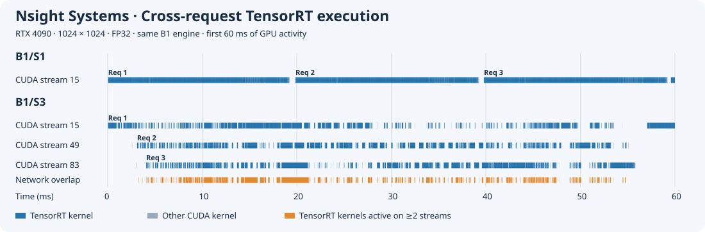
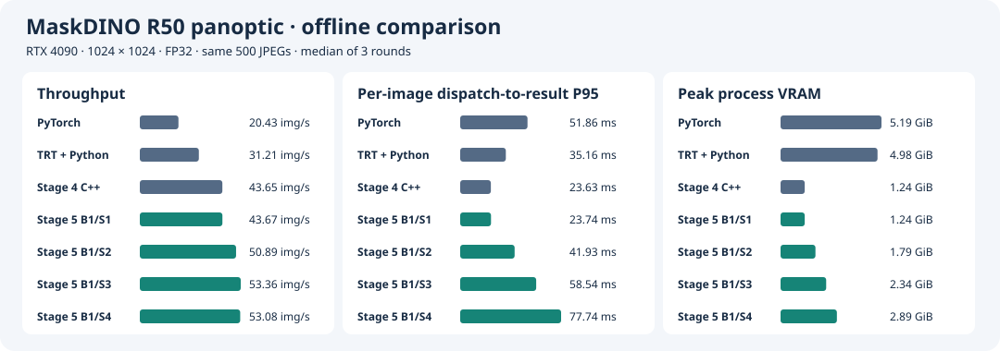
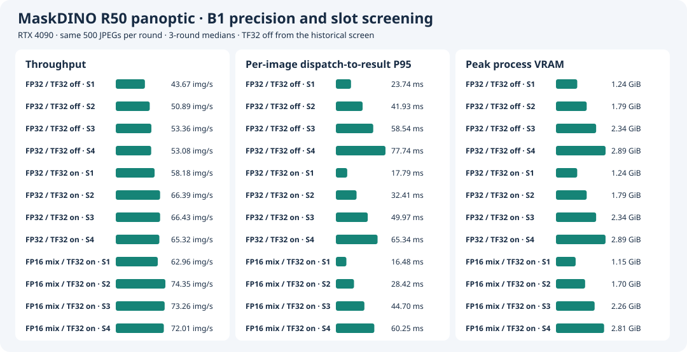

# Stage 5 · 用多 CUDA stream 实现异步并发

[English](README.md) · **简体中文**

固定 RTX 4090、MaskDINO R50 panoptic、1024×1024，复用 Stage 4 的 B1 engine 和 C++/CUDA 前后处理。每个请求处理一张内存 JPEG，交付原图尺寸的 CPU panoptic map 和 segment metadata。固定 batch 为 1，只扫 slot 数。先给出 FP32/TF32 off 的流水线参考，再比较两种允许 TF32 的精度策略。历史 batch 与在线负载选型可在提交 `fcc7dc9` 的 `stage6/README.md` 查看。本分支的 [Stage 6](../stage6/README.zh-CN.md) 继续定位网络热点并验证局部混合精度。

## Slot 生命周期

同一进程共享一份反序列化的 engine。每个 slot 对应一个长期运行的 CPU worker，独立持有 CUDA stream、TensorRT execution context、可写 I/O、前后处理工作区和 pinned staging buffers。worker 在本 slot 的 stream 上提交前处理、`enqueueV3`、后处理与 D2H，等待最终 D2H 后把 map 和 metadata 拷贝到 CPU 结果对象，然后复用 slot。等待期间，其他 worker 可以继续提交或收取结果。运行时要求 engine 的辅助 stream 数为 0，图中的并发来自多个请求的独立 slot。 [调度器](main.cu) · [原生运行时](../stage4/runtime.cu)

## Nsight Systems

用 `c8d4796` 在同一份 32 张 COCO 清单上独立采集，每 slot 预热 20 批。图中两组都从各自第一条 GPU kernel 开始，展示前 60 ms。蓝色按 CUDA correlation ID 关联到同一 CPU 线程的 `TensorRT inference` NVTX 区间，灰色为其余 kernel。橙色标出至少两个 stream 同时执行 TensorRT kernel 的区间。Req 编号按每份 trace 的推理提交区间起点排序。



B1/S3 的前三个请求在饱和离线队列启动时被不同 worker 取走。以下时间相对该 trace 的首条 GPU kernel，起止点取每个请求的首条和末条 TensorRT kernel。

| 请求 | CUDA stream | 首条网络 kernel 开始（ms） | 末条网络 kernel 结束（ms） |
| --- | ---: | ---: | ---: |
| Req 1 | 15 | 0.06 | 53.22 |
| Req 2 | 49 | 3.11 | 54.84 |
| Req 3 | 83 | 4.08 | 55.73 |

三个请求的首末区间有 **49.15 ms** 的交集。按实际 kernel 区间累计，前三个请求中恰好两条 stream 同时执行网络 kernel 的时间为 **13.91 ms**，三条同时执行的时间为 **9.28 ms**。

下表统计完整采集。重叠比例的分母为至少一个相应类别 kernel 活跃的时间。无 kernel 活动的时间在首条到末条 kernel 之间统计。

| 32 张 trace 指标 | B1/S1 | B1/S3 |
| --- | ---: | ---: |
| CUDA stream 数（有 kernel） | 1 | 3 |
| 首条到末条 kernel 的时间窗口（ms） | 704.10 | 607.37 |
| 无 kernel 活动时间（ms） | 52.11 | 7.58 |
| 多 stream kernel 重叠（整条流水线） | 0.0% | 38.0% |
| 多 stream kernel 重叠（仅 TensorRT 网络） | 0.00% | 37.32% |
| 单请求 TensorRT GPU 投影跨度中位数（ms） | 19.95 | 53.22 |
| `cudaStreamSynchronize` 次数 | 32 | 32 |

两组各执行 16,608 条 kernel，其中 16,416 条关联到 TensorRT 推理。B1/S3 缩短了完成整组 GPU 工作的时间，每个请求的网络投影跨度则变长。GPU 投影跨度包含首末 GPU 操作之间的间隙。 [B1/S1 原始报告](results/trace/b1s1.nsys-rep) · [B1/S3 原始报告](results/trace/b1s3.nsys-rep) · [全流水线重叠汇总](results/trace/b1s3.overlap.json)

## RTX 4090 性能与准确率

### 500 张离线筛选

由 `ecf9e25` 运行，表中为三轮中位数，每轮 500 张、零失败。相同 JPEG 清单在计时前预载，每个 slot 预热 20 批。逐图 P95 从派发到 slot 计到 CPU 结果就绪。显存为 NVML 每 20 ms 采样到的推理进程峰值。

| 配置 | 吞吐（图/s） | 逐图 P95（ms） | 进程显存峰值（GiB） |
| --- | ---: | ---: | ---: |
| B1/S1 | 43.67 | 23.74 | 1.24 |
| B1/S2 | 50.89 | 41.93 | 1.79 |
| B1/S3 | 53.36 | 58.54 | 2.34 |
| B1/S4 | 53.08 | 77.74 | 2.89 |

同轮 Stage 4 原生 B1/S1 为 43.77 图/s，新调度器 B1/S1 为 43.67 图/s。以新调度器 B1/S1 为对照，B1/S3 吞吐提高 22.2%，S4 的延迟和显存进一步上升，因此选 S3 进入离线长测。 [B1 逐轮结果](results/screen/summary.json)



### 离线长测

在 `c8d4796` 上，同一份 500 张清单重复 35 次。每配置三轮，每轮 17,500 张，轮换运行顺序。稳态吞吐取总完成时间中间 90% 的窗口。表中为三轮中位数。

| 配置 | 稳态吞吐（图/s） | 总完成时间（s） | 逐图 P95（ms） | 进程显存峰值（GiB） | 三轮失败 |
| --- | ---: | ---: | ---: | ---: | ---: |
| B1/S1 | 43.74 | 400.18 | 23.68 | 1.24 | 0 / 52,500 |
| B1/S3 | 53.22 | 328.78 | 58.31 | 2.34 | 0 / 52,500 |

B1/S3 的稳态吞吐提高 **21.7%**，固定任务总完成时间缩短 **17.8%**。 [逐轮结果](results/offline/summary.json) · [逐请求记录校验](results/offline/raw.sha256)

### 正确性

32 张逐图对齐使用 Stage 4 的类别一致率、segment 配对和 IoU 阈值，B1/S1、S2、S3、S4 均通过。B1/S1、S2、S3 的正式评估在 `c8d4796` 上运行，各覆盖 5,000 个唯一 COCO 预测 ID。三组 PQ / PQ_th / PQ_st 均为 **53.186256 / 59.027261 / 44.369645**，与 Stage 4 一致。 逐图日志保存在 `fcc7dc9` 的 `stage6/results/check/console.log` 和 `stage6/results/check-b8/b1s3/validation.json`。 [全量 PQ](results/pq/)

### 三种精度的 B1 × S1–S4 筛选

固定 1024×1024、C++/CUDA 前后处理和饱和离线负载，比较 FP32/TF32 off、FP32/TF32 on 和模型级 autocast FP16/TF32 on。新测两种候选各自轮换 S1–S4 的执行顺序，共三轮，每轮同顺序预载 500 张 JPEG，每 slot 预热 20 批。表中 P95 从派发到 slot 计到 CPU 结果就绪，吞吐按整轮墙钟时间计算。显存是 NVML 每 20 ms 采样的进程峰值。FP32/off 沿用上方历史初筛，可比较各组随 slot 数变化的趋势。三种精度来自分组运行，精度间差值为跨组描述。

| 精度策略 | Slot | 吞吐（图/s） | 逐图 P95（ms） | 进程峰值显存（GiB） | 逐图检查 |
| --- | ---: | ---: | ---: | ---: | ---: |
| FP32 / TF32 off | S1 | 43.67 | 23.74 | 1.24 | 32/32 |
| FP32 / TF32 off | S2 | 50.89 | 41.93 | 1.79 | 32/32 |
| FP32 / TF32 off | S3 | 53.36 | 58.54 | 2.34 | 32/32 |
| FP32 / TF32 off | S4 | 53.08 | 77.74 | 2.89 | 32/32 |
| FP32 / TF32 on | S1 | 58.18 | 17.79 | 1.24 | 32/32 |
| FP32 / TF32 on | S2 | 66.39 | 32.41 | 1.79 | 32/32 |
| FP32 / TF32 on | S3 | 66.43 | 49.97 | 2.34 | 32/32 |
| FP32 / TF32 on | S4 | 65.32 | 65.34 | 2.89 | 32/32 |
| FP16 混合精度 / TF32 on | S1 | 62.96 | 16.48 | 1.15 | 32/32 |
| FP16 混合精度 / TF32 on | S2 | 74.35 | 28.42 | 1.70 | 32/32 |
| FP16 混合精度 / TF32 on | S3 | 73.26 | 44.70 | 2.26 | 32/32 |
| FP16 混合精度 / TF32 on | S4 | 72.01 | 60.25 | 2.81 | 32/32 |

新测两组共完成 **12,000** 张计时请求，零失败。FP32/on 的 S2 与 S3 吞吐分别为 **66.39** 和 **66.43 图/s**，S2 的逐图 P95 少 **17.56 ms**，进程峰值显存少 **0.55 GiB**。混合/on 在 S2 达到组内最高吞吐 **74.35 图/s**，相对其 S1 提升 **18.1%**。

新测使用 `cc64d1b`、RTX 4090、驱动 595.84、CUDA 13.0、TensorRT 10.14.1.48 和 Stage 4 的参考容器。每个候选用自身 Stage 4 的 B1/S1 原生预测作逐图参考，S1–S4 均沿用类别一致率 ≥99.9%、全部 segment 配对且同类 IoU ≥0.98。 [FP32/on 逐图结果](results/precision/on/check/) · [FP32/on 逐轮计时](results/precision/on/screen/) · [混合/on 逐图结果](results/precision/autocast-on/check/) · [混合/on 逐轮计时](results/precision/autocast-on/screen/)



### 复现精度筛选

沿用 [Stage 3 候选构建](../stage3/README.zh-CN.md#b1s1-精度策略筛选) 的镜像、数据和 engine。每次选择一个候选，令 `previous/native-align-fixed` 指向该 engine 的 Stage 4 32 张原生预测目录，`previous/perf-native-r1` 包含 Stage 4 原生性能运行的 `manifest.tsv` 和 `things.txt`。把文件放在实际挂载的目录下。新测复用了 Stage 4 已有的两份原生参考输出，避免重复生成预测和原生计时。

```bash
bash stage5/run.sh "$data" "$previous" "$engine" precision-check-new check 1s1 1s2 1s3 1s4
bash stage5/run.sh "$data" "$previous" "$engine" precision-screen-new screen 1s1 1s2 1s3 1s4 --skip-stage4
python3 -m stage5.plot stage5/results --precision-comparison stage5/results/precision-comparison.svg
```

逐请求 TSV、验收 JSON 和运行日志位于结果目录。完整预测和运行目录保存在 4090 的 `/home/parker/Code/MaskDINO-TensorRT-precision/native-repo/stage5/runs/`。

## 复现入口

在 RTX 4090 上使用干净 checkout。沿用 [Stage 3 参考镜像](../stage3/results/environment.json)、COCO 数据、原始权重和固定 B1 engine。`previous` 指向 [Stage 4 正式运行目录](../stage4/README.zh-CN.md#复现)，需包含 `perf-native-r1` 和 `native-align-fixed`。每个运行 ID 只使用一次。以下命令使用两阶段共用的 [运行入口](run.sh)。

```bash
export MASKDINO_IMAGE=maskdino:stage1
data=/path/to/coco2017-panoptic-val
engine=/path/to/stage3/runs/build-fp32/network.engine
previous=/path/to/stage4/runs

bash stage5/run.sh "$data" "$previous" "$engine" slots-check check 1s1 1s2 1s3 1s4
bash stage5/run.sh "$data" "$previous" "$engine" slots-screen screen 1s1 1s2 1s3 1s4
bash stage5/run.sh "$data" "$previous" "$engine" slots-offline offline 1s1 1s3 --repeats 35
bash stage5/run.sh "$data" "$previous" "$engine" slots-pq pq 1s1 1s2 1s3
bash stage5/run.sh "$data" "$previous" "$engine" slots-trace trace 1s1 1s3
```

从已有报告重绘时间线只需离线导出 SQLite。以下命令使用 Nsight Systems CLI 和 Python 3。

```bash
for config in b1s1 b1s3; do
  nsys export --type=sqlite --output="/tmp/$config.sqlite" "stage5/results/trace/$config.nsys-rep"
done
python3 -m stage5.trace_plot /tmp/b1s1.sqlite /tmp/b1s3.sqlite stage5/results/nsight-slot-overlap.svg
```

500 张筛选、长测、PQ 和 trace 沿用拆分前的结果，正式提交分别见各节。历史实验入口、日志与原始布局见 [验收 tag `stage5-batch-slots-accepted`](https://github.com/Parker-Lyu/MaskDINO-TensorRT/tree/stage5-batch-slots-accepted/stage5)。
