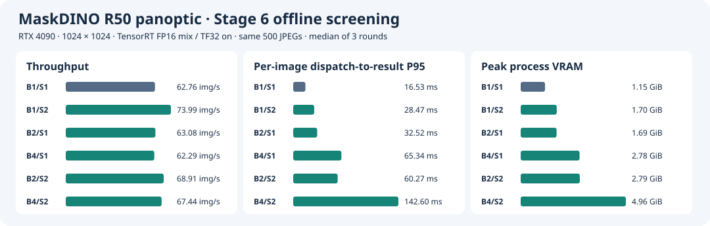
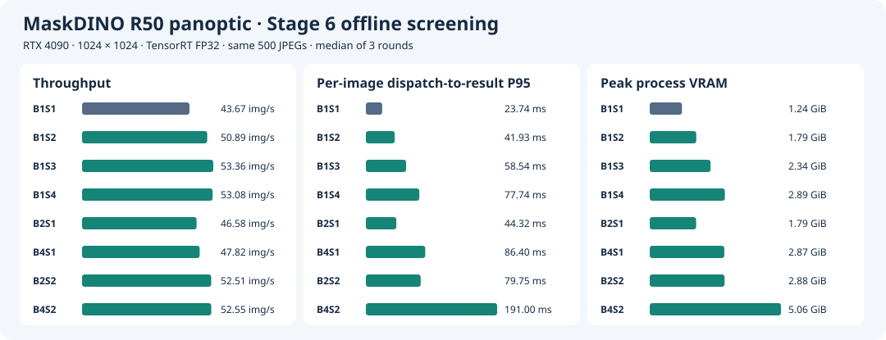

# Stage 6 · 对比 batch × slot 组合并按负载选型

## FP16 混合精度重新选型

固定 RTX 4090、1024×1024、C++/CUDA 前后处理和模型级 FP16 autocast（允许 TF32）。精度验收以同输入的 PyTorch FP32 B1 为参考，完整 COCO val2017 的 PQ、PQ Things、PQ Stuff 各最多下降 0.05 点。B1 复用 Stage 4 已评估的 engine，B2、B4 分别导出并构建。

### 逐图诊断与离线初筛

32 张逐图诊断以同精度原生 B1 为参照。B1/S1 和 B1/S2 均为 32/32，B2 两种 slot 数均为 20/32，B4 两种 slot 数均为 21/32。同一 batch engine 在 S1、S2 的 32 张分割图和 metadata 逐字节一致。B4 尾批的 28 张 B4 和 3 张 B1，以及在线混跑的 22 张 B2 和 10 张 B1，也逐字节匹配各自实际执行的 engine。[逐图诊断](results/fp16/diagnostics/) · [按实际 batch 比对输出](results/fp16/diagnostics/path-consistency.json)

每组每轮预载同一份 500 张 JPEG，每个 slot 预热 20 批，轮换顺序测三轮。表中为中位数，六组各轮均完成 500 张，零失败。逐图 P95 从派发到 CPU 结果就绪，网络 P95 按 batch 统计，进程峰值显存由 NVML 每 20 ms 采样。

| 配置 | 离线吞吐（图/s） | 逐图 P95（ms） | 网络 GPU P95（ms/批） | 进程峰值显存（GiB） |
| --- | ---: | ---: | ---: | ---: |
| B1/S1 | 62.76 | 16.53 | 14.40 | 1.15 |
| **B1/S2** | **73.99** | **28.47** | 26.43 | **1.70** |
| B2/S1 | 63.08 | 32.52 | 28.79 | 1.69 |
| B4/S1 | 62.29 | 65.34 | 58.45 | 2.78 |
| B2/S2 | 68.91 | 60.27 | 56.27 | 2.79 |
| B4/S2 | 67.44 | 142.60 | 113.65 | 4.96 |

B1/S2 在三轮都取得最高吞吐。B2、B4 的多 slot 配置吞吐更低、显存更多，B4/S1 相对 B2/S1 的变化也落在轮间波动范围内。离线保留 B1/S2 进入全量评估与长测。[初筛逐轮汇总](results/fp16/screen/summary.json)



### FP16 在线粗扫

用种子 47 回放同一组到达序列，每点 10 秒。P99 从计划到达到 CPU 结果就绪，包含排队和凑批。B2 比较 S1、S2 和 0、2 ms 的最大凑批等待。以下四个同序列点的 B2 最低 P99 都高于 B1/S2，因此后续在线验证集中在 B1。匀速 55 请求/s 时，B1/S1 和 B1/S2 的 P99 分别为 17.32、17.94 ms。[全部粗扫结果](results/fp16/pilot/)

| 到达负载 | B1/S1 P99（ms） | B1/S2 P99（ms） | B2 最低 P99（ms） |
| --- | ---: | ---: | ---: |
| 泊松 30 请求/s | 91.56 | 77.59 | 95.90 |
| 泊松 45 请求/s | 127.79 | 103.07 | 130.53 |
| 周期突发 25 请求/s | 96.81 | 77.63 | 98.51 |
| 周期突发 35 请求/s | 170.07 | 87.69 | 144.21 |

### FP16 复现入口

B2、B4 在 `acaf623` 构建，逐图诊断、初筛和场景回放从干净的 `922f94e` 运行。使用驱动 595.84、CUDA 13.0、TensorRT 10.14.1.48 和参考镜像 `sha256:24a707391a7592235352cb91d58e11da356aefe3f7512a698a5402671cd83d1e`。B1 复用 Stage 4 原生全量评估的混合 engine。`previous` 使用 FP16 原生 B1 的 500 张计时 manifest、`things.txt` 及 32 张逐图预测，目录名沿用历史入口。[B1 全量结果](../stage4/results/precision/autocast-pair/pq-mixed/result.json) · [B2/B4 导出、构建与哈希](results/fp16/engines/)

```bash
export MASKDINO_IMAGE=sha256:24a707391a7592235352cb91d58e11da356aefe3f7512a698a5402671cd83d1e
export MASKDINO_CHECKPOINT=/path/to/maskdino_r50_panoptic.pth
data=/path/to/coco2017-panoptic-val
engine=/path/to/fp16-b1/network.engine
previous=/path/to/fp16-native-reference
export MASKDINO_BATCH_ENGINES=/path/to/fp16-batch-engines

for b in 2 4; do
  bash stage3/run.sh "$data" "fp16-export-b$b" export --backend mixed \
    --mixed-scope all --cpu-constants --batch "$b"
  bash stage3/run.sh "$data" "fp16-build-b$b" build --backend mixed --tf32 on \
    --batch "$b" --onnx "/project/stage3/runs/fp16-export-b$b/network.onnx"
  mkdir -p "$MASKDINO_BATCH_ENGINES/build-b$b"
  cp "stage3/runs/fp16-build-b$b/"{network.engine,build.json} "$MASKDINO_BATCH_ENGINES/build-b$b/"
done
bash stage5/run.sh "$data" "$previous" "$engine" fp16-stage6-diagnostics check \
  --report-alignment 1s1 1s2 2s1 4s1 2s2 4s2
bash stage5/run.sh "$data" "$previous" "$engine" fp16-stage6-screen screen \
  --skip-stage4 1s1 1s2 2s1 4s1 2s2 4s2
python3 -m stage5.plot stage6/results/fp16 --precision-label 'TensorRT FP16 mix / TF32 on'
```

## FP32（TF32 off）历史选型

固定 RTX 4090、MaskDINO R50 panoptic、1024×1024、TensorRT FP32、关闭 TF32、相同权重和 Stage 4 C++/CUDA 前后处理。每个请求对应一张内存 JPEG，输出原图尺寸 CPU panoptic map 和 segment metadata。以 [Stage 5 的 B1 多 slot](../stage5/README.md) 为基线，比较更大的固定 batch 与联合配置，按两类负载选型。

- **在线**在给定 P99、失败率和显存预算下，比较各到达模型的达标实测点。轻载先测 B1/S1 的响应速度，再看增加 slot 或小 batch 是否扩大达标负载区间。
- **离线**在显存与正确性约束内最大化稳态吞吐，并报告固定任务集的总完成时间。B1 多 slot、较大 batch 单 slot 和二者组合都参与比较。

## 复现入口

在 RTX 4090 上使用干净 checkout，通过两阶段共用的 [运行入口](../stage5/run.sh) 执行。沿用 [Stage 3 参考镜像](../stage3/results/environment.json)、COCO 数据、原始权重、固定 B1 engine 和 [Stage 4 正式运行目录](../stage4/README.md#复现)。`previous` 需要包含 `perf-native-r1` 和 `native-align-fixed` 的 manifest、原生基准程序与逐图预测。

```bash
export MASKDINO_IMAGE=maskdino:stage1
export MASKDINO_CHECKPOINT=/path/to/maskdino_r50_panoptic.pth
data=/path/to/coco2017-panoptic-val
engine=/path/to/stage3/runs/build-fp32/network.engine
previous=/path/to/stage4/runs

for b in 2 4 8; do
  bash stage3/run.sh "$data" "export-b$b" export --backend fp32 --cpu-constants --batch "$b"
  bash stage3/run.sh "$data" "build-b$b" build --backend fp32 \
    --onnx "/project/stage3/runs/export-b$b/network.onnx" --batch "$b"
done
bash stage5/run.sh "$data" "$previous" "$engine" check-r1 check 1s1 1s2 1s4 2s1 2s2 4s1 4s2
bash stage5/run.sh "$data" "$previous" "$engine" screen-r1 screen 1s1 1s2 1s3 1s4 2s1 4s1 2s2 4s2
bash stage5/run.sh "$data" "$previous" "$engine" screen-b8 screen 4s1 8s1 1s3
bash stage5/run.sh "$data" "$previous" "$engine" screen-b8-joint screen 1s3 8s2
```

每个运行 ID 只能使用一次，输出位于共用入口的 `stage5/runs/<ID>/`。所有计时模式的 500 张 JPEG 在计时前预载，COCO 评估独立运行。在线 `--shapes` 可选 `uniform`、`poisson` 和 `burst`，固定 `--rates`、`--seconds`、`--seeds` 后可回放相同的到达序列。配置写为 `1s3` 或 `2s2`。在线 B2 用 `--delays` 指定最大凑批等待（ms）。

## 固定形状 batch 与凑批

- B1 复用 Stage 3 engine。B2/B4/B8 分别生成固定形状 engine，记录 hash 和构建参数。前处理写入对应 NCHW 切片，后处理按每张图的几何和输出索引恢复。不同 batch 的 engine 可能选择不同 tactics，比较的是整套 batch 配置。 [构建记录](results/engines/) · [原生运行时](../stage4/runtime.cu)
- 在线使用有界 FIFO。空闲 slot 在队头满两张或最老请求达到凑批截止时间时发车，超时单张走预热好的 B1 engine。slot 忙时，等待计入排队。进程显存包含 B1/B2 两套常驻 engine/context。离线尾批用 B1 回退，逐请求记录实际执行路径。

## Batch 与 slot 配置筛选

B 表示固定 engine batch 大小，S 表示 slot 数。在线另外标明最大 batch、凑批时限及实际 batch 分布。

| 顺序 | 配置 | 进入下一步的条件 |
| --- | --- | --- |
| A · B1 对照 | B1 × S1/S2/S3/S4 | 使用 Stage 5 同轮结果作为比较基线 |
| B · 单变量 batch | B1/B2/B4 × S1 | 记录每 batch 网络耗时、每图端到端耗时和吞吐。若 B4 仍有稳定增益且显存有余量，再测 B8 |
| C · 联合 | 首选 B2/S2、B4/S2，按 A/B 结果筛选 | 对照同 B 的 S1、同 S 的 B1。收益超过重复轮次的波动，且资源约束允许时，再增加 slot 或 batch |
| D · 场景复测 | 在线保留 B1/S1、B1 多 slot 和有希望的 B2 候选。离线保留吞吐与显存的有效候选 | 按各自负载完成验证，保留并报告无增益、失败或 OOM 的配置及原因 |

正式筛选沿用同一份 500 张内存 JPEG，候选轮换顺序测三轮。Stage 4 对照沿用 20 次单图预热，新配置每个 slot 和常用 engine 路径预热 20 批，记录实际数量。计时前让 GPU 进入稳定状态，报告逐轮数据与中位数。CUDA events 记录每次网络 enqueue 的 GPU P50/P95，单位 ms/batch。墙钟记录逐图端到端 P50/P95，筛选及离线的逐图延迟从所在 batch 被派发到 slot 开始，到该图 CPU 结果就绪。固定输入顺序、镜像、CPU worker 策略和资源采样方法，记录线程数随 slot 变化。若怀疑收益来自 CPU 解码并行，用单独的阶段计时和 trace 区分 CPU 并行与 GPU 重叠。

### 500 张离线筛选

RTX 4090 上由 `ecf9e25` 运行。表中为三轮中位数，每轮 500 张、零失败。逐图延迟从 batch 派发算到该图 CPU 结果就绪。多 slot 行同时有多个 batch 在运行。

| 配置 | 吞吐（图/s） | 逐图 P95（ms） | 进程显存峰值（GiB） |
| --- | ---: | ---: | ---: |
| B1/S1 | 43.67 | 23.74 | 1.24 |
| B1/S2 | 50.89 | 41.93 | 1.79 |
| B1/S3 | 53.36 | 58.54 | 2.34 |
| B1/S4 | 53.08 | 77.74 | 2.89 |
| B2/S1 | 46.58 | 44.33 | 1.79 |
| B4/S1 | 47.82 | 86.40 | 2.87 |
| B2/S2 | 52.51 | 79.75 | 2.88 |
| B4/S2 | 52.55 | 191.00 | 5.06 |

同轮 Stage 4 原生程序的吞吐中位数是 43.77 图/s。新调度器 B1/S1 是 43.67 图/s。B1/S3 相比新调度器基准吞吐提高 22.2%，并以更低的显存取得略高于两组联合配置的吞吐。B4/S1 相比 B2/S1 仍有 2.7% 的收益，因此补测 B8。 [逐轮数据](results/screen/summary.json) · [运行记录](results/screen/console.log)



B8/S1 补测为 **48.76 图/s**、逐图 P95 **169.60 ms**、进程峰值 **5.82 GiB**。同轮 B4/S1 为 47.70 图/s、86.46 ms、2.87 GiB，B1/S3 吞吐为 53.03 图/s。500 张末尾的 4 张使用 B1，B8/S1 的显存峰值包含常驻 B1 回退路径。B8/S1 和 B1/S3 各通过 32/32 对齐。 [补测数据](results/screen-b8/summary.json) · [验收记录](results/check-b8/console.log)

B8/S2 联合补测为 **52.67 图/s**、逐图 P95 **339.09 ms**、进程峰值 **10.72 GiB**。同轮 B1/S3 为 **53.70 图/s**、P95 **57.51 ms**、峰值 **2.34 GiB**，因此选 B1/S3 进入 [Stage 5 离线长测](../stage5/README.md#离线长测)。 [联合补测数据](results/screen-b8-joint/summary.json)

原生逐图验收中 B1/S1、B1/S2、B1/S4、B2/S1、B2/S2、B4/S1、B4/S2 均通过 32/32。B2/S2 超时回退测试也通过 32/32，实际发车 11 个 B2 批和 10 个 B1 批。 [验收记录](results/check/console.log)

## 在线容量

- 用开放环路回放预生成到达时间，从计划到达时刻计到 CPU 结果可用。记录实际提交时刻和负载发生器偏差，以识别客户端发压瓶颈。请求生成独立于完成事件。相同负载点对所有候选复用图片顺序与到达序列。
- 先测低速均匀到达和单请求，再按 B1/S1 同轮饱和吞吐的 25%、50%、75%、90%、100%、110% 测固定种子的泊松到达。向上扩展到候选出现饱和，细扫通过与失败之间的区间。另测可复现的突发，例如每 10 秒中 1 秒以 2 倍目标平均速率到达、其余 9 秒以 8/9 倍到达。B2 初扫最大凑批等待 0、1、2、5 ms。
- 使用统一的有界 FIFO，并把容量和队满拒绝规则写入配置。保存到达、入队、发车、完成、失败等事件。报告端到端 P50/P95/P99、排队与凑批耗时、到达/完成速率、拒绝与错误数、队列深度走势、排空时间、实际 batch 分布和进程显存。按测量窗口内到达的请求归集，排空后结算，单列失败，避免因排除慢请求低估 P99。
- 对最终候选与基准，每个关键负载点以不同种子测三轮，每轮至少 10,000 个到达请求，且至少 5 分钟。以每轮 P99 都在预算内、零拒绝/错误、持续窗口队列无累积且完成率跟上到达率为通过条件。无业务 SLO 时，先用 30/50/100 ms 三档 P99 作为实验预算。分别报告平稳与突发到达下的最高通过实测点及相邻失败点。给不出上界时，只报告已验证的范围。

### 在线粗扫

粗扫使用固定种子 47，每点 10 秒。表中为同一到达序列下的逐请求 P99，包含排队与实际凑批等待。B2 的最大凑批等待为 0 ms。

| 到达负载 | B1/S1 | B1/S2 | B1/S3 | B2/S1 | B2/S2 |
| --- | ---: | ---: | ---: | ---: | ---: |
| 泊松 21.9 请求/s | 124.42 | 116.86 | 116.99 | 124.07 | 132.28 |
| 泊松 32.8 请求/s | 180.97 | 139.59 | 151.56 | 174.57 | 160.88 |
| 泊松 48.2 请求/s | 963.10 | 225.67 | 229.10 | 514.59 | 254.18 |
| 突发 22 请求/s | 136.50 | 114.67 | 135.21 | 136.70 | 135.46 |
| 突发 33 请求/s | 497.95 | 311.60 | 314.07 | 474.65 | 387.84 |

每点仅约 100–500 个请求。短测用于筛候选和确定长测范围。两组 B2 在这些同序列点上均落后于 B1/S2。 [泊松原始汇总](results/pilot-poisson/summary.jsonl) · [突发原始汇总](results/pilot-burst/summary.jsonl)

补扫 5–20 请求/s 后，选 B1/S1 与 B1/S2 进入配对验证。15 请求/s 泊松回放中，B2 在 0/1/2/5 ms 凑批上限下测得的最低 P99 为 **64.95 ms**（B2/S1、1 ms，15 秒内 217 个请求）。B1/S1 使用相同种子，20 秒内 306 个请求的 P99 为 **62.91 ms**。两组的 P99 来自不同长度的窗口。54、58 请求/s 泊松粗扫中，B1/S3、B2/S2 均出现排队累积。 [低速回放](results/pilot-low/summary.jsonl) · [凑批扫描](results/pilot-delay/summary.jsonl) · [过载回放](results/pilot-ceiling/summary.jsonl)


### 已验证的匀速轻载

25 请求/s 匀速短测使用同一份 15 秒到达序列，各完成 375 个请求。B1/S1、B1/S2、B1/S3 的 P99 分别为 24.73、28.17、27.50 ms。该负载只对 B1/S1 做了长测。 [短测结果](results/pilot-uniform/summary.jsonl)

B1/S1 重启进程跑三轮，每轮 420 秒，均完成 10,499 个请求。三轮零拒绝，队列通过稳态检查。P99 分别为 24.55、24.57、24.41 ms。该实测点满足 30 ms P99 预算。 [逐轮结果](results/formal-online-uniform-25-1s1/summary.jsonl)

```bash
bash stage5/run.sh "$data" "$previous" "$engine" formal-online-uniform-25-1s1 online 1s1 \
  --rates 25 --shapes uniform --seconds 420 --seeds 311 449 593
```

### 配对验证的时间预算

泊松 20 请求/s 的配对长测沿用每轮至少 10,000 请求的口径。配对验证采用三个种子（311、449、593），每个种子让 B1/S1 和 B1/S2 分别回放相同序列。只有三轮各自通过 P99 和稳态检查、零拒绝和零错误的配置才通过该实测点。后续验证限时 90 分钟，5 请求/s 档每轮约 900 个请求，P99 由少量尾部观测决定，适合作为缩短后的配置验证。

20 请求/s 突发第一对各跑 210 秒，P99 分别为 140.09 ms 和 102.33 ms。两组已各出现一次超预算。第二个种子在 CUDA 初始化时报错并退出，后续改为每个种子启用独立容器，测 15 请求/s 突发、5 请求/s 泊松、5 请求/s 突发，各 180 秒/轮。 [20 请求/s 突发记录](results/compact-burst-20/console.log)

## 联合配置的 Nsight 采集

在 `c8d4796` 上用同一份 32 张清单采集 B2/S2，预热 20 批/slot。GPU kernel 窗口为 **610.60 ms**，其中 **8.80 ms** 无 kernel 活动。多 stream 同时执行 kernel 的时间占全部 kernel 活跃时间的 **26.7%**，记录到 16 次 `cudaStreamSynchronize`。同轮 B1/S1 和 B1/S3 的时间线与统计见 [Stage 5](../stage5/README.md#nsight-systems)。 [B2/S2 原始报告](results/trace/b2s2.nsys-rep) · [重叠统计](results/trace/b2s2.overlap.json) · [同轮运行日志](results/trace/console.log)

```bash
bash stage5/run.sh "$data" "$previous" "$engine" joint-trace trace 2s2
```

## 正确性

沿用 Stage 4 的 32 张对齐清单和阈值（每图类别一致率 ≥99.9%、segment 完整配对且同类 IoU ≥0.98）。多图 batch 的检查覆盖不同 batch 索引、并发交错、离线尾批和在线超时回退。最终选型均使用 B1；B1/S1、S2、S3 分别通过 5,000 张 COCO val2017 全量 PQ 验收。 [尾批与回退记录](results/check-tail/console.log) · [全量 PQ](../stage5/README.md#正确性)

## 场景选型

以下为 RTX 4090、1024×1024、TensorRT FP32、内存 JPEG 到 CPU panoptic 结果的实测点。在线使用 64 项 FIFO，B1 无凑批等待。表中 P99 取三轮最差值。两组都通过时，选进程峰值显存更低的 B1/S1（1.24 GiB，B1/S2 为 1.79 GiB）。

| 场景 | 选型 | 实测范围和证据 |
| --- | --- | --- |
| 匀速、30 ms P99 | B1/S1 | 25 请求/s，最差 P99 24.57 ms，三轮各 10,499 个请求。B1/S2 仅做短测 |
| 泊松、100 ms P99 | B1/S1 | 20 请求/s，最差 P99 83.06 ms。B1/S2 为 79.52 ms，两个配置均通过 |
| 周期突发、100 ms P99 | B1/S2 | 平均 15 请求/s，最差 P99 92.46 ms。B1/S1 有一轮 100.007 ms，超过门槛 |
| 泊松或周期突发、50 ms P99 | B1/S1 | 平均 5 请求/s，B1/S1 最差 P99 分别为 45.85 和 46.47 ms，B1/S2 分别为 44.48 和 45.00 ms，两个配置均通过 |
| 离线批量 | B1/S3 | 53.22 图/s，17,500 张总完成时间中位数 328.78 s，进程峰值 2.34 GiB。见 [Stage 5 长测](../stage5/README.md#离线长测) |

所有在线通过点的测量轮次均零拒绝，并通过队列稳态检查。泊松 20 请求/s 每轮有 10,496–10,661 个请求。缩短后的 15 请求/s 突发每轮有 2,677–2,746 个请求，5 请求/s 每轮有 850–921 个请求。20 请求/s 突发的首对结果均超过 100 ms。通过点给出了各到达模型下已经验证的范围，容量上界仍需更密集的负载扫描。 [原长测汇总](results/long-capacity.json) · [缩短验证汇总](results/compact-capacity.json)

原实验逐请求记录位于 RTX 4090 的 `/home/parker/Code/MaskDINO-TensorRT-stage5/stage5/runs/`，归档目录中的 `raw.sha256` 可用于核对。重建的 Stage 4 原生入口也通过回归检查，32 张的 map 与 metadata 文件逐字节一致。 [Stage 4 回归记录](results/check-tail/stage4-regression.log)

复跑配对验证时，每个种子使用独立运行目录。以下命令对应 `c8d4796` 上完成的缩短验证。

```bash
for seed in 311 449 593; do
  bash stage5/run.sh "$data" "$previous" "$engine" "compact-burst-15-$seed" online 1s1 1s2 \
    --rates 15 --shapes burst --seconds 180 --seeds "$seed"
  for shape in poisson burst; do
    bash stage5/run.sh "$data" "$previous" "$engine" "compact-$shape-5-$seed" online 1s1 1s2 \
      --rates 5 --shapes "$shape" --seconds 180 --seeds "$seed"
  done
done
python3 -m stage5.capacity --min-seconds 180 --min-requests 800 \
  stage6/results/compact-{burst-15,poisson-5,burst-5}-*/summary.jsonl
python3 stage5/plot.py stage6/results --finalist b1s3 --comparison stage5/results/comparison.svg
```

本阶段沿用拆分前的实测记录。实际运行 commit、镜像、engine 与数据校验见各组日志。原版复现说明与归档布局见 [验收 tag `stage5-batch-slots-accepted`](https://github.com/Parker-Lyu/MaskDINO-TensorRT/tree/stage5-batch-slots-accepted/stage5)。
