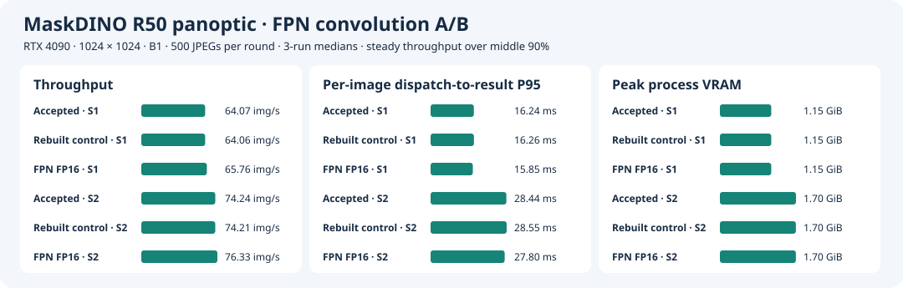
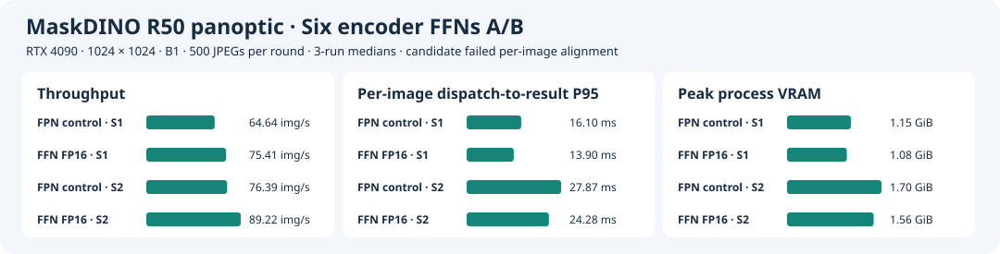

# Stage 6 · TensorRT 逐层 Profiling、定向 FP16 优化与精度归因

[English](README.md) · **简体中文**

Stage 1–5 已完成 MaskDINO R50 panoptic 的精度复现、固定形状 TensorRT 转换、C++/CUDA 前后处理和多 CUDA stream 并发。本阶段不再改动推理链路架构，而是回答三个问题：

1. **网络时间花在哪里？** 不能只凭网络结构或 FLOPs 判断瓶颈。
2. **能否仅降低热点算子的计算精度，以更小的数值风险换取性能收益？** 必须把 Cast、reformat 和 TensorRT tactic 计入实际成本。
3. **如何确定 A/B 的性能和输出差异确实来自目标修改？** 修改一个 ONNX 节点，并不保证两次 Engine 构建只在一个执行算子上不同。

**最终状态：** FPN 单卷积 FP16 已通过当前离线性能、32 张逐图一致性和全量 COCO PQ 验收；六层 Encoder FFN FP16 获得更大性能收益、全量 PQ 基本不变，但仅 26/32 张满足逐图门槛，因此仍是**实验候选，未验收**。

| 实验 | 关键发现 | 结果与决策 |
| --- | --- | --- |
| [逐层 Profiling](layer-profile.zh-CN.md) | Encoder FFN 的 12 个 GEMM 累计 3.675 ms；FPN 3×3 卷积是最贵单层，约 0.903 ms | 先验证影响范围较局部的 FPN，再处理累计耗时更大的 FFN |
| [FPN 单卷积 FP16](fpn-half-ab.zh-CN.md) | 首轮 31/32，异常跟随 logits 而非 masks；检查发现非目标 Backbone tactic 变化 | 共享 timing cache 重建配对，最终 32/32；B1/S1 端到端 P95 降 2.6% |
| [Encoder 六层 FFN FP16](ffn-full-half.zh-CN.md) | 12 个 GEMM 切换为 FP16 Tensor Core；B1/S1 端到端 P95 降 13.7% | 全量 PQ 53.18563，但逐图仅 26/32；保留实验配置 |

## 1. 实验边界：优化什么、固定什么？

固定 RTX 4090、MaskDINO R50 panoptic、**1024×1024 / B1**、模型级 FP16 autocast / TF32 on 的已验收基础 Engine。该 Engine 的 SHA-256 为 `ab6054100b6256861ad320df440543d2e82cf2a833db2e77c159b736021401cf`。这里的“混合精度”不意味着所有层都是 FP16：部分热点仍使用 FP32 路径，某些 GEMM 使用 TF32 Tensor Core。

Stage 6 不改变权重来源、COCO 数据、Engine 的 FP32 输入/输出接口，也不改变 Stage 4–5 的原生 C++/CUDA 前后处理和调度框架。FPN 实验从原始混合 Engine 开始；FFN 实验以**已验收的 FPN FP16 Engine**为对照，因此两次性能改善的参照不同，不能不加限定地累加百分比。

测量分为三个边界：

- **Layer / Kernel Profiling：** 预载 GPU 输入，排除 JPEG、H2D/D2H 和 panoptic 后处理，用于定位瓶颈。逐层计时会有分析开销，**逐层均值之和不等同于正常网络延迟**。
- **网络 GPU 时间：** 正式原生链路中用 CUDA events 测量，报告 P50/P95。
- **端到端与吞吐：** 预载同一份 500 张内存 JPEG，从请求**派发到 slot**起算，计到原图大小的 CPU panoptic map 和 segment metadata 就绪；稳态吞吐取墙钟中间 90% 窗口。B1/S1 和 B1/S2 分开报告。该口径不包含在线排队等待，**离线 P95 不是在线 P99**。

正式 A/B 对每个 slot 预热 20 批，三轮轮换 Engine/slot 测试顺序；NVML 每 20 ms 采样进程峰值显存。Profiling、Nsight 与正式计时分开执行。环境：驱动 595.84、CUDA Toolkit 13.0.88、TensorRT 10.14.1.48、参考容器 `sha256:24a707391a7592235352cb91d58e11da356aefe3f7512a698a5402671cd83d1e`。[环境与数据](../docs/experiment-environment.zh-CN.md) · [原始构建记录](../stage3/results/precision/build-autocast-on/build.json)

**两种正确性标准不能混淆：**

- **逐图行为一致性：** 用固定 32 张图片对照参考 Engine，要求像素类别一致率 ≥99.9%、所有 segment 成功配对、匹配 segment 的同类 IoU ≥0.98。它检验输出是否足够接近，不等于全场景正确性保证。
- **全量任务精度：** COCO val2017 共 5,000 张，以同输入 PyTorch FP32 B1 为基线，PQ、PQ Things、PQ Stuff **每项**最多允许下降 0.05 点。这个阈值是本项目的实验验收条件，不是通用生产标准。

[32 张与 500 张样本](../stage2/sample.json) · [PyTorch B1 PQ 基线](../stage3/results/pt-pq/result.json)

## 2. 先找热点：为什么选择 FPN 和 Encoder FFN？

**问题：** Stage 4–5 已经优化了端到端链路和并发，但基础 TensorRT Engine 内部还有哪些值得优化的部分？

**方法：** 使用 `trtexec --separateProfileRun --dumpProfile` 对固定 B1 Engine 逐层计时。选一张原生预处理后的 COCO 输入连续测三轮，再换两张图检查热点排序。用 Nsight Systems 将 NVTX 层名、CUDA launch 与实际 Kernel 对应，再选代表 Kernel 使用 Nsight Compute 采集资源计数器。

| 层 / 算子组 | 逐层耗时（ms/图） | 占逐层总时间 |
| --- | ---: | ---: |
| Encoder FFN：6 层 × 2 GEMM | **3.675** | **24.30%** |
| Encoder MSDeformAttn：6 个插件层 | 1.480 | 9.78% |
| FPN `/sem_seg_head/layer_1/Conv` | **0.903** | **5.97%** |
| `input_proj.3` 3×3 Conv | 0.306 | 2.02% |
| 最终 Mask Einsum + FP32 Cast | 0.171 | 1.13% |

逐层时间总和约 **15.13 ms**，而独立正常网络计时的 GPU P50 约 **14.09–14.11 ms**；这里采用逐层数据比较排序，不把它直接当作端到端收益预算。

进一步的 Kernel 证据：

- **FPN 3×3 Conv：** 输入和输出都是 `[1,256,256,256]` FP32，使用 FP32 Winograd tactic；代表 Kernel 的 Tensor pipe 活跃为 **0%**，L2 吞吐约为峰值 **74.3%**，并未使用 Tensor Core。
- **Encoder FFN 的代表性 linear2：** 已使用 **TF32 Tensor Core**，代表 Kernel 的 DRAM 吞吐约为峰值 **67.8%**、活跃 Warp 占上限 **14.6%**。单次资源计数器提示研究方向，但不能单独证明某种替换一定更快。

**决策：为什么不直接从最大的 FFN 开始？** FFN 的累计性能空间更大，但它位于 Encoder 中、影响 proposal/TopK 上游特征，存在较广的输出传播风险；FPN 目标卷积是最慢单层，且原 ONNX 数据流只通向最终 `masks`。因此先选择**修改范围更局部的 FPN**作为第一轮受控实验，再扩大到 FFN。

**本步结论：** 已识别高成本计算区域及其实际执行路径；“FP16 会更快”仍是假设，需要构建和 A/B 验证。

[完整逐层 Profiling、Nsight 数据与复现命令](layer-profile.zh-CN.md) · [原始层耗时](results/layer-profile-b1/summary.json) · [ONNX 路径核对](results/layer-profile-b1/onnx-paths.txt)

## 3. 实验一：只把 FPN 的一个 3×3 Conv 改为 FP16

### 3.1 假设与实现

**假设：** 目标 FPN Conv 没用 Tensor Core；只把这一层的计算切换为 FP16，可促使 TensorRT 选择 FP16 Tensor Core tactic。即使增加 Cast/reformat，卷积与周边计算的总体耗时也可能减少。

[ONNX 改写脚本](fpn_precision.py) 精确匹配 `/sem_seg_head/layer_1/Conv`，检查原节点、独占权重及输出消费者，然后：

1. 将该 Conv 的 FP32 权重转成 FP16。
2. 在 Conv 输入前插入 `Cast(FP32 → FP16)`。
3. 将 Conv 输出转回 FP32，再交给原 GroupNorm 分支。
4. 不主动修改其他 ONNX 节点和 Engine I/O；重新构建 TensorRT Engine，检查 Inspector 中的实际 tactic。

转回 FP32 **不会恢复已产生的 FP16 舍入误差**，只是限制下游计算的精度变化范围。同时不能只看 Conv 本身的耗时：显式 Cast、reformat 和融合后的相邻层都要算进成本。

### 3.2 首轮 A/B：性能变快，却只有 31/32 通过

首次独立构建控制组与 FPN FP16 候选后，目标卷积从约 **0.909 ms 降至 0.251 ms**，相邻 Add 到 GroupNorm/ReLU 的局部区域从约 **1.283 ms 降至 0.819 ms**。但是逐图对齐发生异常：

- 重建控制组：**32/32**。
- FPN FP16 候选：**31/32**（S1、S2 均如此）。
- 异常图片 COCO **470924**：类别一致率 **99.7614%**；参考输出 **72** 个 segment，候选仅 **71** 个。

**关键矛盾：** ONNX 中目标 Conv 只通向 `masks`，为什么 segment 丢失会发生？最先怀疑 masks 发生变化，但不能仅凭直觉归因。

### 3.3 交叉替换 logits 和 masks：异常实际上跟随 logits

为定位最终后处理差异，对同一张图分别从原参考 / 重建控制 / FP16 候选 Engine 取出网络输出，再在相同的原生后处理逻辑下**交叉组合 logits 与 masks**。

首轮观察到：**只要使用 FP16 候选的 logits，不论搭配哪一组 masks，最终都是 71 个 segment；使用原参考或重建控制的 logits，配候选 masks 仍能保留 72 个。**

这一步回答的是“**哪个网络输出的差异触发了后处理结果变化**”，而不直接证明哪一层 Kernel 是根因。

进一步比较 Engine Inspector：虽然 ONNX 只针对 FPN mask 分支修改了一个 Conv，首轮重建的 Engine 中另有**四个 Backbone 卷积更换了 tactic**。因此最初的 A/B 不是严格的单变量执行路径对照；logits 差异不能直接归罪于目标 FPN Conv。

**本步结论：** 首轮 31/32 是真实的输出异常，但当时的证据**不足以认定由 FPN 局部 FP16 直接导致**。必须先控制非目标构建差异，重新配对验证。

[首轮逐图验证](results/fpn-half-ab/alignment/) · [470924 首轮交叉张量实验](results/fpn-half-ab/profile/470924-probe.json)

### 3.4 改进实验设计：共享 Timing Cache 后重新构建

**方法：** 从相同的原 ONNX 重新构建控制组，将其生成的 TensorRT timing cache 供 FPN FP16 候选构建使用；随后比较 Engine Inspector 的 tactic，并重新检查异常图和 32 张样本。

**复测观察：**

- 60 个同名 Conv/Pooling 层中，**只有目标 FPN Conv 更换 tactic**。
- 对 `470924`，配对控制组和候选的 **logits 与 boxes 逐元素一致**。
- 两者 masks 有小幅数值差异（相对 L2 为 **0.001342**）；九种 logits × masks 组合均保留 **72** 个 segment。
- 最终候选在 S1、S2 均通过 **32/32**。

**推断与边界：** 复测支持“首轮异常与非目标路径的重建差异有关”，但并未通过逐个替换 Backbone tactic 精确证明某一个 tactic 是唯一根因。共享 Timing Cache 有助于减少不必要的选择差异，**不保证整个 Engine 的所有执行细节必然相同**；因此还需要 Inspector 和中间张量验证。

这是本阶段的重要调试经验：**只改变一个 ONNX 节点 ≠ 两个 TensorRT Engine 只改变一个实际执行算子。**

[共享 Cache 的构建和张量检查](results/fpn-half-ab/cached/) · [完整问题排查与命令](fpn-half-ab.zh-CN.md)

### 3.5 正式 FPN 配对结果与验收

以下使用**共享 Cache 重建控制组**与 FPN FP16 候选的同轮结果，均为三轮中位数：

| 指标 | 对照 | FPN FP16 | 改善 |
| --- | ---: | ---: | ---: |
| 目标 Conv 层均值 | 0.9035 ms | 0.2505 ms | **−72.3%** |
| 相邻 Add → GroupNorm/ReLU | 1.2786 ms | 0.8203 ms | **−35.8%** |
| B1/S1 网络 GPU P95 | 14.17 ms | 13.76 ms | 约 −0.41 ms |
| B1/S1 端到端 P95 | 16.27 ms | 15.85 ms | **−2.6%** |
| B1/S2 稳态吞吐 | 74.21 图/s | 76.33 图/s | **+2.9%** |
| B1/S1 进程峰值显存 | 1.15 GiB | 1.15 GiB | 未观测到明显变化 |

**为什么 Conv 自身快了 72%，端到端只改善 2.6%？** 因为它只是完整网络和前后处理的一部分，且 Cast、数据重排及其他未改变的计算仍需要时间。不能用单层加速倍数推断系统级加速倍数。

候选 B1/S1、B1/S2 均完成 **5,000 张** COCO val2017 全量评估，预测 ID 唯一且完整。二者的 PQ / PQ Things / PQ Stuff 均为 **53.17180 / 59.01222 / 44.35606**，相对 PyTorch FP32 B1 分别变化 **−0.01446 / −0.01504 / −0.01357 点**；并通过当前 **32/32** 逐图门槛。

**决策：接受 FPN 局部 FP16 优化**（验收提交 `5f7b57f`）。验收限于 RTX 4090、B1/S1–S2、指定离线样本和全量 COCO PQ；**不代表在线 P99 或长时间稳定性已经验证**。

[逐轮、精度与复现说明](fpn-half-ab.zh-CN.md) · [A/B 原始数据](results/fpn-half-ab/cached/ab/summary.json) · [全量 PQ](results/fpn-half-ab/pq/)

## 4. 实验二：把六层 Encoder FFN 的 12 个 GEMM 切换为 FP16

### 4.1 为什么继续优化 FFN？

FPN 证明了局部精度切换能够带来真实收益，但系统级收益有限。Profiling 中 Encoder FFN 的 **12 个 GEMM 累计 3.675 ms（24.30%）**，理论优化空间明显更大。

每个 Encoder FFN 的典型数据流为 `256 → 2048 → 256`，在约 21,760 个空间位置重复执行两次 Linear，六层合计 12 个 GEMM。与 FPN 不同，FFN 影响 Encoder 表示及后续 proposal/query 路径，数值变化可能传播得更远。

### 4.2 修改方法与实际 Kernel

在**已验收的 FPN FP16 ONNX**基础上，[FFN 改写脚本](ffn_precision.py) 将 Encoder 第 0–5 层各自的 `linear1 → bias → ReLU → linear2 → bias` 链保持 FP16，之后转回 FP32，再执行原来的 residual add 和 LayerNorm。Proposal TopK 图结构和四个 Engine FP32 I/O 不变。

候选构建复用 FPN 配对构建之后的 timing cache 副本。Engine Inspector 确认 **12 个 GEMM 均采用 FP16 Tensor Core tactic**；部分 `linear2` 与转换、残差或归一化相关执行发生融合，因此不能只按 TensorRT 层名机械计数。

### 4.3 性能 A/B：显著加速

此处**对照是已经优化过 FPN 的 Engine**，不是 Stage 3 原始混合 Engine。

| 指标 | FPN 对照 | FPN + 六层 FFN FP16 | 改善 |
| --- | ---: | ---: | ---: |
| B1/S1 网络 GPU P95 | 14.01 ms | 11.78 ms | −2.23 ms |
| B1/S1 端到端 P95 | 16.10 ms | 13.90 ms | **−13.7%** |
| B1/S1 稳态吞吐 | 64.64 图/s | 75.41 图/s | +16.7% |
| B1/S2 端到端 P95 | 27.87 ms | 24.28 ms | **−12.9%** |
| B1/S2 稳态吞吐 | 76.39 图/s | 89.22 图/s | **+16.8%** |
| B1/S1 峰值显存 | 1.15 GiB | 1.08 GiB | −0.07 GiB |
| B1/S2 峰值显存 | 1.70 GiB | 1.56 GiB | −0.14 GiB |

三轮配对均观察到同方向性能改善。**性能假设得到支持，但还不能仅凭加速就验收。**

### 4.4 精度出现矛盾：全量 PQ 几乎不变，逐图仅 26/32

两种 slot 各完成 **5,000 张 COCO** 全量评估，结果一致：

| 指标 | 已验收 FPN | FPN + 六层 FFN FP16 |
| --- | ---: | ---: |
| PQ | 53.17180 | **53.18563** |
| PQ Things | 59.01222 | **59.02411** |
| PQ Stuff | 44.35606 | **44.37283** |
| 32 张逐图门槛 | 32/32 | **26/32** |

FFN 候选相对 PyTorch FP32 B1 的 PQ / PQ Things / PQ Stuff 变化仅 **−0.00062 / −0.00315 / +0.00319 点**，通过项目设定的全量精度门槛。然而六张样本未通过逐图一致性，其中 **COCO 435081** 的像素类别一致率只有 **85.6848%**、最小同类 IoU 为 **0.16608**，双方各有一个未配对 segment。

这不是数据矛盾：**PQ 衡量相对 ground truth 的整体任务准确率；逐图一致性衡量候选相对对照的具体输出变化。** 两个模型即使 PQ 相近，也可能对个别图片给出明显不同的结果。它们应当分别报告，不能用全量 PQ “覆盖”已知的局部差异。

**目前已知：** 12 个 FP16 GEMM 带来可复现的性能改善，同时部分图像发生明显输出变化。

**尚未证明：** 数值误差是否通过 Encoder 输出、proposal 分数、TopK 截断或 Decoder query 选择被放大。TopK 是合理的排查假设，但当前记录并没有完成中间特征、候选排名和反事实输入的因果验证。

**决策：保留为实验配置，不标记为已验收优化。** 当前结果不支持严格逐图行为一致性要求下的直接替换。若应用只要求任务精度而容忍输出差异，需要另行定义业务指标和独立验收集，不能直接套用此处的 COCO 结论。

[FFN 完整报告、六张失败图与复现](ffn-full-half.zh-CN.md) · [逐轮结果](results/ffn-full-half/ab/summary.json) · [全量和性能汇总](results/ffn-full-half/summary.json)

## 5. 这轮实验真正验证了什么？

| 问题 | 已验证的结论 | 尚不能声称 |
| --- | --- | --- |
| 能否用 Profiling 指导优化？ | 找到 FPN 最慢单层和 Encoder FFN 最大累计热点，并以 Kernel 证据制定 A/B | 仅凭某个 Nsight 利用率就能预测加速倍数 |
| 局部 FPN FP16 是否有效？ | 目标 Conv 和原生端到端性能均改善，且通过本项目当前精度门槛 | FP16 对所有数据、所有硬件都无风险 |
| 如何避免错误归因？ | 首轮异常跟随 logits，非目标 Backbone tactic 确有改变；共享 cache 配对后异常消失 | 共享 cache 能锁定 Engine 内所有执行细节，或已经确定唯一根因 Kernel |
| FFN FP16 是否值得做？ | 可明显降低延迟、提高吞吐；COCO 全量 PQ 几乎持平 | 逐图输出仍等价，或 TopK 已被证实是差异根因 |
| 当前测试能否代表生产？ | 在固定 4090、离线 500 图和 COCO val2017 条件下可复现 | 在线排队延迟、在线 P99、跨卡稳定性及真实业务数据已验收 |

**后续优先级：** 先对 FFN 的六层做逐层/分组 FP16 敏感性实验，检查失败图的 Encoder 特征、TopK index 和临界分数；必要时保留敏感 FFN 为 FP32，比较性能与逐图恢复情况。独立 holdout 图片、在线 Poisson 到达负载、在线 P99 和长时间稳定性应作为进一步验收，而不是当成已经完成的结果。

## 6. 复现入口与实验档案

所有数值来自 RTX 4090 上归档的实验；本文是对已有记录的整理，**没有新增 GPU 复跑结果**。正式复现前先确认 GPU 空闲、原始 Engine/ONNX、参考容器、权重及样本 SHA-256。原始实验分别在不同提交执行，历史路径不一定与当前 `stage6/` 入口相同；请以对应详细报告的复现命令为准。

| 实验 | 原始提交 / 验收 | 代码和步骤 | 结果 |
| --- | --- | --- | --- |
| 逐层计时与 Nsight | `8e3964b` | [layer-profile.zh-CN.md](layer-profile.zh-CN.md#复现) · [profile_layers.sh](profile_layers.sh) | [layer-profile-b1](results/layer-profile-b1/) |
| FPN 首轮构建、逐图异常及交叉验证 | `672f0aa`、`d9e30d7`、`9237433` | [fpn-half-ab.zh-CN.md](fpn-half-ab.zh-CN.md#复现入口) · [fpn_probe.py](fpn_probe.py) | [首轮 A/B](results/fpn-half-ab/alignment/) · [张量复查](results/fpn-half-ab/profile/470924-probe.json) |
| FPN 共享 Cache、正式 A/B、全量 PQ | `54e6f15`；验收 `5f7b57f` | [fpn_precision.py](fpn_precision.py) · [fpn_ab.py](fpn_ab.py) | [配对记录](results/fpn-half-ab/cached/) · [全量 PQ](results/fpn-half-ab/pq/) |
| Encoder FFN FP16 实验 | `301764c` | [ffn_precision.py](ffn_precision.py) · [ffn_ab.py](ffn_ab.py) | [ffn-full-half](results/ffn-full-half/) |

历史 batch × slot 与在线负载尝试仍可从提交 `fcc7dc9` 的 `stage6/` 查看；这些历史内容**不属于本文所述的 FPN / FFN 验收范围**。
