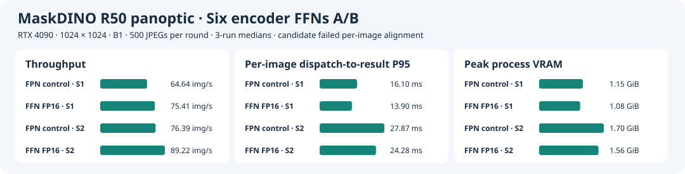

# FP16 Experiment Across All Six Encoder FFNs

**English** · [简体中文](ffn-full-half.zh-CN.md)

Fix the accepted [FPN FP16 B1 engine](fpn-half-ab.md), RTX 4090, MaskDINO R50 panoptic, and 1024×1024. The candidate changes only encoder FFNs 0–5 in the pixel decoder. Each layer keeps `linear1`, bias, ReLU, `linear2`, and bias in FP16, then casts `linear2` output back to FP32 for the original residual add and LayerNorm. The proposal TopK graph and the engine's four FP32 I/O tensors are preserved. The candidate imports the timing cache left by the FPN build and uses a copy in the experiment directory. [Graph rewrite script](ffn_precision.py)

## Measurement Definitions

- **Control.** Load the accepted FPN plan (`d80102c6…`). Build the candidate from the corresponding ONNX (`22433739…`) and use the timing cache from the accepted FPN build (`68549769…`). Run everything from clean commit `301764c`. Use driver 595.84, CUDA Toolkit 13.0.88, TensorRT 10.14.1.48, and reference container `sha256:24a707391a7592235352cb91d58e11da356aefe3f7512a698a5402671cd83d1e`. Input manifest and COCO annotation hashes are in the logs. Weights carry over from the accepted FPN ONNX.
- **Per-image checks.** Use the same 32 JPEGs and native executable. Compare both B1/S1 and B1/S2 candidates with FPN B1/S1. A pass requires ≥99.9% category agreement, all segments matched, and same-class IoU ≥0.98.
- **Native performance.** Preload the same 500 JPEGs per configuration, warm up each slot with 20 batches, and alternate plan order across three rounds. Use CUDA events for network time. End-to-end time spans dispatch to original-size CPU panoptic map and metadata readiness. Steady-state throughput uses the middle 90% of wall-clock time. NVML samples peak process GPU memory every 20 ms. Capture the single-image network microbenchmark in a separate process.
- **Full PQ.** Candidate B1/S1 and B1/S2 each run all 5,000 COCO val2017 images and verify unique prediction IDs. The three PQ metrics use PyTorch FP32 B1 with the same measurement setup as the acceptance reference and allow a drop of at most 0.05 points per metric. Also report differences from the FPN plan. Continue performance and full PQ measurements after per-image failures to distinguish local output changes from aggregate metrics.

## TensorRT Build

Engine Inspector confirms FP16 Tensor Core tactics for all six `linear1` and six `linear2` operations. All six `linear2` operations compile into fused layers with output conversion and residual/normalization work. Use ONNX metadata for attribution because searching TensorRT layer names for `linear2` alone misses them. Control and candidate share 60 matching Cask convolution/pooling layers with identical tactic names, including the previously optimized FPN 3×3 convolution. [Candidate build details](results/ffn-full-half/build/build.json) · [Engine Inspector](results/ffn-full-half/build/layers.json)

## 32-Image Alignment

B1/S1 and B1/S2 both pass **26/32** against the FPN control. All 32 segmentation maps and metadata files match byte for byte across the two slot settings. The table lists the six failing samples and gives unmatched segment counts as FPN / candidate.

| COCO image ID | Category agreement | Minimum same-class IoU | Unmatched segments |
| --- | ---: | ---: | ---: |
| 562229 | 99.8875% | 0.98942 | 0 / 0 |
| 485237 | 95.3071% | 0.99946 | 1 / 0 |
| 31296 | 99.9754% | 0.96154 | 0 / 0 |
| 470924 | 99.9710% | 0.97927 | 0 / 0 |
| 435081 | 85.6848% | 0.16608 | 1 / 1 |
| 36494 | 99.7195% | 0.97870 | 1 / 0 |

[S1 per-image results](results/ffn-full-half/ab/ffn-half-align-s1/validation.json) · [S2 per-image results](results/ffn-full-half/ab/ffn-half-align-s2/validation.json)

## Native Performance on 500 Images

The table reports medians across three rounds. All 12 runs across two plans and two slot settings complete 500 images with zero failures. Latency and throughput improve in the same direction in every round.

| Engine | Configuration | Network GPU P50 / P95 (ms) | End-to-end P50 / P95 (ms) | Steady-state throughput (images/s) | Peak process GPU memory (GiB) |
| --- | --- | ---: | ---: | ---: | ---: |
| FPN control | B1/S1 | 13.99 / 14.01 | 15.50 / 16.10 | 64.64 | 1.15 |
| Six FP16 FFN layers | B1/S1 | **11.77 / 11.78** | **13.29 / 13.90** | **75.41** | **1.08** |
| FPN control | B1/S2 | 24.12 / 25.80 | 26.12 / 27.87 | 76.39 | 1.70 |
| Six FP16 FFN layers | B1/S2 | **20.36 / 22.22** | **22.33 / 24.28** | **89.22** | **1.56** |

Against the same-session FPN control, the candidate lowers B1/S1 end-to-end P95 by **13.7%**, lowers B1/S2 end-to-end P95 by **12.9%**, and improves B1/S2 steady-state throughput by **16.8%**. [Medians](results/ffn-full-half/summary.json) · [Per-run records](results/ffn-full-half/ab/summary.json) · [Per-request file checksums](results/ffn-full-half/ab/raw.sha256)



## Full COCO PQ

Both slot settings process 5,000 images with unique and complete prediction IDs and zero run failures. All three scores match across slot settings. The FPN control PQ comes from the accepted full evaluation, separate from the control run alongside the native timings here.

| Configuration | Coverage | PQ | PQ Things | PQ Stuff |
| --- | ---: | ---: | ---: | ---: |
| FPN control | 5,000 | 53.17180 | 59.01222 | 44.35606 |
| Six FP16 FFN layers, B1/S1 | 5,000 | 53.18563 | 59.02411 | 44.37283 |
| Six FP16 FFN layers, B1/S2 | 5,000 | 53.18563 | 59.02411 | 44.37283 |

Against PyTorch FP32 with the same setup, the candidate changes the three metrics by **−0.00062 / −0.00315 / +0.00319** points and passes all full PQ thresholds. Changes from the FPN control are **+0.01383 / +0.01189 / +0.01677** points. The candidate remains experimental because 26/32 falls short of the current per-image gate. [S1 full evaluation](results/ffn-full-half/ab/ffn-half-pq-s1/validation.json) · [S2 full evaluation](results/ffn-full-half/ab/ffn-half-pq-s2/validation.json) · [FPN control full evaluation](results/fpn-half-ab/pq/b1s1/validation.json)

## Reproduction

Prepare the FP16 candidate ONNX from the [single-layer FPN experiment](fpn-half-ab.md), the accepted plan directory, its timing cache, and the Stage 6 `previous` directory. Use a clean checkout and confirm the 4090 is idle. The commands below use a new run directory.

```bash
root="$PWD"
export MASKDINO_IMAGE=sha256:24a707391a7592235352cb91d58e11da356aefe3f7512a698a5402671cd83d1e
data=/path/to/coco2017-panoptic-val
previous=/path/to/fp16-native-reference
fpn=/path/to/accepted-fpn-plan-directory
source=/path/to/accepted-fpn.onnx
seed_cache=/path/to/fpn-paired.cache
out="$root/stage6/runs/ffn-full-half-repro"
mkdir -p "$(dirname "$out")"
mkdir "$out"
mkdir "$out"/{build,ab}
cp "$seed_cache" "$out/paired.cache"
user=(--rm --network=none --user "$(id -u):$(id -g)" -e HOME=/tmp)
common=("${user[@]}" --gpus all --pid=host --ipc=host -e OMP_NUM_THREADS=1 -e DETECTRON2_DATASETS=/coco
  -v "$root:/project:ro" -v "$data:/coco:ro")

docker run "${user[@]}" -v "$root:/project:ro" -v "$source:/source.onnx:ro" \
  -v "$out:/work" --entrypoint python "$MASKDINO_IMAGE" \
  /project/stage6/ffn_precision.py /source.onnx /work/network.onnx

docker run "${common[@]}" -v "$out:/work" -v "$out/build:/run-output" \
  --entrypoint bash "$MASKDINO_IMAGE" -ec '
    export PYTHONPATH="/project:$PWD${PYTHONPATH:+:$PYTHONPATH}"
    python -m stage3.run build --backend mixed --tf32 on --batch 1 \
      --onnx /work/network.onnx --timing-cache /work/paired.cache
  '

docker run "${common[@]}" -v "$out/ab:/output" -v "$previous:/previous:ro" \
  -v "$fpn:/plans/fpn:ro" -v "$out/build:/plans/ffn-half:ro" \
  --entrypoint bash "$MASKDINO_IMAGE" -ec '
    export PYTHONPATH="/project:$PWD${PYTHONPATH:+:$PYTHONPATH}"
    bash /project/stage5/build.sh /output
    python -u -m stage6.ffn_ab screen
    python -u -m stage6.ffn_ab pq
  '
```

The original run directory is on the 4090 at `/home/parker/Code/MaskDINO-TensorRT-layer-profile-20261110/repo/stage3/runs/ffn-full-half/`.
