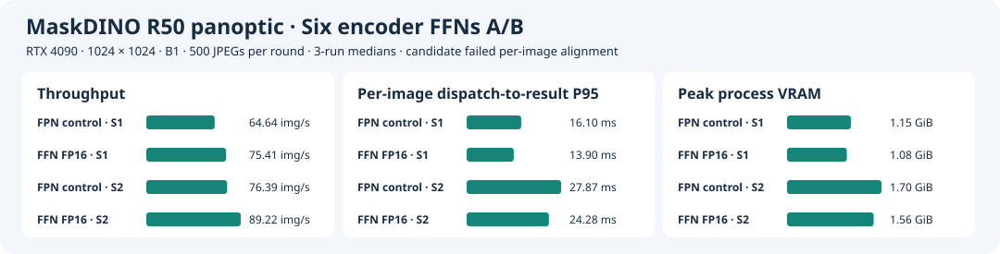

# Encoder 六层 FFN 的 FP16 实验

[English](ffn-full-half.md) · **简体中文**

固定已验收的 [FPN FP16 B1 engine](fpn-half-ab.zh-CN.md) 和 RTX 4090、MaskDINO R50 panoptic、1024×1024。候选只改 pixel decoder 中 encoder 第 0–5 层 FFN。每层的 `linear1`、bias、ReLU、`linear2` 和 bias 保持 FP16，`linear2` 输出转回 FP32，再进入原来的残差加法与 LayerNorm。Proposal TopK 的图和 engine 的四个 FP32 I/O 不变。候选导入 FPN 构建留下的 timing cache，实验目录使用 cache 的副本。 [改图脚本](ffn_precision.py)

## 测量口径

- **对照。** 加载 FPN 已验收 plan（`d80102c6…`），候选从对应 ONNX（`22433739…`）构建，使用 FPN 已验收构建后的 timing cache（`68549769…`）。全程从干净提交 `301764c` 运行。使用驱动 595.84、CUDA Toolkit 13.0.88、TensorRT 10.14.1.48 和参考容器 `sha256:24a707391a7592235352cb91d58e11da356aefe3f7512a698a5402671cd83d1e`。输入清单和 COCO 标注哈希见日志，权重沿用已验收 FPN ONNX。
- **逐图。** 用同一份 32 张 JPEG 和同一个原生可执行文件。候选 B1/S1 和 B1/S2 都对照 FPN B1/S1。通过要求为类别一致率 ≥99.9%、segment 全部配对、同类 IoU ≥0.98。
- **原生性能。** 每个配置预载同样的 500 张 JPEG，每个 slot 预热 20 批，三轮交替两套 plan 的先后次序。网络段用 CUDA events，端到端从派发到原图尺寸的 CPU panoptic map 和 metadata 就绪。稳态吞吐使用墙钟中间 90% 的窗口。NVML 每 20 ms 采样进程峰值显存。单图网络微基准另起进程采集。
- **全量 PQ。** 候选 B1/S1 与 B1/S2 各运行 COCO val2017 全部 5,000 张，核对唯一预测 ID。三项 PQ 以同口径 PyTorch FP32 B1 为验收参照，门槛为各下降最多 0.05 点。同时列出相对 FPN plan 的差值。逐图失败后仍继续测性能和全量 PQ，以区分局部输出差异与全量指标。

## TensorRT 构建

Inspector 确认六个 `linear1` 和六个 `linear2` 均使用 FP16 Tensor Core tactic。六个 `linear2` 被编译成包含输出转换及残差/归一化的融合层，因此统计使用 ONNX 元数据归属，不能仅按 TensorRT 层名搜索 `linear2`。对照与候选有 60 个同名 Cask 卷积/池化层，tactic 名称均一致，包含先前优化的 FPN 3×3 卷积。 [候选构建信息](results/ffn-full-half/build/build.json) · [Engine Inspector](results/ffn-full-half/build/layers.json)

## 32 张逐图

B1/S1、B1/S2 相对 FPN 对照均为 **26/32**，两种 slot 的 32 张分割图和 metadata 文件全部逐字节一致。下表为六个未通过样本，未配对 segment 按 FPN / 候选列出。

| COCO 图像 ID | 类别一致率 | 最小同类 IoU | 未配对 segment |
| --- | ---: | ---: | ---: |
| 562229 | 99.8875% | 0.98942 | 0 / 0 |
| 485237 | 95.3071% | 0.99946 | 1 / 0 |
| 31296 | 99.9754% | 0.96154 | 0 / 0 |
| 470924 | 99.9710% | 0.97927 | 0 / 0 |
| 435081 | 85.6848% | 0.16608 | 1 / 1 |
| 36494 | 99.7195% | 0.97870 | 1 / 0 |

[S1 逐图结果](results/ffn-full-half/ab/ffn-half-align-s1/validation.json) · [S2 逐图结果](results/ffn-full-half/ab/ffn-half-align-s2/validation.json)

## 原生 500 图性能

表中取三轮中位数。两套 plan、两种 slot 的 12 轮各完成 500 张，零失败。每轮都观察到同方向的延迟和吞吐改善。

| Engine | 配置 | 网络 GPU P50 / P95（ms） | 端到端 P50 / P95（ms） | 稳态吞吐（图/s） | 进程峰值显存（GiB） |
| --- | --- | ---: | ---: | ---: | ---: |
| FPN 对照 | B1/S1 | 13.99 / 14.01 | 15.50 / 16.10 | 64.64 | 1.15 |
| 六层 FFN FP16 | B1/S1 | **11.77 / 11.78** | **13.29 / 13.90** | **75.41** | **1.08** |
| FPN 对照 | B1/S2 | 24.12 / 25.80 | 26.12 / 27.87 | 76.39 | 1.70 |
| 六层 FFN FP16 | B1/S2 | **20.36 / 22.22** | **22.33 / 24.28** | **89.22** | **1.56** |

相对同轮 FPN 对照，候选的 B1/S1 端到端 P95 降低 **13.7%**，B1/S2 端到端 P95 降低 **12.9%**，B1/S2 稳态吞吐提高 **16.8%**。 [中位数](results/ffn-full-half/summary.json) · [逐轮记录](results/ffn-full-half/ab/summary.json) · [逐请求文件校验](results/ffn-full-half/ab/raw.sha256)



## 全量 COCO PQ

两种 slot 各处理 5,000 张，预测 ID 唯一且完整，零运行失败。两种 slot 的三项分数一致。FPN 对照的 PQ 复用已验收的全量结果，与本次原生计时的同轮对照分开。

| 配置 | 覆盖 | PQ | PQ Things | PQ Stuff |
| --- | ---: | ---: | ---: | ---: |
| FPN 对照 | 5,000 | 53.17180 | 59.01222 | 44.35606 |
| 六层 FFN FP16，B1/S1 | 5,000 | 53.18563 | 59.02411 | 44.37283 |
| 六层 FFN FP16，B1/S2 | 5,000 | 53.18563 | 59.02411 | 44.37283 |

候选相对同口径 PyTorch FP32 的三项变化为 **−0.00062 / −0.00315 / +0.00319** 点，均通过全量 PQ 门槛。相对 FPN 对照的变化为 **+0.01383 / +0.01189 / +0.01677** 点。候选因逐图 26/32 未通过当前逐图门槛，保留为实验配置。 [S1 全量](results/ffn-full-half/ab/ffn-half-pq-s1/validation.json) · [S2 全量](results/ffn-full-half/ab/ffn-half-pq-s2/validation.json) · [FPN 对照全量](results/fpn-half-ab/pq/b1s1/validation.json)

## 复现入口

准备 [FPN 单层实验](fpn-half-ab.zh-CN.md) 的 FP16 候选 ONNX、已验收 plan 目录、对应 timing cache 和 Stage 6 的 `previous` 目录。进入干净 checkout，在 4090 上确认 GPU 空闲。以下命令使用新运行目录。

```bash
root="$PWD"
export MASKDINO_IMAGE=sha256:24a707391a7592235352cb91d58e11da356aefe3f7512a698a5402671cd83d1e
data=/path/to/coco2017-panoptic-val
previous=/path/to/fp16-native-reference
fpn=/path/to/accepted-fpn-plan-directory
source=/path/to/accepted-fpn.onnx
seed_cache=/path/to/fpn-paired.cache
out="$root/stage6/runs/ffn-full-half-repro"
mkdir -p "$(dirname "$out")"
mkdir "$out"
mkdir "$out"/{build,ab}
cp "$seed_cache" "$out/paired.cache"
user=(--rm --network=none --user "$(id -u):$(id -g)" -e HOME=/tmp)
common=("${user[@]}" --gpus all --pid=host --ipc=host -e OMP_NUM_THREADS=1 -e DETECTRON2_DATASETS=/coco
  -v "$root:/project:ro" -v "$data:/coco:ro")

docker run "${user[@]}" -v "$root:/project:ro" -v "$source:/source.onnx:ro" \
  -v "$out:/work" --entrypoint python "$MASKDINO_IMAGE" \
  /project/stage6/ffn_precision.py /source.onnx /work/network.onnx

docker run "${common[@]}" -v "$out:/work" -v "$out/build:/run-output" \
  --entrypoint bash "$MASKDINO_IMAGE" -ec '
    export PYTHONPATH="/project:$PWD${PYTHONPATH:+:$PYTHONPATH}"
    python -m stage3.run build --backend mixed --tf32 on --batch 1 \
      --onnx /work/network.onnx --timing-cache /work/paired.cache
  '

docker run "${common[@]}" -v "$out/ab:/output" -v "$previous:/previous:ro" \
  -v "$fpn:/plans/fpn:ro" -v "$out/build:/plans/ffn-half:ro" \
  --entrypoint bash "$MASKDINO_IMAGE" -ec '
    export PYTHONPATH="/project:$PWD${PYTHONPATH:+:$PYTHONPATH}"
    bash /project/stage5/build.sh /output
    python -u -m stage6.ffn_ab screen
    python -u -m stage6.ffn_ab pq
  '
```

原始运行目录位于 4090 的 `/home/parker/Code/MaskDINO-TensorRT-layer-profile-20261110/repo/stage3/runs/ffn-full-half/`。
