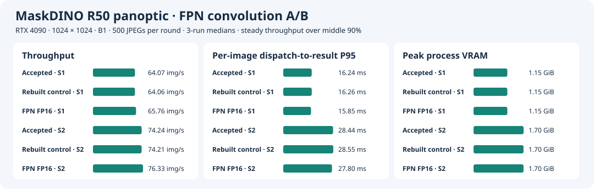

# Single-Layer FP16 A/B for the FPN 3×3 Convolution

**English** · [简体中文](fpn-half-ab.zh-CN.md)

[Layer profiling](layer-profile.md) identified `/sem_seg_head/layer_1/Conv` as the most expensive single layer in the accepted FP16 mixed-precision B1 engine. In the original ONNX graph, this convolution feeds only the final `masks`. The candidate converts only this convolution's inputs and weights to FP16 and casts the output back to FP32 before the original GroupNorm. Other weights, interfaces, and precision policies carry over from the original graph. [ONNX rewrite entry point](fpn_precision.py) · [Original graph data path](results/layer-profile-b1/onnx-paths.txt)

## Initial Round Without a Shared Cache

Use an RTX 4090, 1024×1024, B1, reference image `sha256:24a707391a7592235352cb91d58e11da356aefe3f7512a698a5402671cd83d1e`, driver 595.84, CUDA Toolkit 13.0.88, and TensorRT 10.14.1.48. The [original build log](../stage3/results/precision/build-autocast-on/console.log) identifies the original ONNX and weights. Use the Stage 6 accepted plan as the output reference and rebuild a control from the same original ONNX. Both new plans were built from clean commit `672f0aa`. Native per-image checks and layer microbenchmarks ran at `d9e30d7`. Tensor swapping for the anomalous image ran at `9237433`. The GPU was idle before per-image checks, and sampling during builds and per-image checks found only experiment processes. [Candidate build](results/fpn-half-ab/half-build/) · [Control build](results/fpn-half-ab/control-build/) · [Native per-image records](results/fpn-half-ab/alignment/console.log)

| Configuration | Conv (ms) | Local Add to GroupNorm/ReLU (ms) | Network GPU P50 / P95 (ms) |
| --- | ---: | ---: | ---: |
| Accepted plan | 0.906 | 1.280 | 14.091 / 14.105 |
| Rebuilt control | 0.909 | 1.283 | 14.113 / 14.132 |
| Single-convolution FP16 | 0.251 | 0.819 | 13.696 / 13.712 |

Use natively preprocessed COCO 149770, one stream, 1 second of warmup, and at least 2 seconds or 100 iterations of timing. Disable H2D/D2H in the timing loop. Convolution and local times use layer means from `--separateProfileRun`. The local total includes attributed layers for the adjacent Add, Cast, reformat, and GroupNorm/ReLU. Network time comes from an independent normal timing run and covers only the network. Engine Inspector confirms the switch from FP32 Winograd to FP16 Tensor Cores. Input conversion costs about 0.094 ms, and output conversion is fused into a GroupNorm-related kernel. [Raw layer results](results/fpn-half-ab/profile/)

The rebuilt control passes 32/32. The candidate passes 31/32 at both S1 and S2, and all 32 maps and metadata files match byte for byte across slot settings. COCO `470924` has 99.7614% category agreement and one fewer segment than the reference (72 → 71). When outputs are swapped in native postprocessing, accepted or rebuilt control logits with candidate masks retain 72 segments. Candidate logits with any set of masks yield 71. The candidate plan's logits trigger the anomaly. The ONNX edit is confined to the mask branch, but Engine Inspector shows four backbone convolutions with different tactics in the first pair of new plans. [S1 per-image](results/fpn-half-ab/alignment/fpn-half-align-s1/validation.json) · [S2 per-image](results/fpn-half-ab/alignment/fpn-half-align-s2/validation.json) · [Tensor swapping](results/fpn-half-ab/profile/470924-probe.json)

## Paired Builds With a Shared Timing Cache

Build the control from the original ONNX at clean commit `54e6f15`, then pass its cache to the single-convolution candidate. The SHA-256 of the control's output cache matches the candidate's input cache. Engine Inspector shows 60 matching convolution or pooling layers across the plans, with a tactic change only for the target convolution. For `470924`, the candidate's logits and boxes match the rebuilt control elementwise, and mask relative L2 is 0.001342. All nine logits × masks combinations retain 72 segments. The recheck supports attributing the original anomaly to rebuild changes outside the target path. [Rebuilt control](results/fpn-half-ab/cached/control/build.json) · [Candidate](results/fpn-half-ab/cached/fpn-half/build.json) · [Tensor swapping](results/fpn-half-ab/cached/ab/470924-probe.json)

With the shared cache, target convolution mean layer time drops from **0.9035 to 0.2505 ms**, and the total from adjacent Add to GroupNorm/ReLU falls from **1.2786 to 0.8203 ms**. Normal GPU network P95 on the same input goes from 14.1567 to 13.7502 ms. Layer diagnostics use the same boundary. Formal native timing runs separately. [Shared-cache layer details](results/fpn-half-ab/summary.json)

### Native Performance on 500 Images

Reuse the Stage 6 alignment list of 32 images and timing list of 500 images. Candidate B1/S1 and B1/S2 both pass 32/32 against the accepted B1 reference. Require category agreement of at least 99.9%, all segments matched, and same-class IoU of at least 0.98. Rotate the three plans across three rounds of formal timing and warm up each slot with 20 batches. Measure wall-clock time from dispatch to CPU panoptic map and metadata readiness, network time with CUDA events, steady-state throughput in the middle 90% of wall-clock time, and process peak GPU memory with 20 ms NVML samples. All 18 runs complete 500 images with zero failures. [Raw alignment and timing results](results/fpn-half-ab/cached/ab/) · [GPU process samples](results/fpn-half-ab/cached/compute-processes.csv)

| Plan | Configuration | Network GPU P50 / P95 (ms) | End-to-end P50 / P95 (ms) | Steady-state throughput (images/s) | Peak GPU memory (GiB) |
| --- | --- | ---: | ---: | ---: | ---: |
| Accepted plan | B1/S1 | 14.13 / 14.17 | 15.64 / 16.24 | 64.07 | 1.15 |
| Shared-cache control | B1/S1 | 14.14 / 14.17 | 15.64 / 16.27 | 64.06 | 1.15 |
| Single-convolution FP16 | B1/S1 | **13.73 / 13.76** | **15.24 / 15.85** | **65.76** | 1.15 |
| Accepted plan | B1/S2 | 24.75 / 26.32 | 26.81 / 28.44 | 74.24 | 1.70 |
| Shared-cache control | B1/S2 | 24.84 / 26.38 | 26.83 / 28.55 | 74.21 | 1.70 |
| Single-convolution FP16 | B1/S2 | **24.05 / 25.69** | **26.10 / 27.80** | **76.33** | 1.70 |

Values are medians across runs. Against the shared-cache control, the candidate lowers B1/S1 end-to-end P95 by **0.42 ms (2.6%)** and raises B1/S2 steady-state throughput by **2.13 images/s (2.9%)**. Both changes have the same direction across all three paired rounds. No material memory change was observed. [Per-run values and medians](results/fpn-half-ab/summary.json)



### Full COCO PQ

B1/S1 and B1/S2 with the shared-cache candidate each process 5,000 COCO val2017 images with unique and complete prediction IDs and zero run failures. Both configurations have identical scores in all three metrics and meet the 0.05-point maximum drop per metric against PyTorch FP32 B1 with the same inputs.

| Native configuration | Coverage | PQ | PQ Things | PQ Stuff | Three metric changes vs. PyTorch (points) |
| --- | ---: | ---: | ---: | ---: | --- |
| Single-convolution FP16, B1/S1 | 5,000 | 53.17180 | 59.01222 | 44.35606 | −0.01446 / −0.01504 / −0.01357 |
| Single-convolution FP16, B1/S2 | 5,000 | 53.17180 | 59.01222 | 44.35606 | −0.01446 / −0.01504 / −0.01357 |

Acceptance covers B1/S1 and B1/S2 per-image checks, full PQ, and the paired 500-image offline benchmarks on the RTX 4090. The tag is `stage3-fpn-fp16-accepted`. Online P99 and sustained offline throughput remain to be measured. [S1 results](results/fpn-half-ab/pq/b1s1/validation.json) · [S2 results](results/fpn-half-ab/pq/b1s2/validation.json) · [Full evaluation logs](results/fpn-half-ab/pq/console.log)

## Reproduction

Use the inputs and image from the [layer profiling experiment](layer-profile.md#reproduction). Prepare the original mixed B1 ONNX, accepted engine directory with `build.json`, Stage 6 `previous` directory, and COCO data. Start formal runs from a clean checkout and verify that the GPU is idle. The commands below use a new output directory, rewrite ONNX first, and share the cache between builds.

```bash
root="$PWD"
export MASKDINO_IMAGE=sha256:24a707391a7592235352cb91d58e11da356aefe3f7512a698a5402671cd83d1e
original=/path/to/mixed-b1/network.onnx
shipped=/path/to/accepted-b1
previous=/path/to/fp16-native-reference
data=/path/to/coco2017-panoptic-val
run="$root/stage6/runs/fpn-cache-repro"
mkdir -p "$(dirname "$run")"
mkdir "$run"
mkdir "$run"/{control,fpn-half,ab}
cp "$original" "$run/control.onnx"
docker run --rm --network=none --user "$(id -u):$(id -g)" -e HOME=/tmp \
  -v "$root:/project:ro" -v "$run:/run" --entrypoint python "$MASKDINO_IMAGE" \
  /project/stage6/fpn_precision.py /run/control.onnx /run/fpn-half.onnx

common=(--rm --gpus all --pid=host --ipc=host --network=none --user "$(id -u):$(id -g)"
  -e HOME=/tmp -e OMP_NUM_THREADS=1 -e DETECTRON2_DATASETS=/coco
  -v "$root:/project:ro" -v "$data:/coco:ro")
for name in control fpn-half; do
  docker run "${common[@]}" -v "$run:/run" -v "$run/$name:/run-output" \
    --entrypoint bash "$MASKDINO_IMAGE" -ec '
      export PYTHONPATH="/project:$PWD${PYTHONPATH:+:$PYTHONPATH}"
      python -m stage3.run build --backend mixed --tf32 on --batch 1 \
        --onnx "/run/$1.onnx" --timing-cache /run/paired.cache
    ' bash "$name"
done

docker run "${common[@]}" -v "$run/ab:/output" -v "$previous:/previous:ro" \
  -v "$shipped:/plans/shipped:ro" -v "$run/control:/plans/control:ro" \
  -v "$run/fpn-half:/plans/fpn-half:ro" --entrypoint bash "$MASKDINO_IMAGE" -ec '
    export PYTHONPATH="/project:$PWD${PYTHONPATH:+:$PYTHONPATH}"
    bash /project/stage5/build.sh /output
    python -u -m stage6.fpn_ab
  '

bash stage5/run.sh "$data" "$previous" "$run/fpn-half/network.engine" \
  fpn-cache-repro-pq pq 1s1 1s2 --pq-reference pytorch
```

Run the single-layer microbenchmark in a separate process inside the same image. Load the three plans and reuse `149770.f32`. To recheck the anomalous image, reuse `restore-check.so` from `stage4/build.sh` and the natively preprocessed `470924.f32`.

```bash
trtexec --loadEngine=/plans/fpn-half/network.engine --loadInputs=image:/inputs/149770.f32 \
  --infStreams=1 --noDataTransfers --warmUp=1000 --duration=2 --iterations=100 \
  --percentile=50,95 --separateProfileRun --dumpProfile --exportProfile=fpn-half.layers.json

python -m stage6.fpn_probe /inputs/470924.f32 480 640 768 1024 \
  /previous/perf-native-r1/things.txt /output/restore-check.so \
  /plans/{shipped,control,fpn-half}/network.engine --output /output/470924-probe.json
```

Full run directories are on the 4090 under `/home/parker/Code/MaskDINO-TensorRT-layer-profile-20261110/repo/` at `stage3/runs/fpn-cache-pair` and `stage5/runs/fpn-cache-pq`. Native per-request data uses the fixed JPEG list and the same C++ binary.
